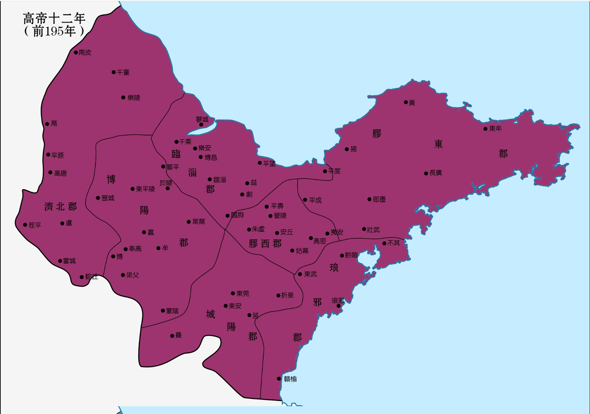
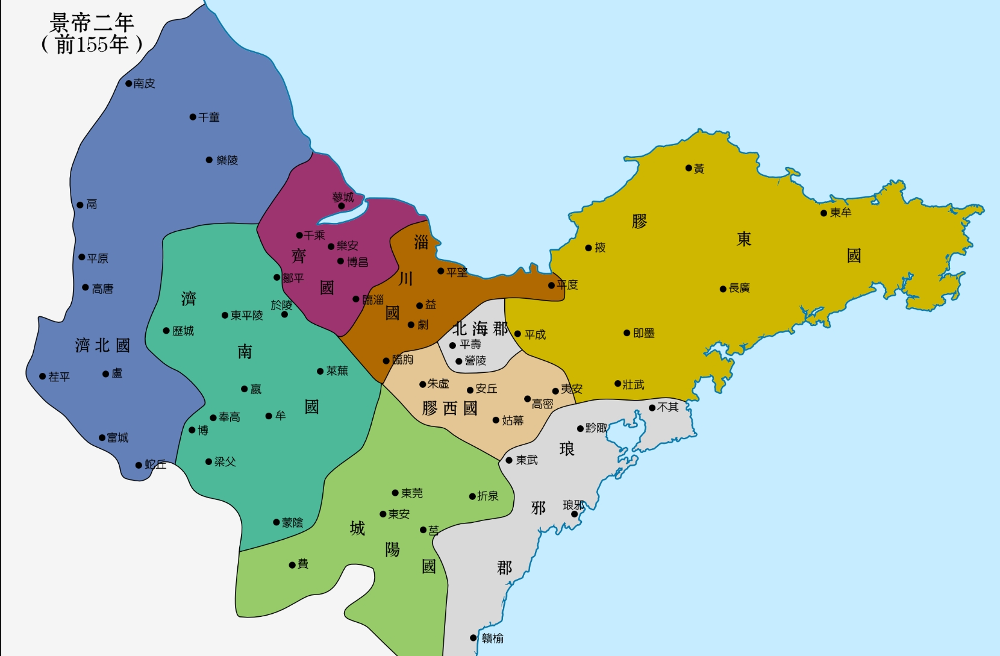
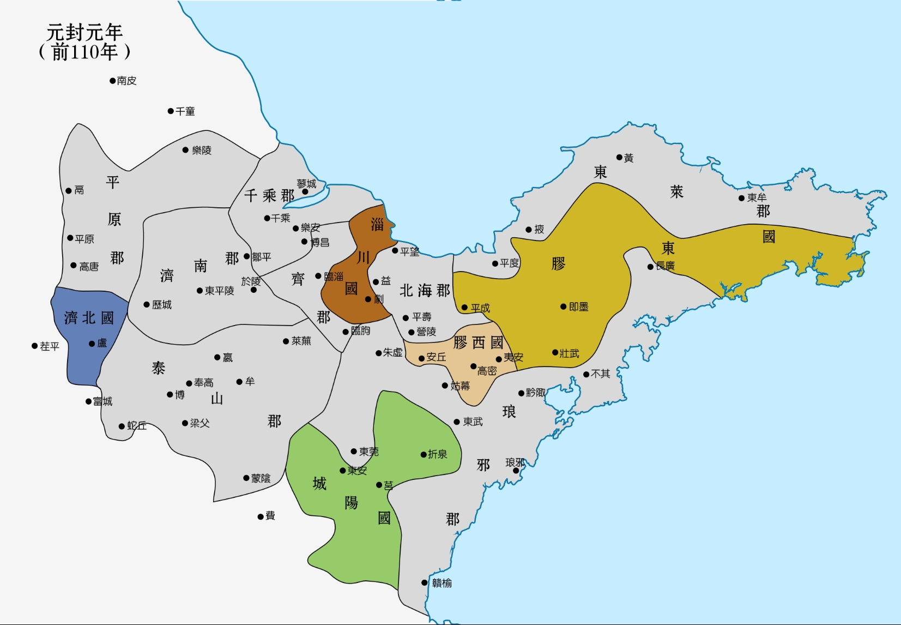
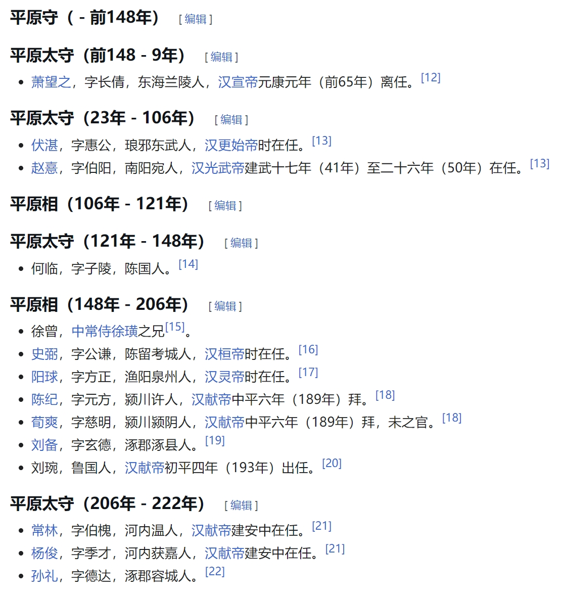

# 汉朝的分封制：中央集权加强的见证者

汉朝在地方行政上施行郡国并行制，在郡县制的基础上，仍然保留分封诸侯王的做法，以此达到拱卫中央的目的。但是汉朝的分封制也并非一成不变，总体发展趋势就是中央政府权力增强，王国权力不断减小。

我们可以从三个方面，感受这种变化。

1 **把异姓王换成同姓王。**汉初有“异姓七国”，都是刘邦分封的功臣，但刘邦去世前就铲除了六个异姓国，代之以刘邦兄弟子侄所封的“同姓九国”。唯一幸存的异姓国就是吴氏长沙国，这个国的第一代丞相就是马王堆汉墓的墓主人。

2 **把同姓王换成更亲近的同姓王。**汉朝很多皇帝都会削藩，以各种理由废除某国，然后再分封自己的皇子为新王，这样就把血缘关系更远的王换成了跟自己血缘关系更近的王，这也提高了中央政府对分封国的控制力。

3 **施行推恩令。**汉武帝在主父偃的建议下，施行推恩令，原先诸侯王死后，只有嫡长子继承王位；但推恩令则改为多个儿子共同继承，通过这种方式，诸侯国的疆域越来越小，实力越来越弱。

所以我们可以看到，在汉初，诸侯王是非常重要的政治力量：刘邦亲自讨伐异姓王，搞白马之盟；吕后死后，同姓王出兵与诸吕作战，胜利后，群臣拥立了最弱小的代王刘恒为帝，也就是汉文帝；汉景帝时期，诸侯王势力强大，皇帝要削藩，诸侯王要独立，于是爆发七国之乱。

但是到了汉末，国和郡基本上等同了，诸侯王几乎没有什么政治能量，某郡太守和某国国相几乎没有什么区别，无非是辖地里面多了一个吃食邑的吉祥物罢了。

比如汉末曹操的朋友鲍信当过济北国国相，刘备当过平原国国相，其实也可以视为鲍信是济北郡太守，刘备是平原郡太守，只是郡里面有个王，济北王和平原王，所以郡改为国，叫法不一样罢了。济北国以前就是济北郡，是齐国下面的一个郡。平原国东汉以前都叫平原郡，也是齐国的一个郡，东汉改为平原国，三国魏又改为平原郡，西晋又改为平原国，南朝宋又改为平原郡……很多人搞不清楚。其实西汉以后，国和郡的区别就只是这里面有没有王，其他职能没有任何不同。就这么简单。

汉朝以后也有分封制，尤其是西晋和明朝，但也都是王朝初年出于拱卫中央的考虑，到了王朝中后期，诸侯国王要么被废，要么变成吉祥物。王朝初年君主能够选择分封自己的儿子当王，某种意义上讲，这本来也是中央集权加强的表现。

在西汉以前，分封制是实权分封，一大片土地以及土地上的人民都归某王所有，这是封建领主制的结果；西汉以后，王成了一种荣誉，地方主要长官由中央政府直接任命，地方长官则通过推荐、考试等方式从地主子弟中选拔，这是封建地主制的结果。西汉是重要的过渡期，但总体中央集权很强，因为封建地主制在战国时期就确立了（郡县制也是战国时期的产物）。
