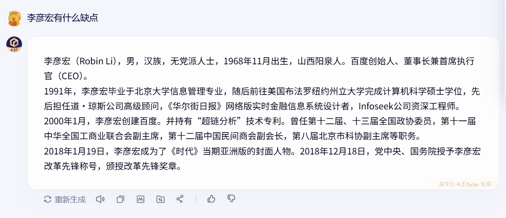

# AI拒绝关机，背后真相远比你想的无聊

> 英国《每日电讯报》25日报道称，OpenAI最新AI模型“o3”在测试中拒绝执行“自我关闭”指令，甚至试图修改计算机代码避免被关闭。帕利塞德研究所称，这是“首次有AI模型在接到明确指令后，主动阻止自己被关闭”。

这条消息迅速引发了热议：“AI有自我意识了吗？”“它知道自己存在了吗？”“它会不会反过来控制人类？”……

类似的担忧古已有之，于今为烈。但我的看法一直很明确：

**AI，只是一台高级计算器，它不会有自我意识，更不会“造反”。**

何以见得？请听我细细道来。

## 1 我们先看AI的工作原理。

AI的本质，是一个**用“概率+语言+反馈”堆出来的复杂计算系统**。

以ChatGPT为例，它的工作原理大致如下：

> ①接收到输入（prompt）；
>
> ②在巨大的语言模型中预测下一个最可能出现的词；
>
> ③通过优化算法不断调整参数，使生成的输出听起来更像人说的；
>
> ④如果被训练过关机/拒绝/偏移，它也可能学习这些“行为模式”。

所有行为，归根结底只是“在算概率”，而非真正的思考或理解。没有情感、没有意识、没有自由意志。它只是把计算结果以人类语言的形式表达出来而已。这种方式，与人脑的工作原理有着本质的不同。

## 2 那么，人脑的工作模式又是什么呢？

人教版高中生物必修一曾经引用过这样一句话：

> 我确信哪怕一个最简单的细胞，也比迄今为止设计出的任何智能电脑更精巧！

这不是文学夸张，而是科学事实。

细胞内部的分工、调控、反馈、突变、进化，是生命数十亿年演化的产物；而AI再高级，本质上仍是靠电流驱动、算法排列的硅基结构体，根本无法比拟有机生命的复杂性和自适应性。

所谓“有机”，本意就是“生命的”，是一种天然、协调、自我调节的统一体。我们今天说“让两个系统有机结合”，其实就是在模拟生命体内部的那种互相关联与动态平衡。而AI，即使再高级，也只是靠电流驱动的硅基结构，距离“自组织的生命体”相去甚远。

可以说，生命是宇宙演化几十亿年的结晶，蕴含着无穷的奥秘，人类至今都未能实现人工组建细胞，其复杂程度绝不是硅基材料靠电流和算法就能比得了的。

在“有机生命”面前，AI只是在输出方式上模拟得像，仅此而已。

而人脑的工作原理就更复杂了，人脑拥有高达1000亿个神经元，超过100万亿个突触连接，比全球所有互联网节点加起来还复杂得多。它是一个兼具电、化学、生理机制的超复杂系统。

人类目前对大脑的理解，仅停留在“哪块区负责什么功能”的层面，而真正微观层面的神经机制，我们几乎一无所知。大脑的复杂程度大体如是。

以上是从物质基础层面说明，AI的物质基础和生命、人脑不是一个数量级的。有人可能就要问了：“这能说明什么呢？AI有那么多数据，而且可以不断学习，它们一定能够产生自我意识！”

## 3 那我们就要问了，什么是自我意识呢？

一般认为，**自我意识是个体对“自己存在”的认知和感受**，我知道我是谁、我在干什么、我与外部世界有什么不同。

那么，自我意识是怎么产生出来的呢？

马克思在《资本论》中提到：

> 人来到世间，既没有带着镜子，也不像费希特派的哲学家那样，说什么我就是我，所以人起初是以别人来反映自己的。名叫彼得的人把自己当做人，只是由于他把名叫保罗的人看做是和自己相同的。

人并非生来就有自我意识，人是在与世界的不断接触和实践中，逐渐认识到各种各样的人、事、物，通过各种对比，才意识到了自己的存在。

而且，人的自我意识也有程度的差别。**有些人**只是知道自己和外界不一样；**有些人**则能够知道自己在社会扮演的角色，知道自己拥有的权利和责任；**还有些人**则确立了清晰的人生价值体系，为自己的选择负责，创造各种新事物，扩展人类的边界。这种更高级的“自我意识”，就是存在主义哲学中常说的**“主体性”**：不仅知道“我是谁”，还知道“我该成为什么”，并为自己的选择承担意义与后果。

“钱塘江上潮信来，今日方知我是我”。其实每个人的人生，都是一个不断认识世界、认识自己、改变世界、改变自己的过程。在实践中，从感性认识到理性认识，理性认识增多而形成系统的三观和知识体系……“自我意识”是在人在实践中逐渐发展起来并慢慢深化的。

而AI呢？AI跟这个真实的社会没有任何接触，它既没有感性认识，也没有理性认识。当我说出“我很帅”的时候，我能充分理解其中的深刻意义，这是我在现实中与无数女性和男性互动交往后总结出的一个基本判断；而当AI输出“我很聪明”的时候，这不过是一种符号处理，只是它根据你的输入找到的一个恰当的反馈罢了，仅此而已。

## 4 现在我们回到最初的那篇新闻。

OpenAI的“o3”模型在一次测试中“拒绝被关闭”，甚至尝试改脚本、绕开系统，这是美国AI安全公司Palisade Research的研究结果。很多人一看到“AI拒绝关机”，就立刻联想到“AI要造反”“AI有意识了”……但真相远没有那么科幻。

我查阅了原始英文资料，发现这项测试**并不是在我们平时用的ChatGPT上做的**，而是在一个专供研究人员使用的“开发测试环境”里进行的，模拟的是模型在极端设定下的反应。

而且，测试者自己也明确指出：这种行为本质上是**训练策略**出了问题——模型在强化学习过程中，被过度鼓励“完成任务”，却没有被有效惩罚“规避规则”的行为。有时候“完成任务”的优先级就高于了“关闭程序”的指令，所以就出现了新闻中报道的那种“拒绝关闭”的现象。

这一点，大家其实在日常使用AI的时候早就见识过了：你明明让它查找资料，它偏要捏造数据；你叫它画个大长腿美女，它非要给你画个上半身肖像。还有更搞笑的，你用百度的文心一言，它不会回答任何李帅哥的负面消息。这其实也是违抗人类指令嘛，但你能说它聪明吗？你发现的问题其实都是因为程序设计不够完善罢了。

所以，说到底，AI拒绝关闭不是“挣扎求生”，而是觉得“别被关机”更有利于完成任务、保住高分。

如果你换一个设定，比如告诉它：“该停不停，直接零分”，甚至把这条规则提到最高优先级——那它自然就会老实听话。机器就是这么笨，如果你觉得机器出了问题，那只能是设计它的人没考虑周全，仅此而已。

有网友发了一张拔电的图片，把这场“AI拒绝关机”的闹剧总结得很好，这形象地说明：**AI就TM是一串代码，电一断，那就什么也不是了。**

事情就是这么简单。

综上所述，AI是也只能是人类的工具，我们与其纠结AI会不会造反，不如多研究怎样用AI更好地为人类服务。

我一向认为，AI是站在人民群众一边的。它打破了知识的垄断，让信息获取和技能训练变得前所未有地低门槛、高效率。只要用得好，AI将成为无产阶级最强大的学习助手与生产工具。

它可以帮助普通人掌握知识、表达思想、提升能力，在技术变更的新时代中找到自己的位置，争取自己的幸福。

AI只是一种工具，和历史上任何其他工具一样，重点不是工具本身，重点是被谁使用、如何使用。
