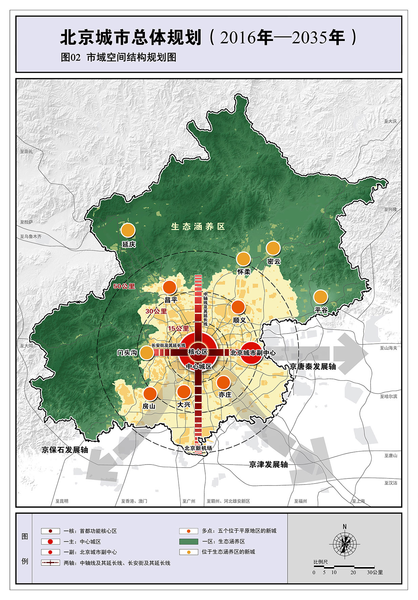

# 北京的现在和未来，八年前的这份规划早已写好

2017年，北京发布了新一轮城市总体规划（2016-2035年），为首都未来二十年发展划定了蓝图。

一眨眼已是2025年，我们距离这份规划描述的最终图景，仅剩10年光阴，当年的蓝图很多早已变成现实，有些则正在落地。一切都在改变，缓慢而彻底。

这篇文章介绍当年国家对北京的总体规划，介绍北京各区的基本定位。大家将其与当下现实结合，相信会有不少感触。

我相信，随着时间的推移，这份规划的含金量还会不断上升。

## 一、北京未来的城市骨架：一核一主一副，两轴多点一区

只要牢记这六个关键词，再配合这张市域空间结构规划图，我们可以很轻松地记住北京的规划逻辑和城市骨架。

一核：首都功能核心区（东城、西城）

一主：中心城区（朝阳、海淀、丰台、石景山）

一副：北京城市副中心（通州）

两轴：中轴线、长安街及延长线

多点：五个平原新城（顺义、昌平、房山、大兴、亦庄）

一区：生态涵养区（门头沟、平谷、怀柔、密云、延庆，以及昌平和房山的山区）

## 二、“首都”和“北京”，其实不是一回事？

我们可以这样通俗理解：五环以内是首都；五环以外才是北京。东城、西城，是全国政治中心；通州，是北京市的行政中心。

当然，这只是便于理解的表达。北京就是首都，首都就是北京，但不同区域在功能上确实分工不同。大家从“一主一核一副”的定位就能看出来。

### 1 首都功能核心区（东城、西城）

关键词：政治，文化，核心

全国政治中心、文化中心和国际交往中心的核心承载区，是历史文化名城保护的重点地区，是展示国家首都形象的重要窗口地区。

这里是中国真正的“心脏”，将严格控制人口与开发强度。非首都功能必须搬走，古都风貌必须保住，政治安全优先保障。

### 2 中心城区（朝阳、海淀、丰台、石景山）

关键词：四个中心的集中承载区

中心城区是全国政治中心、文化中心、国际交往中心、科技创新中心的集中承载地区，是建设国际一流的和谐宜居之都的关键地区，是疏解非首都功能的主要地区

是科技创新、文化创意、国际交往的主阵地。未来也将降低密度、腾退空间、优化人居，建设更高品质的城市核心。

### 3 城市副中心（通州）

关键词：首都“两翼”之一，疏解主城区人口与功能

北京城市副中心为北京新两翼中的一翼（另外一翼即雄安新区）。应当坚持世界眼光、国际标准、中国特色、高点定位，以创造历史、追求艺术的精神，以最先进的理念、最高的标准、最好的质量推进北京城市副中心规划建设，着力打造国际一流的和谐宜居之都示范区、新型城镇化示范区和京津冀区域协同发展示范区。

现在大部分北京市政府机构都已经搬到通州，副中心将打造新的行政、商务、文化、旅游核心，预计到2035年能承接中心城区40-50万人口，并与雄安构成京津冀新极核。

## 三、五大新城：各区的定位如何？

下面，我们看看官方对顺义、大兴、亦庄、昌平、房山五大新城的定位（首先，大家从排名中就可以看出各区的重要程度……）。

### 1 顺义：

港城融合的国际航空中心核心区；创新引领的区域经济提升发展先行区；城乡协调的首都和谐宜居示范区

### 2 大兴：

面向京津冀的协同发展示范区；科技创新引领区；首都国际交往新门户；城乡发展深化改革先行区。

### 3 亦庄：

具有全球影响力的创新型产业集群和科技服务中心；首都东南部区域创新发展协同区；战略性新兴产业基地及制造业转型升级示范区；宜居宜业绿色城区。

### 4 昌平：

首都西北部重点生态保育及区域生态治理协作区；具有全球影响力的全国科技创新中心重要组成部分和国际一流的科教新区；特色历史文化旅游和生态休闲区；城乡综合治理和协调发展的先行示范区。

### 5 房山：

首都西南部重点生态保育及区域生态治理协作区；京津冀区域京保石发展轴上的重要节点；科技金融创新转型发展示范区；历史文化和地质遗迹相融合的国际旅游休闲区。

## 四、生态涵养区：北京的“后花园”

众所周知，北京是一块风水宝地，山区当然也是北京的重要组成部分。以下是北京各山区的定位。

### 1 门头沟：

首都西部重点生态保育及区域生态治理协作区；首都西部综合服务区；京西特色历史文化旅游休闲区

### 2 平谷：

首都东部重点生态保育及区域生态治理协作区；服务首都的综合性物流口岸；特色休闲及绿色经济创新发展示范区。

### 3 怀柔：

首都北部重点生态保育及区域生态治理协作区；服务国家对外交往的生态发展示范区；绿色创新引领的高端科技文化发展区。

### 4 密云：

首都最重要的水源保护地及区域生态治理协作区；国家生态文明先行示范区；特色文化旅游休闲及创新发展示范区。

### 5 延庆：

首都西北部重要生态保育及区域生态治理协作区；生态文明示范区；国际文化体育旅游休闲名区；京西北科技创新特色发展区。

### 6 昌平和房山的山区：

按照生态涵养区的总体要求，着力建设首都西北、西南部生态屏障，构建较高品质的特色历史文化旅游和生态休闲区。

## 五、京南的发展前途无量

本人2020年9月在北京上学，当时是从大兴机场入京的。对我这一代大学生来说，大兴机场似乎是一直就有的。但后来我才知道，大兴机场其实2019年才刚刚投入运营——尽管北京新机场的规划早在十几年前就制定好了。所以我经常感叹，很多变化就是如此缓慢而深刻。

清代的北京城，有“东富西贵，南贱北贫”的说法；过去几十年的发展，北京更侧重北边。但在这份规划中，国家特意强调了要南北协调发展，加之京津冀协同发展的国家战略，雄安新区的千年规划，可以说，未来北京南边将会成为中国经济增长和社会发展最快速的区域之一。

我很荣幸能见证这片土地的发展，这也是我创办这个公众号的目的。本公众号将聚焦京南，包括房山区、大兴区、保定市、廊坊市、雄安新区等区域，提供京南人文历史、经济产业、政策解读、工作生活、区域新闻等各个方面的信息。欢迎大家持续关注。
