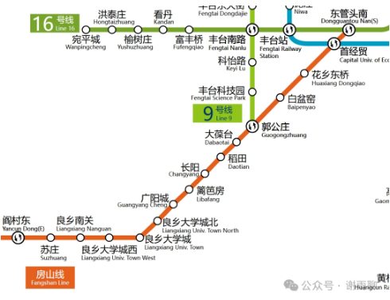
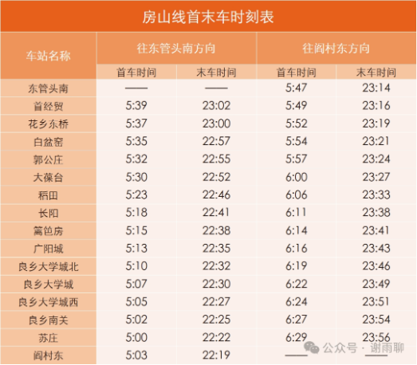
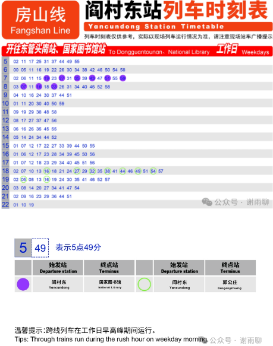
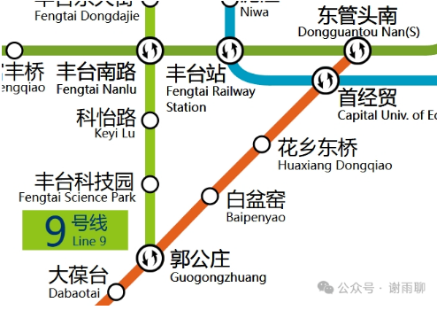
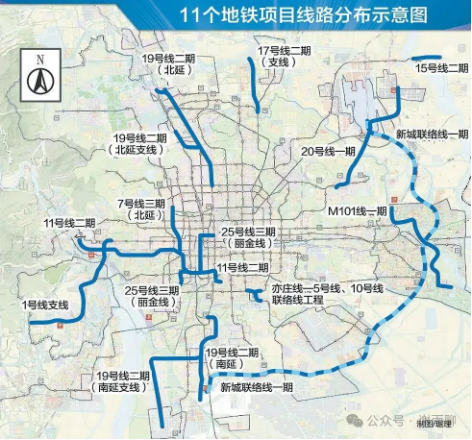
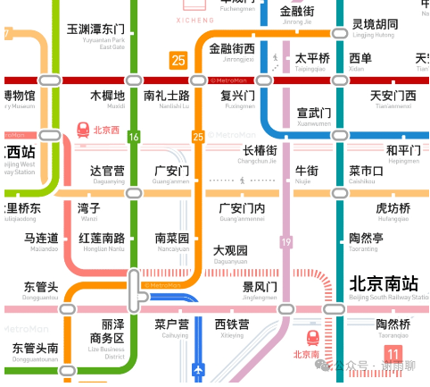
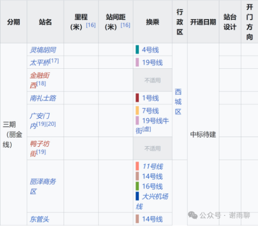
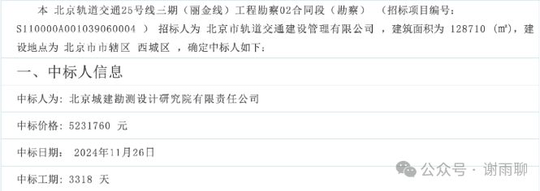

# 房山线的现状和未来

## 一、房山线现状

房山有两条地铁，即房山线和燕房线。虽然他们现在是连通的，未来也会贯通运营，但它们有着不同的历史和故事。今天我们讲房山线。

房山线又称“北京地铁25号线”，始发站为阎村东，终点站为东管头南，途经16站，跨房山、丰台两区，共32km。其中，阎村东站可换乘燕房线；郭公庄站可换乘9号线；首经贸站可换乘10号线；东管头南站可换乘16号线。

进城的首班车，每天5：03分左右从阎村东出发；回房山的末班车，每天23：14分左右从东管头南出发。

工作日一个方向每天大概有176趟列车，平峰期6-10分钟一趟，高峰期最快两三分钟即有一趟。

## 二、房山线发展规划

房山线于2010年12月31日通车，当时只是从苏庄到大葆台。2011年12月31日，北延1站至郭公庄。2017年12月30日，西延1站至阎村东，与燕房线贯通。2020年12月31日，向北延伸4站至东管头南。

未来，房山线将继续向北延伸。

根据北京市轨道交通第三期建设规划（2022年-2027年），25号线（丽金线）将南起东管头南站（不含），北至灵境胡同站，线路全长10.9公里，设站8座。

建成以后，大家坐房山线可以一口气坐到金融街，中间不需要任何换乘。减少了绕路和中转，很多人上班会节省半小时的通勤时间，且舒适度会进一步提高。（规划图来自地铁通）

此外，丽金线将增强房山与丰台、石景山、西城等城区的联系，推动房山人才和产业与丽泽商务区、金融街、石景山科创谷等地流动。（站名来自Wikipedia）

是时，地铁红利将进一步提升良乡、长阳、窦店等地段的房产价值。商圈发展潜力上升，长阳、良乡大学城等地将更加繁荣。

有人可能要问了，丽金线什么时候开通运营呢？现在到哪一步了呢？

根据网上查到的资料，2024年11月末，丽金线项目的工程设计已经中标，中标人为北京城建勘测设计院有限责任公司，投标价格为5231760元，周期为3318天。

换句话说，2024年底，丽金线正式开始制作设计方案和施工图了。

需要说明的是，3318天不是施工时间，而是全周期设计服务时间（从设计开始，到建设完成，再到交付运营后的质保期，甚至后续的扩展改造）。

鉴于规划丽金线的文件明确限定规划时间为“2022年-2027年”，结合地铁建造的一般规律，我们大概可以判断，丽金线2025年末将开始施工，可能在2027年底或者2028年初通车。

不出意外的话，今年下半年就会发布施工招标文件。欢迎大家关注公众号，和我一起追踪丽金线的施工进度。

> 转换说明：配图：第1–8幅暂沿用现图（指定资料目录未找到可靠且质量更好的无水印原件）。
