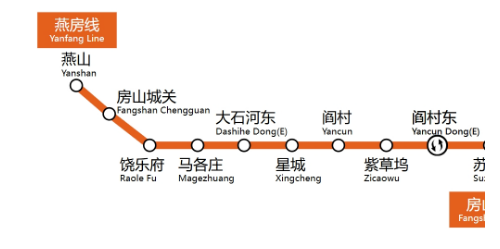
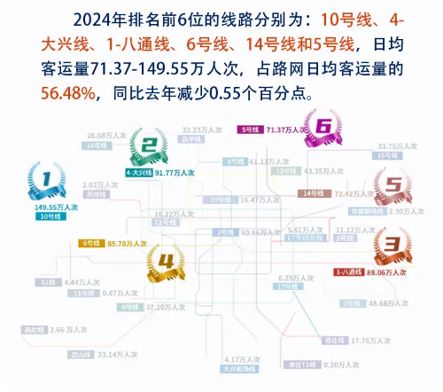
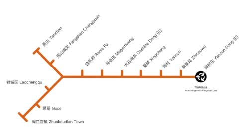
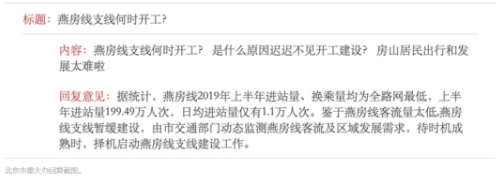
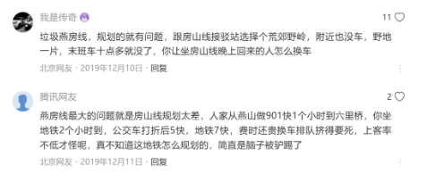
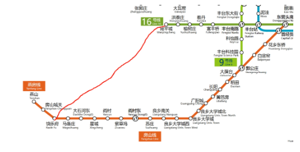

# 北京燕房线支线项目暂停，未来还有希望吗？

北京地铁燕房线于2013年底动工，2017年12月30日通车。始发站为燕山站，终点站为阎村东站，途经9站，长14.4千米。

燕房线是中国首条自主研发的全自动运行线路，据说是房山线的延长线，两条铁路线路相连，标志色也都是橙黄色，据说远期将贯通运营。

但是，燕房线还有一个最大的特点，那就是客运量太低了。据北京轨道交通指挥中心官方公众号提供的数据，2024年北京地铁客运量前三名分别为：10号线（149.55万人次）；4-大兴线（91.77万人次）；1-八通线（88.06万人次）。而燕房线的客运量为2.66万人次，实在太少。房山线为23.14万人次，客运量几乎是燕房线的10倍，你说，这种差距，如何贯通运营？

事实上，燕房线本来并非一条线路，除了主线以外，还有支线。支线于2019年8月启动征地工作，原定于2019年底开工，2020年底建成通车。通车以后，大家可以直接坐地铁到达周口店看北京人和山顶洞人……

2019年底，有市民在北京市重大办的官网留言咨询，“燕房线支线何时开工？是什么原因迟迟不见开工建设？”

官方回复如下：

> 据统计，燕房线2019年上半年进站量、换乘量均为全路网最低，上半年进站量199.49万人次，日均进站量仅有1.1万人次。鉴于燕房线客流量太低，燕房线支线暂缓建设，由市交通部门动态监测燕房线客流及区域发展需求，待时机成熟时，择机启动燕房线支线建设工作。

不过，有网友指出，不是燕房线上的居民没有进京需求，而是燕房线的规划实在太差。在燕山坐901快，1个小时即可到达六里桥，坐地铁2小时才到，花费还更便宜，这才是燕房线客流量低的根本原因。

如果沿着901快的路线修地铁，从房山城关到宛平城再修一条线路，和16号线的宛平城站连接，自然会快很多，但这条线路需要与京广线铁路并行，还可能改变卢沟桥的景观。实在是耗资巨大，难以落实。

不过，我认为最关键的问题不在于规划，而在于房山线和燕房线周边的产业。一方面，目前本来就有很多人需要从房山各地到良乡上班，如果良乡的产业进一步发展，提供更多就业岗位，那么燕房线自然会提高客流量。另一方面，房山老县城和燕山地区，也曾经有过辉煌的历史，现在也并不差，至少也是县城规模，如果能继续发展产业，燕房线自然会更加繁忙。

此外，燕房线上风景优美，周口店遗址举世闻名，旅游业也能发展，就看有关部门如何利用这些资源了。

不过，目前来看，至少在2027年以前，不会有修建燕房线支线的计划。大家或许可以期待2028年发布的北京市轨道交通第四期建设规划，我推测那时可能会将燕房线支线付诸实践，毕竟，燕房线支线经过房山区老城，直通周口店，并非一无是处。

> 转换说明：配图：第1–6幅暂沿用现图（指定资料目录未找到可靠且质量更好的无水印原件）。
