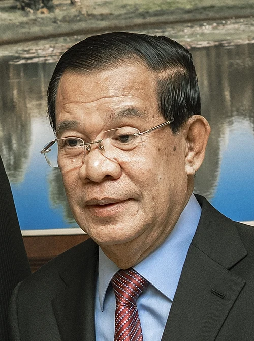
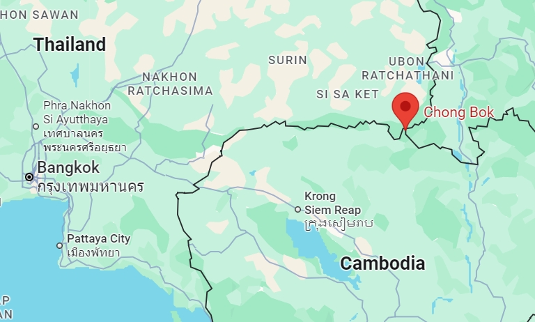
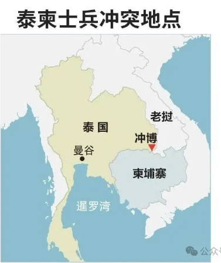
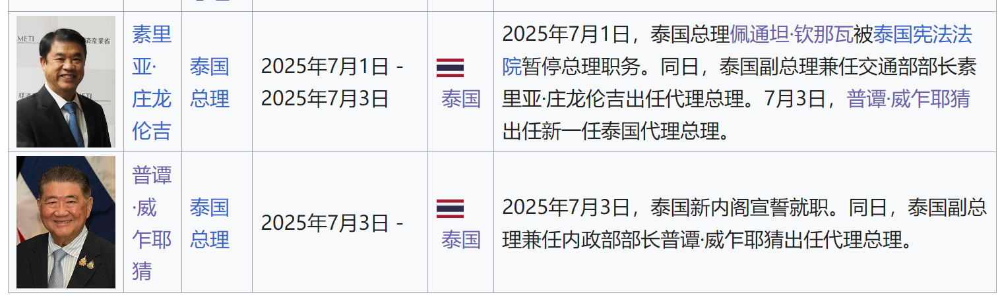
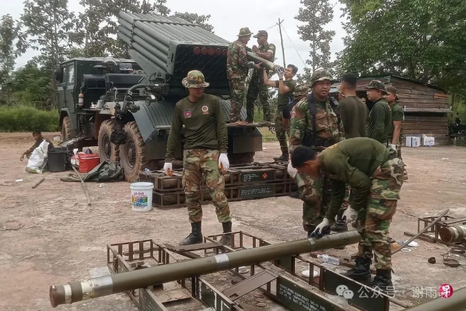

# 泰国与柬埔寨在两国边境地区发生交火，背后有哪些原因？目前情况如何？

**两国各自政治势力之间的矛盾，远大于两国统治者的矛盾，更远大于两国人民之间的矛盾。**

首先，泰国有两大政治势力，一是泰国皇室和军方，二是民选文官政府（他信家族为代表，现任总理佩通坦即他信幼女），前者掌握泰国军权和经济命脉，后者为大资本家。文官政府总体亲中，军方则立场复杂，既有亲中的，也有亲美的。当然，我们也可以这样讲：从来就没有什么亲中亲美，都是从自己的利益出发罢了。

而柬埔寨呢？柬埔寨也是君主立宪制国家，但国王基本没有权力，政权主要由洪森家族掌控。在洪森的主导下，柬埔寨完全站队中国。洪森之子洪玛奈继任首相后（2023年8月22日），继续与中国保持良好关系，但更强调多边平衡，对中国友好度稍低于洪森。

大家可以从这次泰柬冲突的时间线中看出一些端倪：

2025年5月28日，泰国军队同柬埔寨军队在两国边境发生短暂交火，致使一名柬埔寨士兵死亡。这个边境就是崇博关口（the Chong Bok pass），此地是翡翠三角（Emerald Triangle）的一部分，位于泰国、柬埔寨、老挝三国交界之处，边界划定混乱，属于历史遗留问题，和印度巴基斯坦的情况类似，都是西方国家临走前故意留下的争端。

根据泰国的说法，泰国士兵发现，在被视为泰国领土的区域内，有大量柬埔寨士兵在挖掘战壕，泰军劝说无果后爆发冲突。

从柬埔寨的视角看，这个区域并非泰国领土，而且是泰国士兵首先向柬埔寨士兵开火，死的是柬埔寨士兵，也是柬方首先致电泰方才停止了冲突。

总之，双方都指责对方首先挑起了争端，柬埔寨闹着要向国际法庭提起诉讼，同时重申不希望和泰国发生冲突；泰方也表现较为克制，表示要缓解冲突，只有部分泰国军方人物表现强硬，泰国总理佩通坦则声明：“我们绝不放弃一寸国土，但也不会因误解而投入战争。”

2025年6月15日，佩通坦以私人身份和洪森通电话。在通话中，佩通坦语气温和，尊称洪森为“叔叔”，自称“侄女”，并批评了一些做出强烈表态的泰国军方人物。

2025年6月18日：

> 佩通坦和洪森一段时长9分钟的通话录音遭到外泄[55]。洪森承认自己有意录制了这一段音频，并将其转发给约八十名官员[55]，他更是于稍晚时候在脸书账号上发布了全程对话音频，时长17分钟，以“避免误会和误读[56]”。佩通坦亦承认此音频属实[55]。——摘自维基百科

此事让佩通坦陷入被动，尽管专门召开新闻发布会进行解释，依然挡不住反对党和民间的示威。

2025年6月20日，泰国参议院议长蒙坤·素拉沙乍分别向国家反腐败委员会和宪法法院提交弹劾总理佩通坦的请求。

2025年7月1日，宪法法院宣布受理佩通坦违宪案，佩通坦即时停职。由副总理轮流担任代理总理。佩通坦仍兼任文化部长。

2025年7月16日：

> 3名泰国皇家陆军士兵在翡翠三角区巡逻时误触地雷受伤。初步推测为冷战时期遗留地雷[17]，但后续证据显示实为新型俄罗斯PMN-2地雷[18]，其中一名伤者截肢[19]。泰国拟将柬埔寨违反《渥太华条约》一事诉诸联合国[20]。——摘自维基百科

2025年7月20日：

> 柬埔寨否认了埋雷指控，并指责泰军偏离2000年《谅解备忘录》所订立的巡逻路线，进入了柬埔寨境内布满战后遗留地雷的地区，质疑泰方动机。[21]——摘自维基百科

2025年7月23日：

> 泰方表示另一支由5名士兵组成的泰国巡逻队在乌汶府南元县被地雷炸伤，其中1人伤势严重，右腿截肢。泰方将事件归咎柬埔寨。对此，泰国皇家军队发布声明称，强烈谴责这一“不人道的行为”，并称其“威胁了边境地区的和平与稳定”。柬埔寨否认指控，并表示爆炸发生在柬埔寨柏威夏省的无人区。[24]

> 同日，泰国决定降低与柬埔寨的外交关系级别，泰国召回了驻金边的大使，并驱逐了柬埔寨驻曼谷的外交人员[25]。柬埔寨就此事表示，泰方关于地雷爆炸的指控毫无根据，纯属捏造，旨在将其不当外交行动的责任转嫁给柬埔寨，同时柬方回应，将与泰国的外交关系降至最低级别，即代办级，宣布召回驻泰国大使馆除必要人员外的所有外交官和工作人员，并同时要求泰国外交官限时离境[26]。——摘自维基百科

2025年7月24日，泰柬边境冲突升级，上午，泰国与柬埔寨在两国边境地区至少6个地点发生交火，泰国F-16战机对柬埔寨境内目标实施了空袭。双方互指对方率先开火。目前已致多人伤亡，且并无停火迹象。

图为柬埔寨北部与泰国接壤的柏威夏省边区，柬士兵给BM-21多管火箭发射器装弹。（法新社）

以上是目前收集到的信息，当然有偏差，但大差不差。

至此，我有以下想法，供大家参考：

1这次冲突，泰国军方始终占据主动权。什么寺庙不寺庙，地雷不地雷，在我看来都是借口，对泰国军方来说，只要能打仗，他们就能获得能量，就能巩固权力。

2泰国军方发起这次冲突，很可能是为了打击国内的文官派，巩固自身地位。至少客观上达到了这样的效果，佩通坦停职，冲突升级，军方获得主导权。

3佩通坦和洪森私下关系较好，他们有很多共同利益。泰国强，柬埔寨弱，但佩通坦和洪森通话时，却将自己的姿态放得很低，将洪森当成长辈对待，且不惜批评自己国家的将军，来安抚洪森。

4通话泄露，有两种可能，可能是洪森自己授意的，也可能是柬埔寨一些反对派或者泰国军方间谍泄露的。如果是前者，说明洪森也有引导冲突升级的动机，也许是为了打击某些政敌，或者转移国内矛盾；如果是后者，则说明洪森对柬埔寨的控制并没有那么强。但不管怎样，通话泄露可以说明，柬埔寨内部也充满矛盾，问题重重。

5当然，从柬埔寨的角度看，他们实在没有跟泰国打的动机，毕竟柬埔寨打不过泰国，而且柬埔寨国内矛盾也没有达到要打一仗的地步。

6中国和泰柬两国都有非常深厚的联系和经济合作，泰柬爆发太大冲突对中国是没有好处的。所以从中国立场看，应该尽量避免冲突升级。当然，中国也确实是这样做的。

7总体来看，这次冲突不会失控，因为泰柬冲突不符合中国利益，中国一定会居中调停。此外，对泰国军方来说，冲突地区在国际法中，确实不属于泰国领土，他们最多也就是将冲突地区实际占领，这已经要冒很大风险了，再进一步则更没有任何法理依据，失道寡助了。

以上是我根据现有资料产生的一些想法，当然是不成熟的，欢迎大家讨论。一起跟进吃瓜吧！
