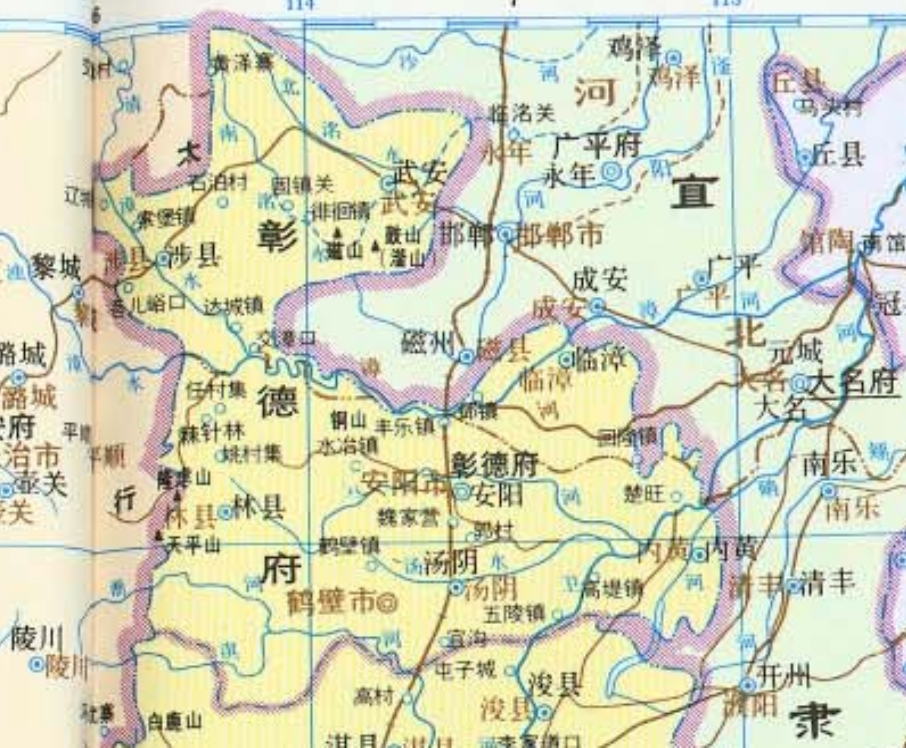
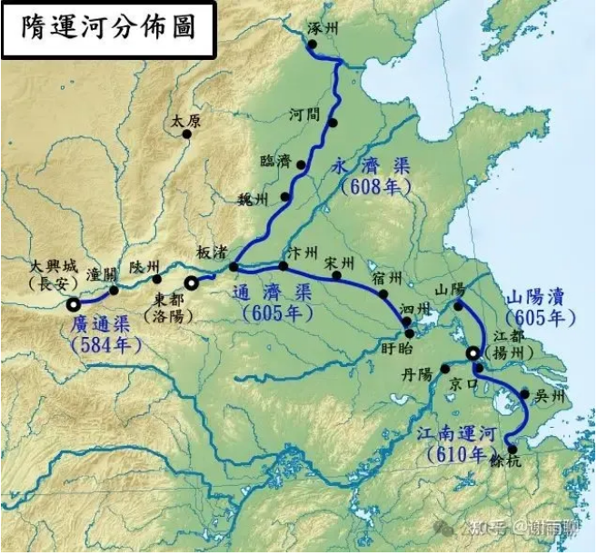
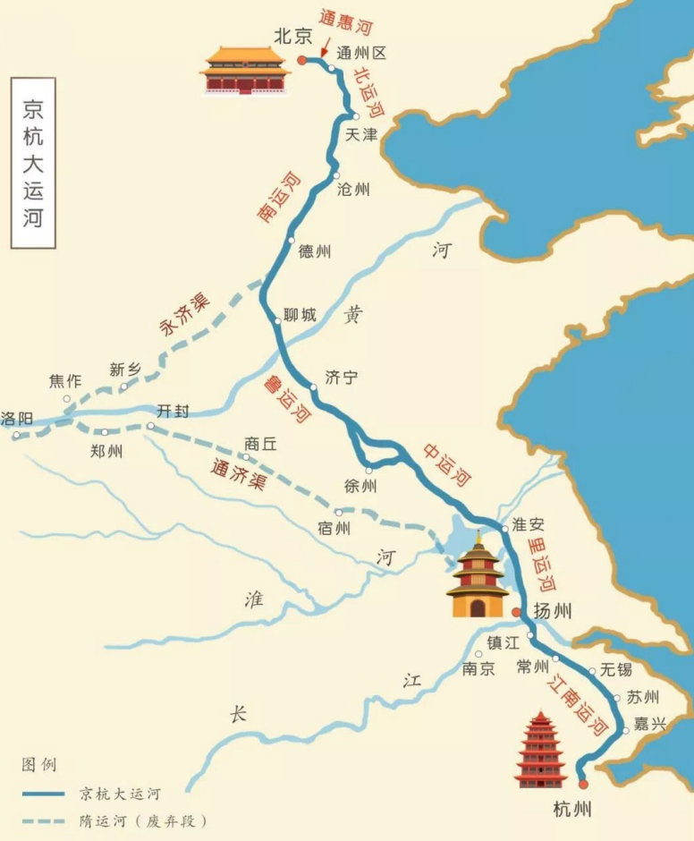

# 究竟谁是邺城的继承者？河南安阳还是河北临漳？谁才是真正的邺城？

能出现这个问题，首先在于1949-1952年的行政区调整。

临漳和安阳，在明清时期都隶属于河南省彰德府，彰德府的治所就在安阳。

清地图

如果这个问题在明清时期，就压根不会出现。

比如假设现在临漳县是安阳市下辖的一个县，那么大家还会纠结邺城是在安阳还是临漳吗？临漳就在安阳嘛，差不多嘛。

关键就在于临漳县现在隶属于邯郸市，跟安阳不但不在一个市了，甚至不在一个省。所以才会有争论。

那么临漳县是什么时候划到邯郸的呢？又为什么要划到邯郸呢？

1949年-1952年，新中国为了恢复华北平原的经济，曾经短暂地设置过平原省，辖有新乡、濮阳、安阳、菏泽、湖西、聊城、安阳等地，省会在新乡。

那时，就将原为河南省的临漳县划到了邯郸专区。而安阳市则被划到平原省。

1952年撤销平原省时，并没有完全恢复原先的行政区划，而是有所调整，调整的主要依据就是治水之便。濮阳等地为了治理黄河，本来属于河北，划入了河南；临漳等地本来属于河南，为了治理漳河，划入了河北：

> 现属平原省原为山东省旧辖之高唐、清平、博平、茌平、聊城、堂邑、冠县、莘县、朝城、阳谷、东阿、梁山、寿张、范县、观城、濮县、鄄城、郓城、南旺、嘉祥、钜野、菏泽、定陶、城武、金乡、鱼台、单县、复程、曹县等二十九县，全部划回山东省属；原为河南省旧辖之林县、安阳、邺县、内黄、汤阴、浚县、滑县、淇县、汲县、辉县、新乡、延津、封邱、原阳、获嘉、修武、武陟、博爱、温县、沁阳、孟县、济源等二十二县，新乡、安阳两市及焦作工矿区，全部划回河南省属；

> 原为河北省旧辖之南乐、清丰、濮阳、东明、长垣等五县，为治黄之便，亦划归河南省属，不再归回河北省；现属河北省原为河南省旧辖之武安、涉县、临漳三县不动，仍属河北省，以利治漳。——1952年11月16日《中共平原省委关于正确执行中央撤销平原省建制的指示》

此后，临漳县就彻底成为河北邯郸的一部分，结束了其长期隶属于河南省的历史。

而这次政区调整的关键，就在于漳水。

嘉靖《彰德府志》记载：“漳水善徙。”也就是说漳水经常泛滥，河道经常更改，沿岸城镇的具体位置也经常更改。

现在的邺城遗址，有南北两城。北城为曹魏所建，大部分在今漳水北，属临漳县辖地；南城为东魏所建，在漳水南，属安阳辖地。

而曹魏所建邺城，当时并不在漳水北，而在漳水南岸，只不过漳水改道多次，现在相对地到了漳水北。

事实上，邺城一直都是漳水南岸，紧邻漳水的军事重镇。

大家有没有想过，为什么战国时期，邯郸和邺城只相隔四十公里，却分属赵魏两国？

而且邯郸是赵国都城，邺城则是魏国河内郡的中心，两个中心城市为什么离得这么近呢？

就是因为当时漳水水量很大，而且比现在更靠北。邯郸在漳水以北四十里，邺城则在漳水南岸。魏国经营邺城，可以有效防止赵军的进攻。

西门豹治邺，开槽水渠，使邺城附近成为重要的粮产区。

水路交通便利，粮产丰富，地形险要，邺城逐渐成为整个河北的中心。袁绍、曹魏、后赵、冉魏、前燕、东魏、北齐都以此为都。直到580年，杨坚焚毁邺城，相州、魏郡、邺县三级治所及邺民迁至安阳古城，邺城毁弃，此后再未复兴。

那么为什么长安、洛阳也多次被毁，却能够复兴，而邺城再也没能复兴呢？

关键还是在水系。

北宋时期，北方的中心在大名，当时大名可是北宋的“北京”，是河北最大的城市。

而大名就在漳水边，在邺城下游，而且通过永济渠可以连接大运河，其实一定程度上代替了邺城的战略地位。

隋运河。大名在永济渠上

漳水缺乏治理，经过多次改道，泥沙淤积，水运能力下降，军事作用减弱。后来的运河体系，也主要是在东边。河运之便，与临清、聊城相比，就荡然无存了。

于是，从纵向看，广阳-邯郸通道（现在的京广线），有邯郸、安阳代替邺城的位置。水路，有大名、聊城代替邺城的位置。所以邺城自然就没有再重建的必要了。

近现代，黄河泛滥，运河废弃，京广线修建，理论上讲邺城存在复兴的可能。但此时邺城故地早成为一片农田，且北有邯郸，南有安阳，自己则在河南河北省界线这个尴尬的位置上……

现在，邺城作为一个文化遗址，一鱼两吃，被河南河北两省共同开发利用，也算是发挥它最后的余热了。

所以回到一开始的问题，到底谁是邺城的继承者？

从地理的角度，河北临漳继承了大半，河南安阳继承了小半。

从城市角度，安阳继承了邺城，毕竟邺城移民都被迁到了安阳。

从战略地位的角度，安阳继承了一般，邯郸继承了一半。

但是真正的邺城其实就是死了，就是消亡了，谁也没继承，邯郸和安阳都成为不了华北的中心，更成为不了都城。安阳和临漳应该去努力创造自己的历史，向前看，而不是纠结于一个死去的城。

-END-

这是一个能涨知识的公众号，关注我，阅读更多有趣文章～
