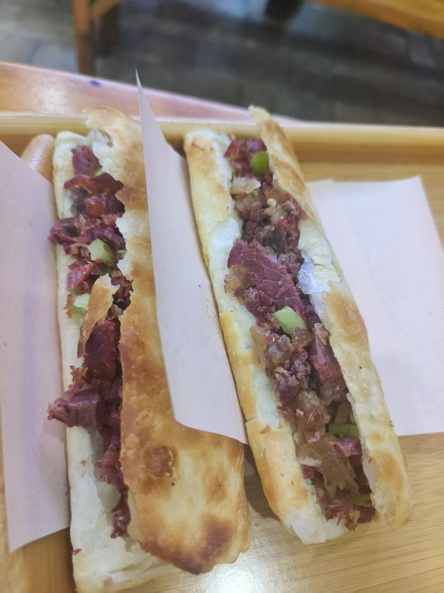
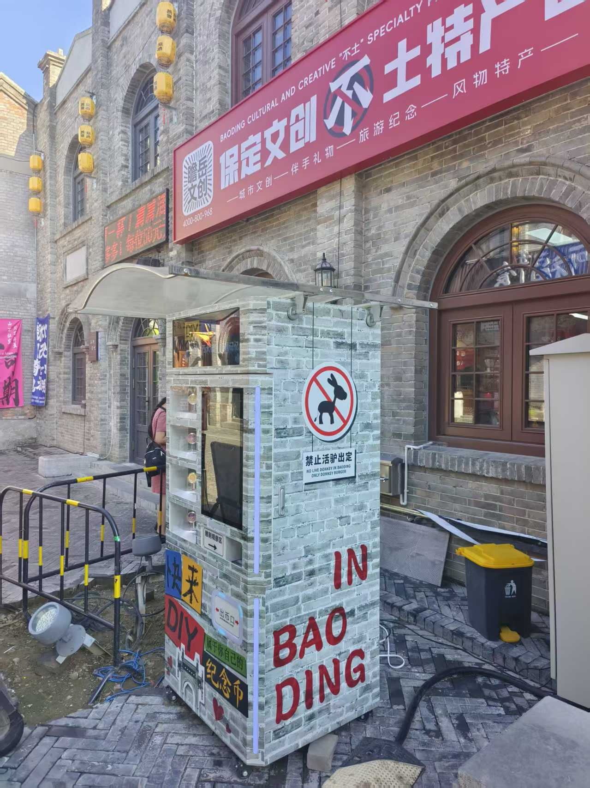
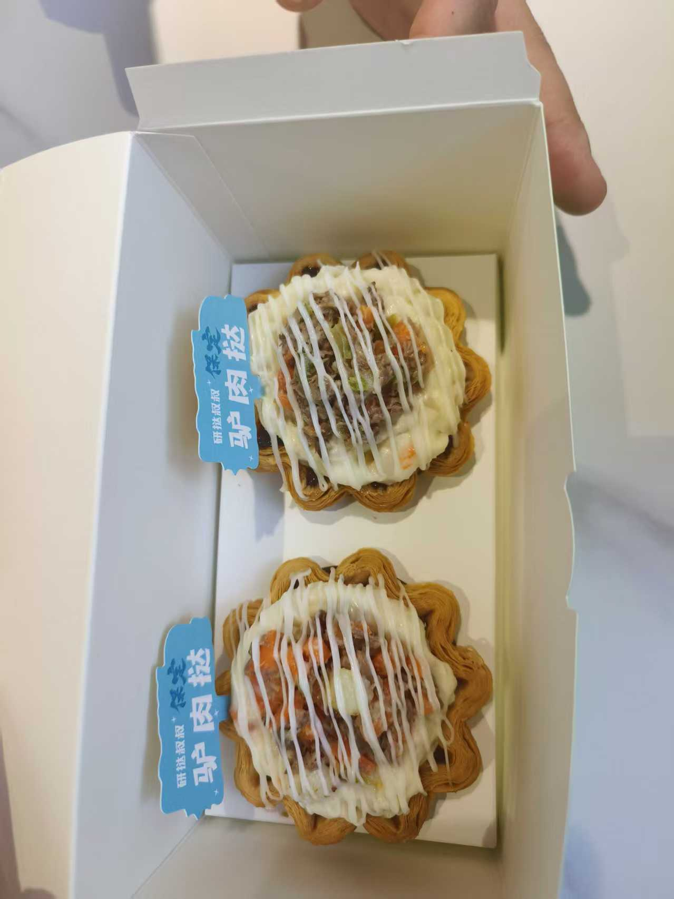
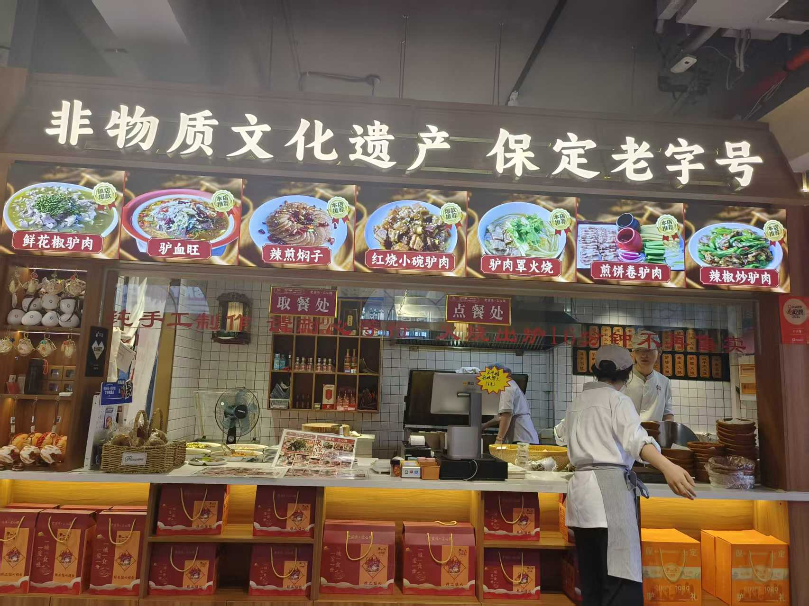
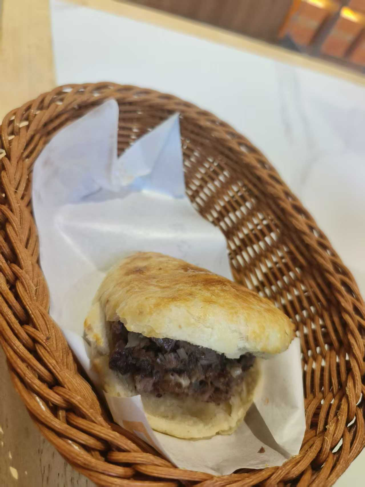
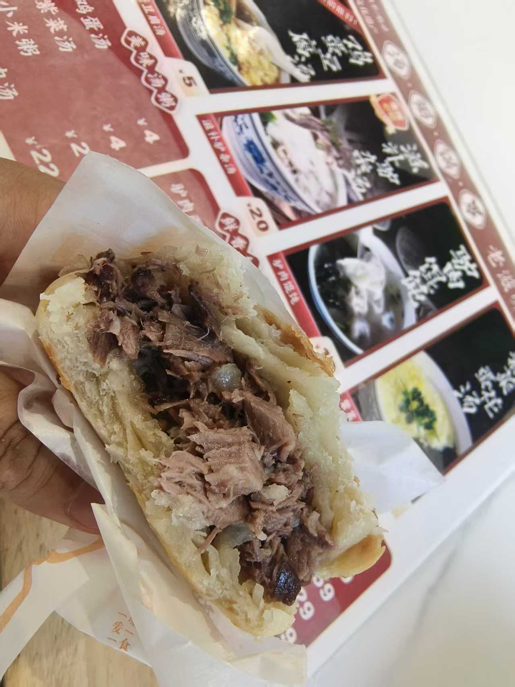

# 四川人第一次在保定吃驴肉火烧，被狠狠惊艳了

作为一个四川人，来北京上大学以前，连羊肉都没吃过几顿，驴肉更是闻所未闻。有一次偶然吃到了驴肉火烧，才知道“**天上龙肉，地下驴肉**”此言不虚，不禁感叹，这样的好东西，怎么只有河北才有呢？

后来又了解到，驴肉火烧分为保定驴肉火烧和河间驴肉火烧。我当时吃的是**河间驴肉火烧**，火烧是长方形的，驴肉是酱制。而**保定驴肉火烧**则是圆形火烧，驴肉是卤制。听说两种火烧选用的驴肉也是不一样的。

吃得多了，就知道了一些技巧。比如河间驴肉火烧最好吃的是普通火烧，火烧里面加上驴肉、青椒和焖子，这样口感最好。如果火烧里面全放驴肉，反而觉得干硬寡淡；如果都放焖子，又容易腻。

当然，长期以来，我一直有个误区，就是认为保定驴肉火烧不怎么好吃，口味比不上河间驴肉火烧……直到有一天，我真的去了保定。

前段时间去保定，顺便旅游。去逛了直隶总督府，出来后在西大街转了转。

不得不说，保定市政府对驴肉火烧的宣传真是非常给力，街上到处都是驴肉火烧相关的文化产品和标语。

最离谱的就是“保定驴肉挞”——上面是驴肉，下面是蛋挞。更离谱的是，味道还挺好吃。

但是我之前在北京也吃过保定驴肉火烧，感觉一般般啊，不至于你们这样吹吧？难道是北京的保定驴肉火烧不正宗？好吧，那就再试试。

于是我在旁边找了一家店，名叫“驴肉曹”，据说这店始于1989年，还上过央视《三餐四季》的美食节目。不说最正宗吧，至少不会踩雷。

进去以后，发现这店真是高档，装修豪华，生意兴隆，明厨亮灶，可以看到后厨的状况，火烧都是现烤的，服务员忙忙碌碌。

我点了一个驴肉火烧，不久就上来了。这火烧一看就不一样，小小一个，椭圆厚实，外皮鼓起焦黄的气泡。刚出锅，热气腾腾的，拿在手上还有点烫手，饼皮碎成薄片掉在桌子上，好像在催你赶紧吃掉。

一口咬下去，先是饼壳的脆硬感，再是肉的筋道与咸香，汁水顺着指缝渗出来，烫嘴却欲罢不能。

很快，一个驴肉火烧就吃完了，仍然觉得意犹未尽，闻了闻蘸着汁水的手指继续回味……

现在我算是知道了，保定驴肉火烧一定要**找对店**，而且一定要**趁热吃**，最好找个离厨房近的位置，这样才能真正品味到它的魅力。

第二天我坐出租车去火车站，跟师傅说了这事，他说我吃的那家店并不算最好的，有几家更好吃，每天都排着长队呢。

可惜没在保定长待，不然一定要再吃几次驴肉火烧。

司机师傅说，下次来保定，随便找个出租车，告诉他想去一家正宗的店吃驴肉火烧，让他直接拉你去，这样就能吃到好吃的保定驴肉火烧了。

当然，每个人口味不一样。我一位朋友是广东人，对驴肉火烧压根没有兴趣；还有一位朋友是沧州人，始终认为河间驴肉火烧比保定驴肉火烧好吃。
