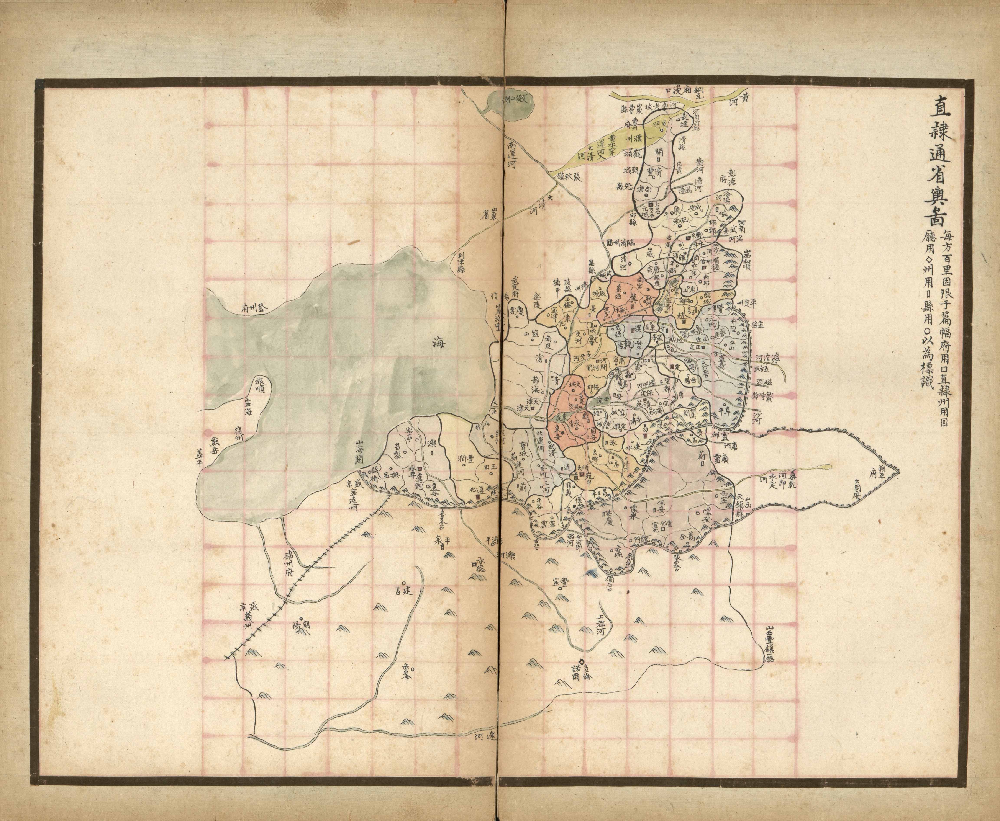
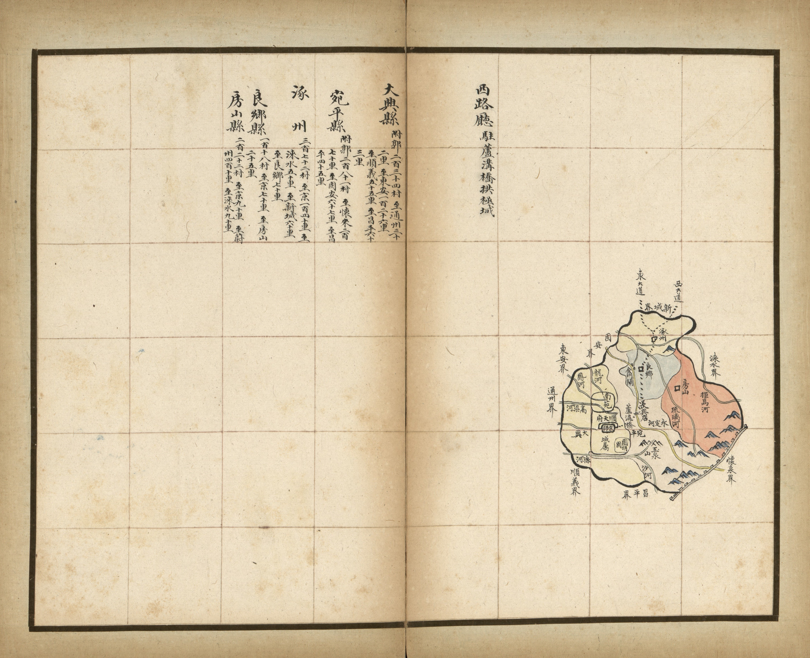
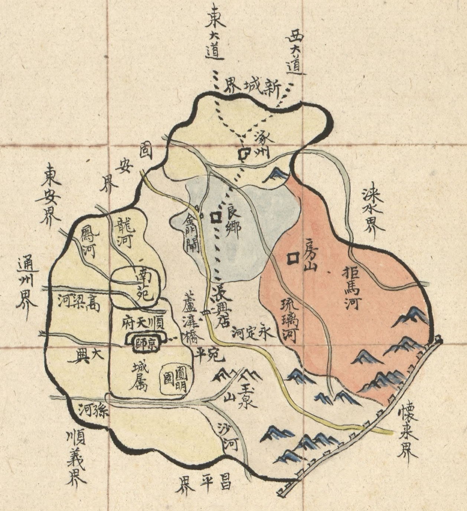
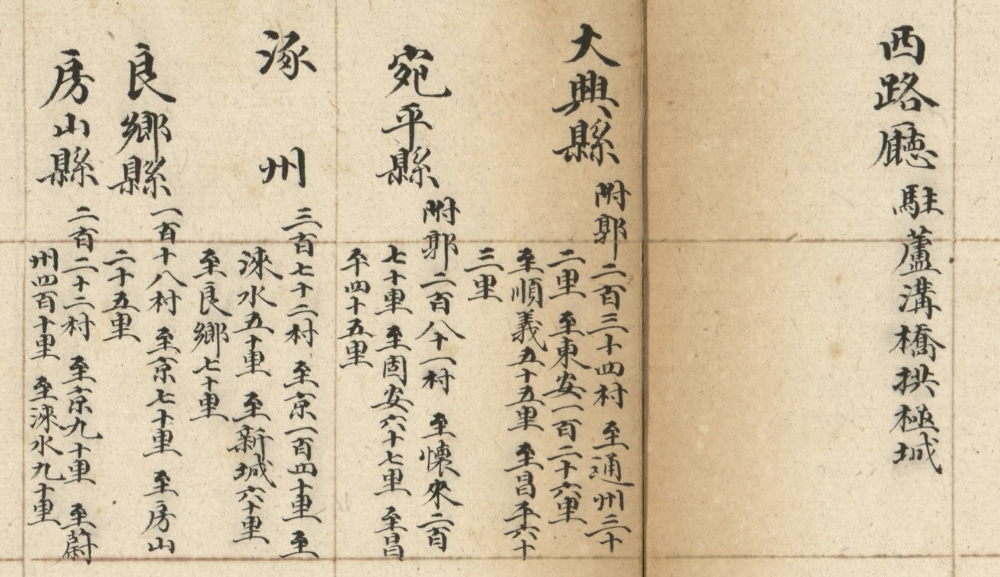
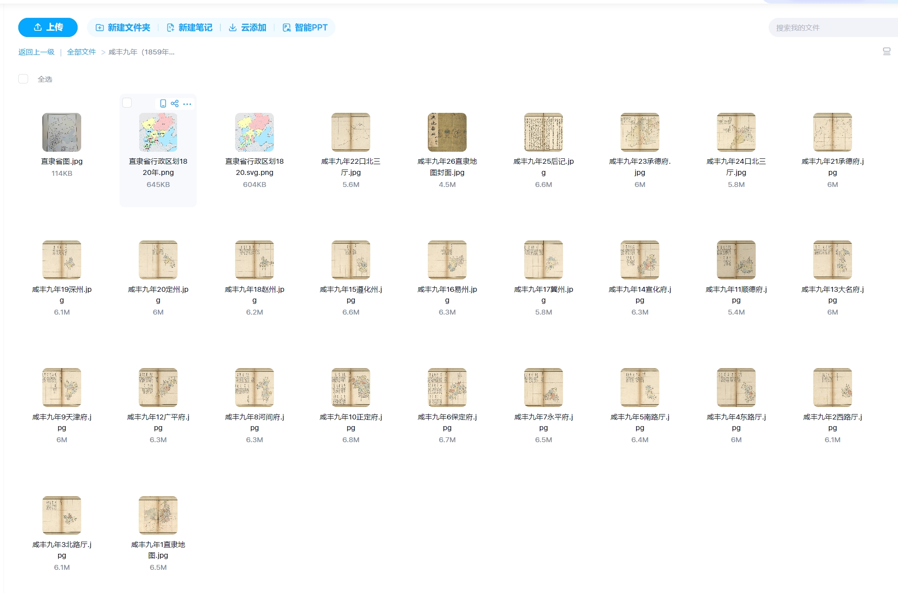

# 古地图里的直隶省：咸丰九年的24幅彩绘地图分享

这是咸丰九年（1859年）的直隶省行政区图册，由保定府官员徐志导手绘，应当时的直隶总督恒福的要求，此图主要服务于直隶总督在军务、防务、治安、行政上的参考。

此图共24幅，包括1幅直隶省全图，4张顺天府辖区图（西路厅图、北路厅图、东路厅图、南路厅图），9张府图（保定府、永平府、河间府、天津府、正定府、顺德府、广平府、大名府、宣化府），6张直隶州图（遵化州、易州、冀州、赵州、深州、定州），以及承德府、口北三厅府图各2幅。

图中简单绘出行政划分、长城、山峦、河川及主要道路；另用不同图形符号标示县辖所在。本图坐标南上北下；全图采计里画方。每个县都标注了境内村庄数目、府州四至与至京或与邻县的道路里程。

在这幅图中，可以看到北京、天津、河北等地的辖区变化。

以顺天府西路厅为例。

右下角是西路厅行政图。需要注意，看图的时候要转换思维，上南下北左东又西。

可以看到，当时的西路厅共大兴、宛平、房山、良乡、涿州五县，京城在大兴县境内，不同的县用不同的颜色填充；图边缘标有“怀来界”“新城界”“通州界”“顺义界”等，显示了顺天府西路厅与邻近府州县的接壤情况。

还可以看到永定河、拒马河、琉璃河、沙河等河流，还有玉泉山、卢沟桥、长城、东大道、西大道等地理要素或军事重地，都在图中清晰标出。

左上角则是西路厅各县的情况。可见西路厅的政府驻地在卢沟桥拱极城。还可以清晰地看到各县有多少村，到京城、临县有多少公里。

比如这里写的涿州至京140里，至良乡70里，我用高德地图测了一下，从涿州市政府到天安门走京港澳高速正好70公里，到良乡也是36公里。可以说非常准确了。

我平时特别喜欢看地图，将古地图和现代地图对比，乐趣无穷，可以发现不少有趣的事情。

这套地图册现在藏于美国国会图书馆，网上只有电子版本，都是免费公开的，大家可以自行下载。

但是网上下载非常麻烦，我这已经下载整理好了。大家可以在公众号后台回复“**直隶省地图**”，就可以直接领取。

