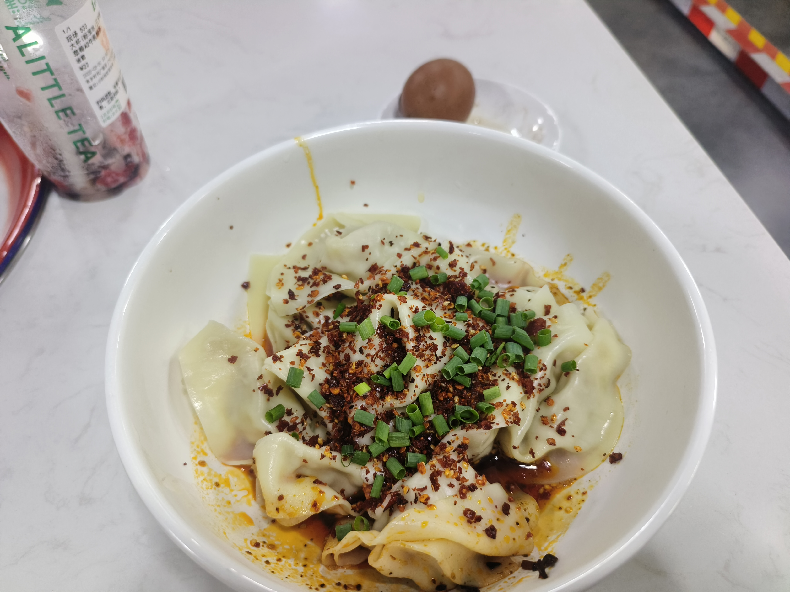
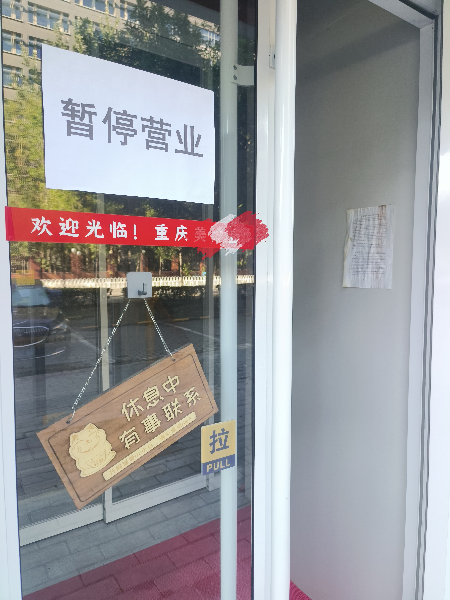
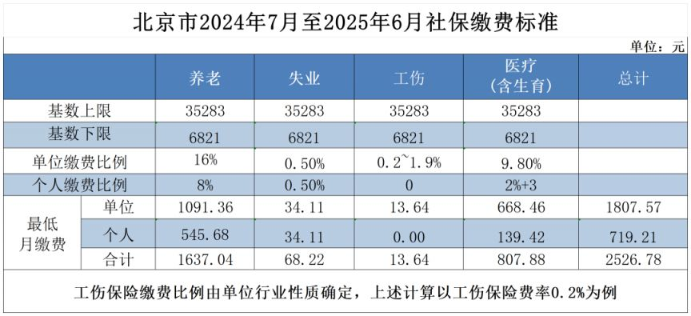

# 9月1日社保新规对普通人有什么影响？

前天，8月30日，我在一家川菜馆吃饭，他们家卖小面抄手什么的，味道还挺正宗。

我就问了一嘴：你们店还挺好吃的嘛？是四川人吗？你们还有火锅？

老板娘回答：是的。但是你想吃最好明天来，9月1号我们就关门了。

我：怎么好好的要关门呢？

老板娘：也不是关门，店面还租着，就是打算做点别的了。看看社保是怎么实施的。

我：原来是社保问题。

老板娘：一个人要交两千多，有好几个员工，根本负担不起。如果真要交，这个店就不干了。

这是我第一次感受到这个政策的影响，以前一直觉得没什么，但现在就要亲眼见证一个店的倒闭了。

我把以上内容发到知乎上，结果引发很大反响。

今天是9月1日，上午我去看了一下，这家店确实暂停营业了。

另外说明几点我的看法：

1 很多人觉得我是编故事，而且我看了网上的文章，确实有和我相似的经历，但我的经历都是真实的，店当然也是真实的。如果有网友来打假，到北京后我可以提供地址，只需要请我吃顿饭就行。

2 这家店有两个招牌、两张菜单，一张菜单是小面抄手之类，另一张菜单是火锅炒菜。一楼入口小，二楼空间大，所以我刚进去的时候以为只有抄手小面，点完菜看其他顾客的餐桌，才发现有火锅，所以才问了老板娘。

3 我查了一下网上的信息，北京市养老保险、医疗保险、工伤保险、失业保险，加在一起，按最低基数缴纳，每个月企业要承担1807.57元，个人要承担719.21元。老板娘说一个人要交两千多，应该是指在不影响员工收入的情况下，企业要额外承担2526.78元的成本。这家店大概四五个人，交社保每个月会产生1万以上的额外成本，确实太高了。

4 有些店关门未必是因为交不起社保，也可能是因为赚得太少了，比如本来夫妻俩一个月能赚2万多，现在加上社保成本，夫妻俩一个月只能赚1万出头了，那确实不如打工，就没有必要开下去了。

5 有些人质疑，说这个店在大学城，地段那么好，味道又那么好，怎么会交不起社保呢？我只能说他社会经验太少了。他只看到附近有很多饭店，但没看到两年内有多少饭店倒闭了。味道好、生意好、地段好，但不赚钱的店，不在少数。当然赚钱的也有，但大多数老板也就是挣个辛苦钱，不比其他普通打工人强多少，当然承担不起几个人的社保了。

6 确实，关店的是少数。比如我昨天去的那家韩国烤肉，我特意问了社保的事。老板娘表示，自己是不会交社保的，她也不会关门，因为这么小的店不会有人查；当然，如果真的强制要交社保，他们也不会再干下去，因为那样就实在没啥利润了；更何况，餐饮店人员流动性大，就算交，实际操作也会非常麻烦。可见这个政策的影响未必那么严重，但是小餐饮店利润空间小、难以承担社保成本却是普遍的事实。

7 有人说，交社保是好事，就是应该让那些交不起社保的企业倒闭。我想说你可能是对的，但问题是，那些不交社保的人是不想交吗？他们为什么不去找个交社保的工作呢？那些做小本生意的餐饮店老板是想克扣员工的社保钱吗？他们自己可能是店里最忙的人，而且自己都不舍得交社保。你让他们交社保，你给他们补偿损失吗？你们是不是有点何不食肉糜了呢？

8 本人当然拥护社保政策。但对于那些生活清贫、一分钱掰成两半花的人，我实在不忍心苛求他们每个月再花几百块钱去买社保；对于那些没什么文化，只能开店谋生，每天起早贪黑地劳动，还要承受大量租金的饭店老板们，我也实在说不出“交不起社保的店就该倒闭”这样的话。这就是我的态度。
