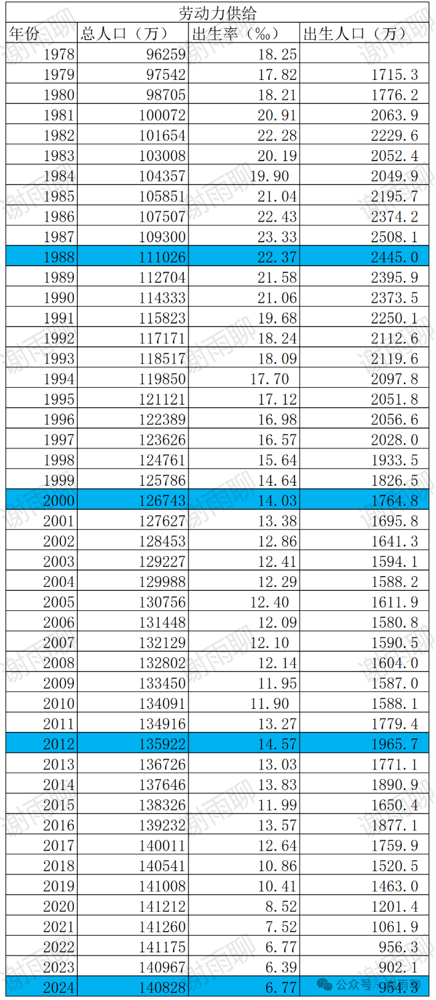

# 1978–2024：中国出生人口趋势

刚刚根据国家统计局的数据，录入了1978年以来的人口数量和出生率，计算了每年的出生人口。为了减少视觉疲劳，我把龙年的那一行涂成了浅蓝色。统计结果如下：

观察到以下几点：

①1981年，中国人口突破10亿，1988年突破11亿，1995年突破12亿，2005年突破13亿，2017年突破14亿。

②中国的人口顶峰是在2021年，有14.126亿人，2022年人口首次下降。

③2016年开始开放全面二孩，允许所有夫妻生两个孩子，但搞笑的是，除了2016年本年，之后的每一年，出生人口都在下降，再也没上升过。

④2021年起，国家允许夫妻生育三个孩子，然而并没有什么卵用，当年还有砖家预测2027年中国人口达到峰值14.5亿，谁能料到2021年本年就是中国人口的峰值年……

⑤有一个很反常识的事：80后人口2.21亿，90后人口2.09亿，00后人口1.63亿，10后人口1.73亿。是的，10后比00后多一千万人，00后才是最少的一代（当然肯定会比20后多）。

⑥10后比00后多，中国人在2019年以前，还是很喜欢生孩子的，生育率大幅下降其实也就是最近几年的事，这种大幅下降，可能要在二十年后我们才会深刻感受到。

⑦2024年出生人口反弹，宣传很好听，其实也就是954.3万，比2023年的902.1万好一些，甚至比不上2022年的956.3万，所以从趋势看，中国人口出生率下降是大势所趋，这种局面不大幅度改革是改变不了的。

⑧至少未来十年，中国的劳动力人口都会只多不少，大学毕业生还会不断增多，就业还是很难。但到了20年后，劳动力市场的供需关系会攻守易势，到时中国会成为一个相对缺乏劳动力的国家，也许跟现在的日本类似，就业率上升，还会开始引进外来人口。

> 转换说明：配图：第1幅暂沿用现图（指定资料目录未找到可靠且质量更好的无水印原件）。
