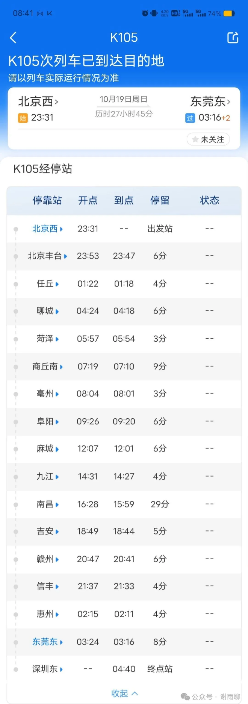
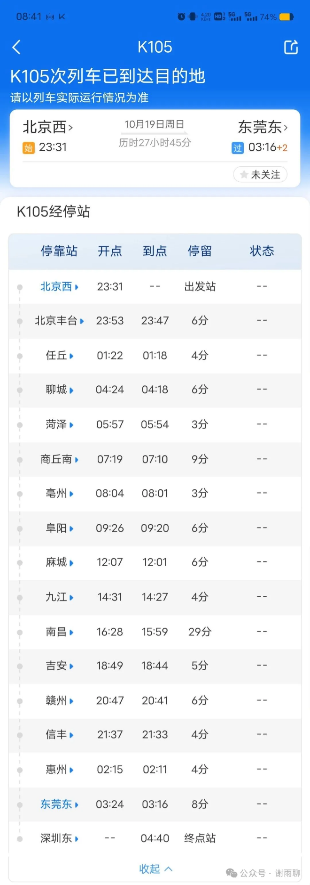
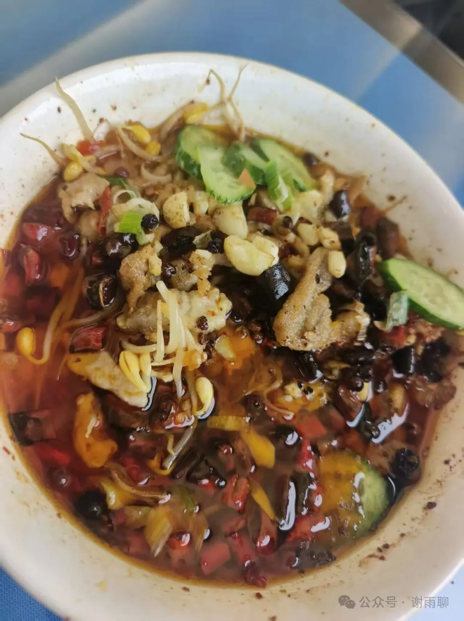
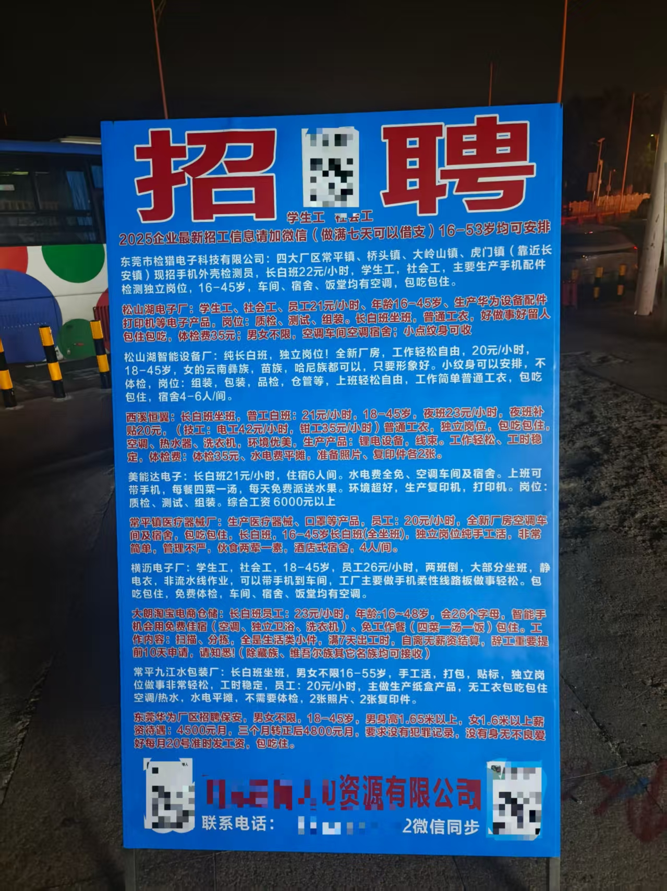
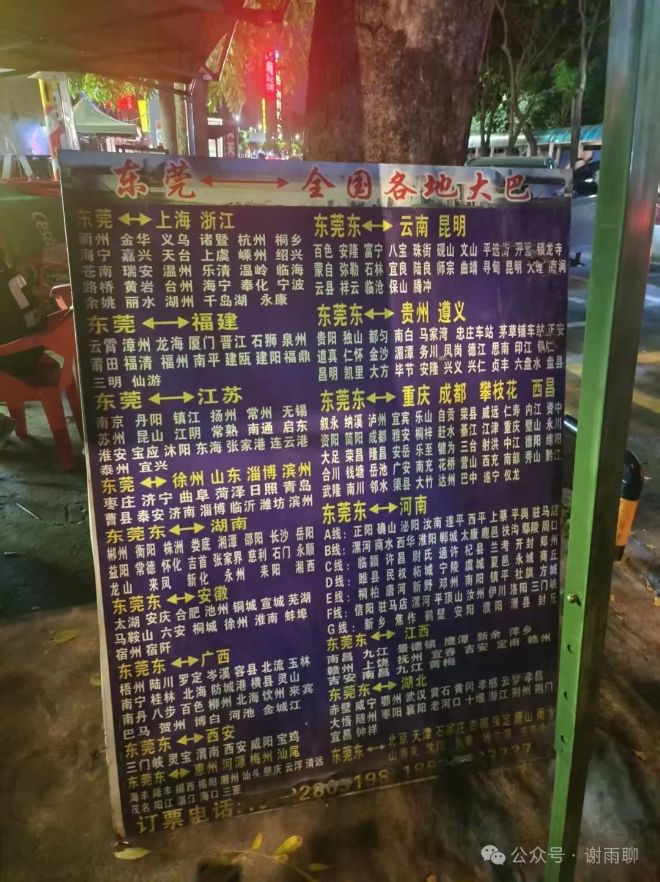
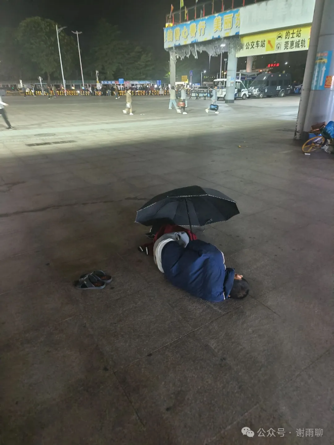
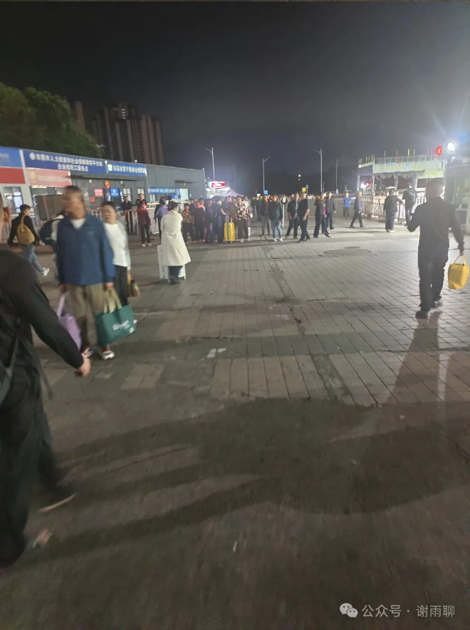

# 南下随记：从北京到东莞

这次从北京去东莞，坐火车20多个小时，沿路认识了几位朋友，经历颇为有趣。以下是随记。

## 一、基本信息

1. K105，2025年10月19日星期日23:31从北京西发车，10月21日3:16到东莞东站。

2. 途经站点（京九线）（北京局）：北京西、北京丰台、任丘、聊城、菏泽、商丘南、亳州、阜阳、麻城、九江、南昌、吉安、赣州、信丰、惠州、东莞东、深圳东。（全称2372千米）

3. 硬卧，17号车，09号上铺，426元。餐车在6车。

4. 遇到的人：东北大叔、达州阿姨、北京男孩、横店小明星、天大法律生。

## 二、东北大叔

1. 黑龙江人，50岁出头，之前在北京打工，跟老板发生争吵，结完工资后踏上了南下的火车，去深圳谋生。

2. 吃了两次方便面，吃面的时候喜欢喝酒，加一个烧饼，还带了瓜子。

3. 自言东北有“猫冬”的传统，每年10月底到次年3月，东北天寒地冻，难以在外活动，传统上只能窝在家里；现在东北人会在冬季南下，春天回东北，像候鸟一般。

4. 据说东北人已经控制了海南的很多行业，现在海南岛有很多东北人。

5. 为什么不定居南方？说是自己年纪大了，在老家有一些社会关系，不想离开了，而且自己孩子也在东北上学，自己也走不开。

6. 显老，两鬓斑白，但是精气神还行。

## 三、达州阿姨

1. 达州人，在惠东做平面设计，40多岁，头已灰白，但光看皮肤还是很年轻，有点知识分子的感觉。

2. 达州宣汉人，据说宣汉中学是达州最好的学校，每年能出十几个清北的。

3. 自己老公是河南人，儿子在河南高考，20年考到top2光电专业，现在已经直博读博二了。

4. 自己做过很多副业，比如团购、微商。微商没赚钱，但加的好友成了自己广告的客户，这个赚了不少。

5. 这次回四川，然后去北京看儿子，现在坐这趟车到深圳再回惠东。

6. 据说她之前坐火车遇到一个业内有名的律师，打了很多有名的案子。这位律师说自己现在在内蒙古接了于某胧的案子。不过阿姨没有继续深问。

7. 据她说惠州黄埔镇和吉隆镇承接了深圳的工厂，又有核电站和中科院入驻，未来发展可期。两地有大量工厂，可以考察作为电商的货源。

## 四、北京男孩

1. 北京某郊区人，03年出生，中专学的厨师，大专学的护理，去年毕业，在朝阳区某三甲医院做了一年护工，前段时间辞职，在M区找工作，一时没找到合适的，于是计划休息一段时间，去深圳找小姨，预计待两三个月。

2. 父亲是北京人，做殡葬行业，据说一单就能赚一两万，每一单的周期大概十多天。具体一个月赚多少钱不清楚，但肯定是有钱的。自己家里也拆迁了，现在有4套房。

3. 母亲是山东L城人，姨夫也是山东人。姨夫一家一开始在北京打拼，无果，于是南下深圳，现在有了一家电子类公司，目前运营状况也很好。

4. 自己很喜欢护工行业，虽然很累，经常上夜班，但是觉得这个行业处于上升期，是朝阳产业，能长期干下去，永远不愁找不到工作，打算从深圳回去后，还在M区找护工类工作。

5. 开朗、乐观、彬彬有礼，气质很像我大学的一位山东籍英语老师，也很像抖音上一位叫“2米饭桶”的网红（就是去别人家吃饭的那位）……而且他饭量也确实很大，每顿至少吃两碗，而且还没吃饱。

## 五、横店小演员

1. 深圳人，97年的，在横店当短剧演员，横漂4年了。这次去北京旅游，玩了一个星期，坐火车到九江，然后转车去横店。

2. 说话字正腔圆，吐字清晰，声音洪亮，确实有演员的风范，让我想起了自己在学校主持朗诵队和话剧队的经历。

3. 短剧演员一般是日结工，一次拍十几二十个小时，然后结钱。和传统影视相比，短剧周期更短，大概一两个星期，就能在荧幕上看到自己了。以前的电视剧，拍一部剧要很久，而且对小演员来说，要等一两年才能看到自己，而且自己的片段还可能被剪辑掉。

4. 没问薪资，但看她朋友圈的生活方式，经常外出旅游，应该算是工资不少了。不过自称小演员、小卡拉米，也是，大演员也不会坐火车。

## 六、天大法律生

1. 安徽阜阳人，03年，北方某985大学金融专业，今年7月毕业，由于之前考研失败，所以没有提前准备找工作，只有大三一段实习经历，整个7、8、9月都在找工作，都没找到。这次是去北京面试，结束后坐火车去深圳面试。

2. 按理说，这位同学算是名校毕业，她是我在火车上遇到的学历最高的人，但竟然同时也是最发愁最焦虑的人，她说现在工作不好找，金融类专业对口的职业，有的一个萝卜一个坑，有的公司传统上只招男生，还有的面试的都是硕士博士。但她表示，这些工作其实让初中生来都没问题，因为大学生也都是去之前啥都不会，要边干边学的。

3. 父母在北京工作，开了个店。她跟父母总是吵架，因为父母总是想让她考研，但她自己不想考了。她在深圳有两个面试，坐火车时，上海有个公司打电话给她，通知她复试。她打算之后如果还面不上，就直接在深圳找工作了。她对北京印象很不好，觉得北京房租太贵。我们说在北京都是要住郊区的，通勤一两个小时，她表示无法接受。

## 七、火车其他印象

1. 整个火车以长途乘客为主，只有三四节硬座车厢、两三节软卧车厢，其他都是硬座车厢。

2. 餐车在6车，其实挺好吃的，价格也不贵，可能比北京的一些餐馆还更具性价比。比如水煮肉片58元，量大，味道非常不错。盒饭30元，3个菜，似乎不如单点划算。

3. 感觉火车上00后明显比以前多了，我没有刻意搭话，很自然地聊了起来，因为确实一个时代的人更有共同语言。00后已经登上社会舞台了，尽管主角还不是他们。

## 八、东莞印象

1. 凌晨3点多出东莞东站，出口处不远站着三五排人，问我们去哪，要不要打车。小吃店和路边摊都开着，广场上睡着很多人，旁边都是大包小包的行李，招牌上有很多招聘信息，还有一些通往全国各地的大巴广告。出站左拐，能看到一些劳务公司，还有打着“彝族老乡自助”标语的四川宾馆。

2. 我转了一圈，又回到车站旁边的一家店吃饭，吃完饭打开电脑处理工作。老板是安徽人，价格亲民，但味道一般。这位老板性子比较烈，后来跟一位顾客发生了争吵，起因是店里有“消费10元以上才能充电”的规矩，那位客户不想买东西，直接充电。两个人互相问候对方父母，差点要打起来，但被员工拉住了。

3. 凌晨五点多，我走路去常平东车站，不太熟悉东莞交通，分别买了“常平东到常平南”、“常平南到西平西”的车票。后来才知道，我第一辆车也能到西平西。到了西平西，就在当地找了个酒店休息了。

4. 在南城转了一圈，散步10公里，全是繁华的地方，深夜也有饭店开门，而且还能找到各种菜系。据说东莞28个镇，都各有自己的中心，发展较为平衡。查资料，东莞1057万人，2460平方公里，GDP1.23万亿元；北京2189万人，1.64万平方公里，GDP4.98万亿元。东莞的经济密度比北京更高。其中东莞长安镇GDP1050.7亿元，高于房山区GDP948.9亿元。

5. 我认为这些迹象表明，跟北京相比，东莞一是经济更活跃，厂多人多，二是监管较为宽松。展现出一种不太一样的社会面貌。

说明：本文写于2025年10月22日上午，根据旅途见闻整理，人物均已做匿名化处理，隐去了一些具体信息，情节如有雷同，纯属巧合。旨在记录时代切片，传递多元声音。

> 转换说明：配图：第1–3、5–7幅暂沿用现图（指定资料目录未找到可靠且质量更好的无水印原件）。
