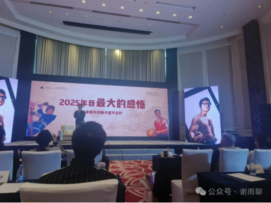
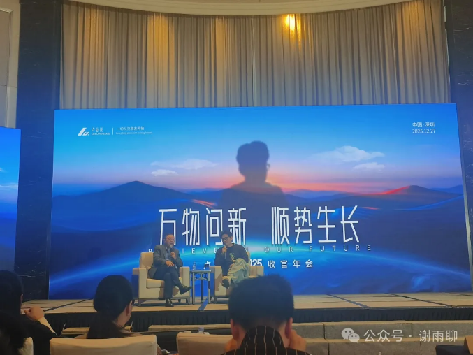

# 有钱人的烦恼——卢总的年会演讲治好了我的精神内耗

自媒体平台上有一位博主叫“卢总说”，此人是一位从业二十年的职业金融人，首位中国籍FOF经理，其粉丝和付费圈圈友多是金融从业者和各行各业的老板、富二代。为了扩大见闻，我吃了1个月稀饭，凑了2000多块钱，参加了卢总说的年终年会。卢总的演讲主题是《万物问新，顺势生长》。但在我看来，这个主题要是改成《有钱人的烦恼》会更合适，作为一个普通人，听了卢总的演讲大开眼界，收获满满，通过了解有钱人的烦恼相对地提高了自己的幸福感，某种程度上也治好了我的精神内耗。

那么有钱人都有什么烦恼呢？

## 首先就是健康问题和年龄焦虑。

卢总演讲的第一页PPT，就是“2025年我最大的感悟，身体不好脑子就不会好”，他也不止一次地提到自己已经40多岁了，有时候会有年龄焦虑，会怕老。所以他非常执着地加强锻炼，效果也不错，一身腱子肉藏都藏不住。他的视频风格就是眯眯眼和扮丑。眯眯眼是真的，卢总讲话的时候眼睛确实睁不开，但是卢总的颜值其实非常高，很符合大众审美。

卢总说他有个朋友，是早期加入小圈子的老板，身家8位数，很年轻，40岁左右。这位朋友去年消失了一年，后来才知道是生病了，整整治疗了一年，所幸是治好了。从中也可以看出，对有钱人来说，健康问题是为数不多的重大风险。

## 其次就是资金安全问题和破产风险

可能是大环境的原因，有钱人普遍比较谨慎，卢总的演讲也反复强调风险和资金安全。他说“没有人能一直赢”，要在自己的业务线之外，发展自己的后手线，哪怕后手线的资金回报率不及自己的主业。因为世事无常，现在再好的业务，如果遇到无法预知的风险，都会变得不再赚钱，甚至亏钱。据说，李嘉诚的公开财富只是他所有财富的一半，就是因为他留了太多后手。而且就算是公开财富，李嘉诚的资产也足够分散了。这就是有钱人的抗风险意识。

卢总还说，很多有钱人都是德不配位的，如果这些人不反思自己并改正过去的观念和行为，资产终究会回落到他们匹配的认知水平。卢总说他喜欢唱歌，以前跟房地产老板唱，后来跟互联网老板唱，再后来跟跨境老板唱，台上的大哥人来人往，能够长久活下来的太少太少了。“所有杀死你的，都是你没有预期的事。”“最大的风险，就是不知道自己不够行”，所以能够长久富下去的老板，都是有敬畏之心的人。

总之，对于资金量比较小的老板来说，他们一般能够接受高风险，因为他在进入富人圈子之前，必须首先积累一定的资金量，而要达到这个资金量，必须做利润率高的生意，也就是做风险大的生意；但对于卢总及其受众来说，他们的资金量已经很大了，他们思考问题就会首先考虑到风险，考虑不确定性。

## 然后才是投资和财富增值问题。

这也是有钱人关注的问题。不过就算是投资，他们也首先考虑风险。总体上卢总看好明年的A股市场，但他不会买某个公司的股票，而是偏向于购买金融产品，让专业的人决定买哪些股票。卢总之后还邀请了何华博士（九轶投资创始人）演讲，何华提到要资产全球化配置，A股可以投，美股也不错，金银铜这样的大宗商品期货也很有投资价值，但他强调投资多样化，不要把鸡蛋放到一个篮子里，这本质上也是防范风险，哪怕有些项目亏了，至少其他项目会对冲，抵消掉损失，实现总体上的资产增值。

## 最后就是幸福问题。

大部分有钱人都并不幸福。卢总说，像他们这样的人，食欲物欲性欲都是被过度满足的，阈值变得特别高，而最理想的幸福状态，就是同时拥有极高的财富和极低的阈值，当然，这是很难做到的。有钱人总是会有一种虚无感，就是觉得什么都没意思，因为什么都体验过了。

卢总那位生病的朋友说，“极致的痛苦能够重置阈值”，他在生病的时候想通了很多事，变得更通透了。所以有时候可以人为制造一下匮乏感，比如故意饿一段时间，这样吃碗面条都比平时吃山珍海味更香。

我的很多同龄朋友都处于事业刚起步的阶段，对我们来说，缺钱可以说是最大的烦恼，有钱可以解决绝大部分的烦恼。然而听了卢总的演讲，我发现人的需求是无止境的，赚钱也是没有尽头的，不断面临挑战才是人生的常态，最好的品质应该是苦中作乐，享受人生奋斗的过程。古代有很多安贫乐道的圣人君子，比如“一箪食，一瓢饮，在陋巷，人不堪其忧，回也不改其乐”的颜回，比如“以中有足乐者，不知口体之奉不若人也”的宋濂，他们的人生态度也许才是我们这个时代最应该学习的东西。

> 转换说明：配图：第1–2幅暂沿用现图（指定资料目录未找到可靠且质量更好的无水印原件）。
