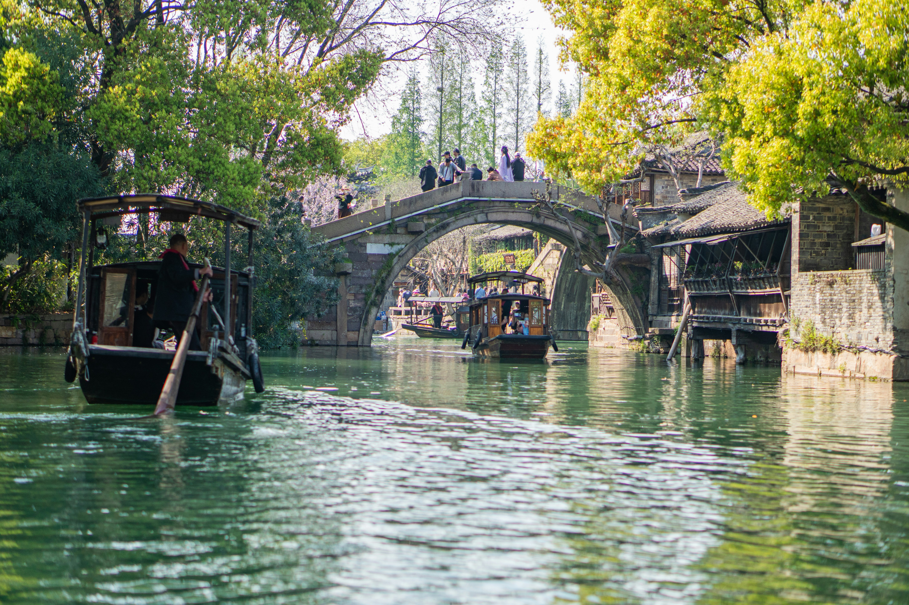
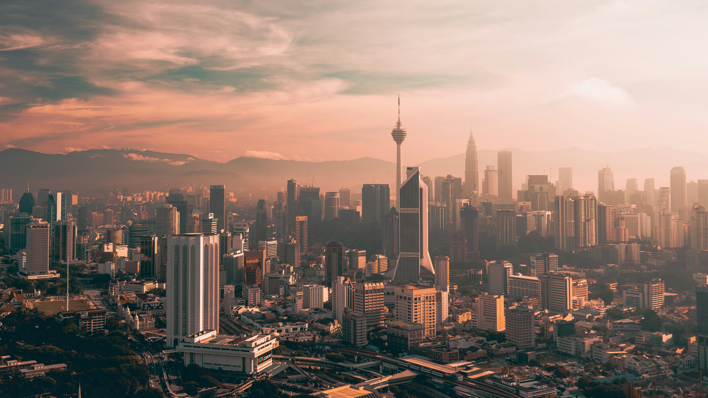

# 气候对一个人的身体影响能有多大？

气候对身体的影响很大，下面我用亲身经历说明。

虽然我是四川人，小时候又在浙江长大，但长江流域的气候并不适合我。

小时候每到冬天，我都会生冻疮，入冬时两只手开始长小痘痘，非常痒，总忍不住去抓。一开始只是一两个，之后越来越多。过几天这些痘痘连成一片，变得通红、肿大。随着天气变冷，肿大的手指开始溃烂、流脓，最严重的时候，连作业都没法写了，一直要到冬季后期才好转。所以长冻疮是我印象深刻的童年记忆之一。

我从小又有鼻炎，永远有一个鼻孔是堵着的，鼻涕也总擦不干净，只要稍有感冒，就会非常痛苦，晚上压根没法睡觉。似乎也曾去医院看过，但最终没有根除，鼻炎就这样一直常伴于我了。

大学到了北京，我真心感觉气候更宜人了。一方面是鼻炎不再那样严重，另一方面是冬天湿度低且有暖气，体感上没有那么冷，更没有再生过冻疮。但同时出现了两个问题，一是流鼻血的频率增加了，多的时候甚至一个月流四五次；二是体重增加，从大一时期的120斤到大四时期的160斤。

当然，体重增加的主要原因是缺少锻炼以及热量摄入过多，但我们先不管，现在聚焦其中的气候因素。

去年年底，我到了广东，以上问题都有不同程度的好转：鼻炎没了，鼻血少了，体重减轻了，腰围减少了。但是当时并没有特别注意到这些变化。

今年过年回四川，我才感受到巨大的变化。才到四川没两天，就感觉眼睛痒、喉咙痛，总是忍不住咳嗽、揉眼睛，而且几乎每天都流鼻血，到了不得不去医院的地步。

去了医院，医生听我陈述，看了我一眼，说我是过敏性鼻炎。她说这个季节太多这样的病人了，大多是花粉过敏，如果不管，就要等到5月份才会自然好转。她开了抗炎和抗组胺的药，用了以后确实有效果，但也只能算是缓解。几天后，我带着药去深圳，谁想一到广东，鼻炎就自动好了，那些药再也没用过。这时我才真正意识到气候对身体的重要影响

去年十月底到今年四月，我大部分时间在东莞和深圳，正好体验了岭南更舒适的冬半年。四月底，我到了吉隆坡，这是我第一次出国，也是第一次体验到热带雨林气候。吉隆坡几乎没有季节变化，全年高温多雨，每天的气温都在28-33度的区间上下波动，平均两天左右下一次雨，而且是典型的对流雨，都是在午后或傍晚下，通常不会太久。风雨送凉，所以总体来说吉隆坡的体感温度很舒适。

到吉隆坡以后，我的身体延续了广东时期的状态，而且体重稳定在了151斤左右，大概是到了热带地区，人的食欲也不自觉地下降了。

现在唯一的问题就是，我发现我的胡子长得更快了。有朋友说，在热带新陈代谢加快，胡子和指甲都长得更快了，人的寿命也会减少，可能每在热带过一年，就要少活几天。不过考虑到新加坡和吉隆坡的气候几乎一样，而新加坡的人均寿命超过80岁，在全球排进前五，可见高温对寿命的影响，权重没有那么高。

总结而言，岭南和吉隆坡的气候我最为适应，北京其次，浙江和四川最差。每个人的具体情况不同，适应的气候也不同。适宜的气候可以改善人的身心状态，大家平时出差、旅游可以留意一下这个因素。
