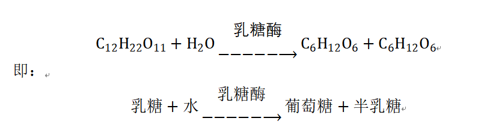
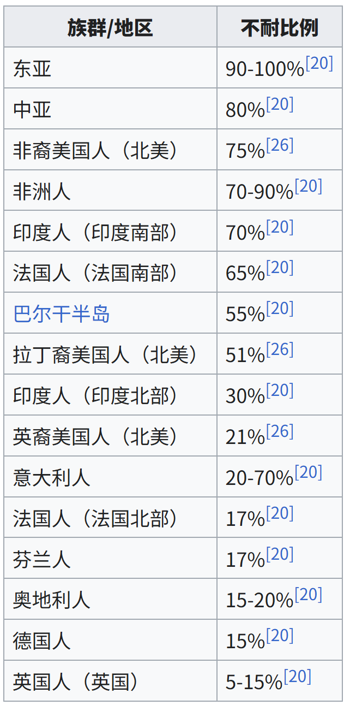
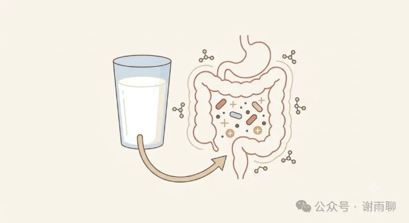
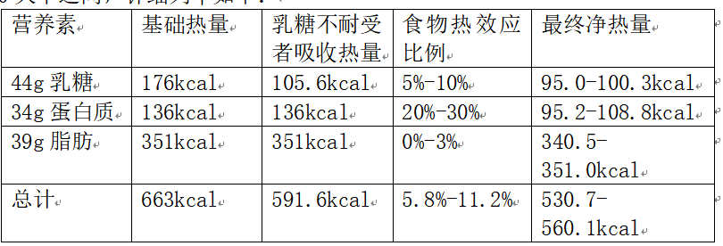
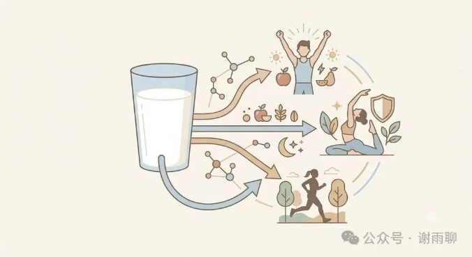

# 乳糖不耐受者更应该多喝牛奶

超过95%的中国人乳糖不耐受，过多食用乳制品会出现腹泻、胀气等症状。但我最近发现乳糖不耐受者喝牛奶也会有一些意想不到的好处。以下是论证。

## 一、乳糖的正常消化吸收过程

乳糖是一种双糖，双糖无法被人体直接吸收利用，所以在吸收之前必须经过一定的化学反应将其分解成单糖。乳糖在自然条件下本身也能分解，但速度极慢，而小肠中的乳糖酶会加速这一过程，使其瞬间分解成葡萄糖和半乳糖，吸收到血液中，进入全身循环。其化学反应式如下：

人类幼崽小肠内具有充足的乳糖酶，可以高效分解乳糖，不必担心消化不良。但成年以后，体内的乳糖酶合成数量会大幅度下降，造成乳糖不耐受。大约几千年或上万年前，部分人类第二号染色体上MCM6基因某个点位发生变突变，使其具备了成年后继续大量合成乳糖酶的能力。这种基因突变主要发生在欧洲。因此，成人乳糖不耐受才是人类的常态，耐受反而是例外。

## 二、不耐受者的乳糖代谢过程

乳糖不耐受者仍然可以喝牛奶，除了小肠内尚有部分乳糖酶可以加速分解乳糖以外，最重要的分解方式就是依靠大肠内的肠道菌群。肠道菌群种类很多，代谢乳糖的过程也很复杂，大体有四个阶段：

阶段一，部分益生菌，例如双歧杆菌和乳杆菌，将乳糖分解为葡萄糖和半乳糖作为自己的能量来源。

阶段二，细菌将切开的葡萄糖和半乳糖吸收进自己体内，代谢产生乳酸、乙酸等物质。

阶段三，产丁酸菌（如普拉梭菌）利用上一阶段产生的乳酸和乙酸，进一步代谢产生丁酸和丙酸，并释放二氧化碳、氢气等气体。

阶段四，部分耗氢菌消耗氢气，产生甲烷、硫化氢等气体。

可见，乳糖代谢产生的物质主要有两类，一类是乳酸、乙酸、丁酸等有机酸，另一类则是二氧化碳、氢气、甲烷等无色无味的气体。假设大肠中有硫化物，则也会在某些微生物的作用下和氢气结合产生硫化氢。硫化氢是有臭味的。

乳糖不耐受者食用牛奶，乳糖进入大肠，一方面增加大肠渗透压而吸收大量水分，另一方面肠道菌群代谢乳糖产生大量气体，这些快速增加的水和气体就是乳糖不耐受者胀气、腹泻的主要原因。

也正是基于这个原理，如果不断改善肠道菌群，并且遵循少量、多次、不空腹、循序渐进的饮用原则，乳糖不耐受者也可以大量喝奶。以本人为例，我是典型的乳糖不耐受者，有基因检测为证。我曾经也没少因为喝牛奶而腹泻，而现在，通过上述方法，我已经可以每天喝1升牛奶而没有任何副作用，实现了牛奶自由。

## 三、乳糖不耐受者喝牛奶的好处

牛奶富含蛋白质、钙、维生素等多种宏量及微量营养素，是廉价而优质的食品，权威医生和营养师都大力推荐。但这些营养洋人与我们共有之，算不上额外的好处。通过研究上述乳糖的代谢过程，我认为乳糖不耐受者喝牛奶有以下两个额外的好处：

### 1减少热量摄入。

对乳糖耐受者来说，所有乳糖都在小肠分解，全部被人体吸收并转化为热量。而对于乳糖不耐受者来说，乳糖在大肠被微生物分解，很大部分为微生物提供了热量，人体只吸收它们吃剩下的乙酸等物质。所以，喝同样数量的牛奶，乳糖不耐受者事实上吸收了更少的热量，有利于减肥。

以我现在喝的牛奶为例，1升牛奶有44g乳糖，贡献176大卡热量；有34g蛋白质，贡献136大卡热量；有39g脂肪，贡献351大卡热量。一共663大卡。乳糖不耐受者吸收乳糖的热量的效率大概是60%，也就是105.6大卡左右，少吸收了70.4大卡，总热量为592.6大卡。如果腹泻，或喝脱脂牛奶，则吸收更少。牛奶蛋白质含量高，如果再考虑到食物热效应，则净热量摄入大概在530-560大卡之间，详细列举如下：

此外，由于乳糖不耐受者只能少量多次饮用牛奶，肠道菌群代谢产生的乙酸、丙酸、丁酸等短链脂肪酸又不会直接升高血糖，所以不会出现血糖剧烈波动的情况，也就不会导致饭量突然增大。这样一来，1升牛奶在实际体验中很有饱腹感，营养也丰富，可以减少其他食物的摄入。因此，喝同样剂量的牛奶，乳糖不耐受者能被动打折少吸收热量；如果换成脱脂牛奶，热量优势和高饱腹感会更加明显。

### 2优化肠道菌群，促进肠道健康

膳食纤维并不能被人体直接吸收，它之所以不可或缺，就是因为其有利于益生菌生长。而进入大肠的乳糖实际上也起到了这样的作用，给益生菌提供了食物。尤其是乳糖有利于增加双歧杆菌和乳杆菌的数量，这两种黄金益生菌可以从多个方面优化肠道菌群，从而促进肠道健康和全身健康。

首先，双歧杆菌和乳杆菌可以有效抑制致病菌，它们数量多了以后，就可以牢牢附着在肠道上，形成生物屏障，抢占空间和营养，使大肠杆菌、沙门氏菌、金黄色葡萄球菌等外来致病菌无处安身。另外，它们代谢产生的乳酸、乙酸等物质可以维持肠道的酸性环境，从而抑制大多数喜碱和喜中性环境的有害菌。有害菌减少，有益菌交叉喂养，有利于形成一个复杂而有益的肠道菌群。

其次，细菌代谢乳糖产生的丁酸是大肠上皮细胞的主要来源，可以修复和强化肠道粘膜，可防止肠漏。代谢产生的丙酸会被运送到肝脏参与糖异生，这有利于维持人体血糖稳定和代谢健康，增强饱腹感。代谢产生的乙酸为全身供能，但不引起血糖升高。

肠道菌群和肠道激素的运作是很复杂的，除了以上好处，肠道菌群的健康还有利于促进营养吸收、合成必须维生素、降低胆固醇、减少毒素吸收、抗炎等多种作用。

总之，对于乳糖不耐受者来说，乳糖分解代谢不得不依靠肠道菌群，这样一方面改变了吸收热量的方式，减少了总热量的摄入；另一方面则为肠道益生菌提供了食物，从而改善肠道菌群，促进整体的身体健康。
