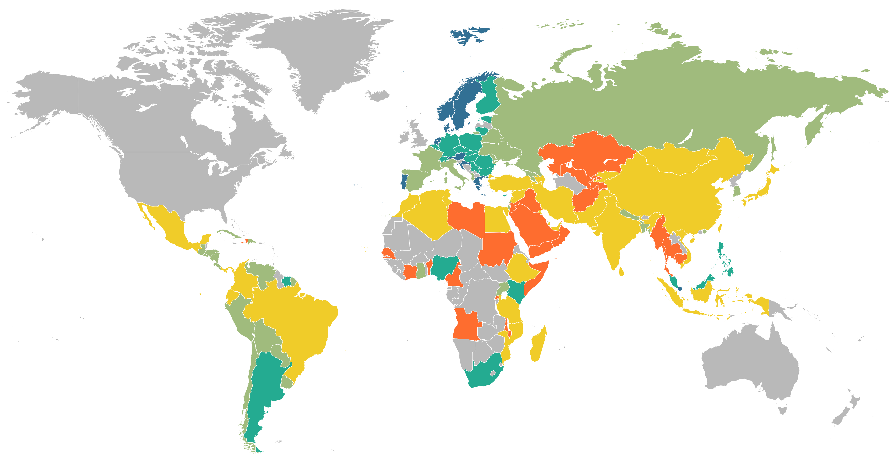
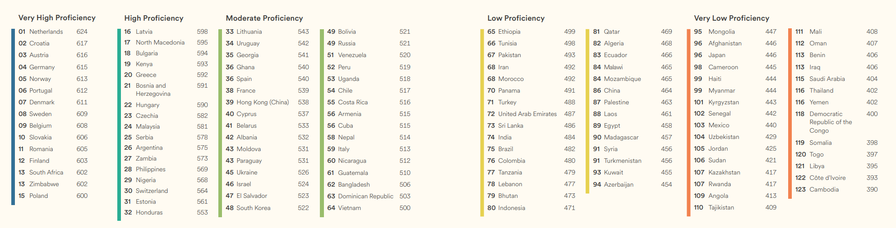

# 从大马华人到新加坡的“母语陷阱”：降级英语主科地位，真的不可接受吗？

很多中国的青年才俊文科和理工科都很优秀，唯独英语死活学不好。以我自己为例，我在中学时期几乎40%的时间都在学习英语，最后也就勉强考了个131分，而我的数学没花太多时间，仅仅靠上课和简单的研究、练习，就考了143分。大学我选了英语专业，想挑战一下自己的软肋，但是专业并没有提高我对英语的兴趣，因此成绩一直很差，水平刚好足够毕业而已。

今年四月，我来到马来西亚留学，对马来西亚的社会有了更多了解。我发现马来西亚华人普遍至少会3种语言：华语（普通话）、英语和马来语，有些还会说粤语、闽南语或客家话。同样的种族，大马华人人均语言天才，中国大陆则是人均哑巴英语，真是令人羡慕。

我认为这种差异主要是社会环境的问题。马来语是马来西亚的官方语言，是所有国民必学的；英语是广泛使用的第二语言；华语不具备任何法律地位，但在华人群体中广泛使用。建国后马来西亚政府推行同化导向的教育政策，企图将华文学校改制，大马华人经过长期抗争与民间筹资，才保住了华文独立中学的血脉。在这样的社会环境下，大马华人在家里说华语，在和政府、其他族群打交道则必须说马来语，和外国人交流用英语，在学校则三种语言都说（独中有华语课，文科多是马来语授课，理工科多是英语授课）。经常使用，自然都能说一些。

现在想来，语言最重要的还是环境，在环境中多听多使用就能很容易掌握。比如马来西亚有很多外来劳工，印尼、缅甸、越南、尼泊尔都很多，除了印尼人本身语言和马来语互通以外，其他国家基本既不会说英语也不会说马来语。但这些人在马来西亚工作一段时间后，基本都能说。比如我认识一位缅甸人，他在酒店当学徒，有时候跟他师傅（酒店主厨，华人）出去做一些装修的生意。这位缅甸人没有文化，但马来语已经很流利了，英语则足够和我进行简单的交流，华语只要是跟他自己工作有关的都能听懂。有时我们去饭店吃饭，只要是中餐厅，里面的缅甸员工基本都会几句常用的华语。

和缅甸人相比，和大马华人相比，我们在英语学习上付出了更多的时间、精力和金钱，但成效甚微。所以有时候我们对中国的英语教育颇有微词，也是可以理解的。这次胡锡进和汤家凤争论是否取消英语的主科地位，我感情上是支持汤老师的。

不过大家也不要自卑，中国大陆的总体英语水平其实并不比中国台湾、韩国和日本差。有一个评估非母语国家英语水平的指数，叫EF EPI（英孚英语熟练度指数）。在历年的排名中，欧洲国家名列前茅，几乎霸占了榜单的前半部分。在亚洲国家中，新加坡、菲律宾、马来西亚、香港和韩国靠前。但是韩国、中国台湾、中国大陆和日本排名都比较接近。韩国好很多，大陆和台湾差不多，日本最差。

在最新的2025年榜单中，新加坡被列入英语母语国家，因此不被计入排名，马来西亚的分数超过菲律宾成为亚洲第一，中国的排名大幅下降，中国台湾没有被计入，据说是数据不够，日本则依旧拉跨。具体数据详见下图。

还有一点也能让我们安慰一下。那就是大马华人虽然会多种语言，但一部分没受过完整华文教育或离开学校较久的大马华人，对中华历史文化常识的了解相对有限。有一次我打车和一位华人司机聊天，他说他爷爷是从海南过来的，于是我提了一嘴海瑞就是海南人，他说不知道海瑞是谁。于是我跟他聊苏轼被贬海南的故事，给他讲“日啖荔枝三百颗”的诗句（当然必须指出这首诗其实写于惠州，这里只是延伸），毕竟苏轼还是很有名的。但我说了半天，他竟然一脸茫然，原来他只是会说汉语，古诗文和中华文化常识基本没啥涉及。

当然，这可能与职业和年龄有关，也许年轻一代的大马华人会学得多些，毕竟马来西亚具有中国大陆和台湾外，最完备的华文教育体系，他们的水平比泰国和印尼的华人高到不知道哪里去了（这两个国家的华人都和当地人同化了）。

相比之下，新加坡华人的汉语水平才更是问题。前段时间新加坡前总理李显龙还专门讲了这件事，他说现在70%以上的华裔家庭把英语作为主要交流语言，远高于20年前的40%。现在大部分华裔事实上母语就是英语，对华语能听懂，但说得不流利，词汇量严重不足，更缺乏书写和深度交流的能力。

综合以上种种，我并不觉得取消英语主科地位会有什么严重的后果，强制学也不见得会学得更好，取消也不影响以后自己学。相反，适当降低英语地位倒是说不定有利于解放中国青年的负担，减少时间浪费，让他们在最适合学英语的时候自己学习。另外，过分强调英语的地位确实不利于中国自己独立自主的科学和文化发展研究，新加坡殷鉴不远。

我的意见仅供参考，我也没有对各国有什么批评的意思，毕竟各国都各国的国情。但是我认为大家热切讨论这个问题本身就是一种进步：英语当然重要，但降低英语地位并非不能讨论的事情，有些人一说到要取消英语的主科地位就激动，这反而让我感到莫名其妙。
