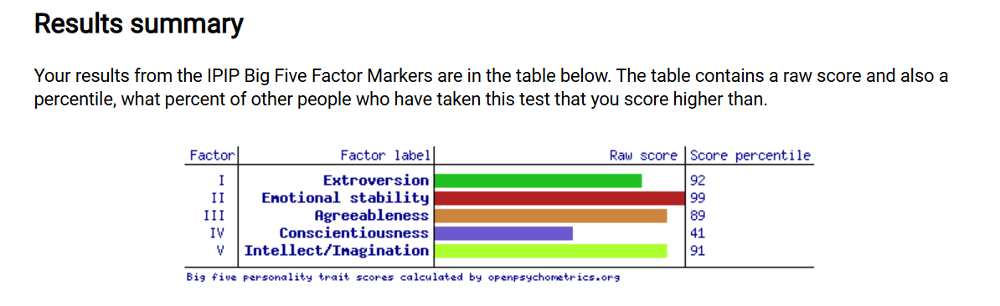
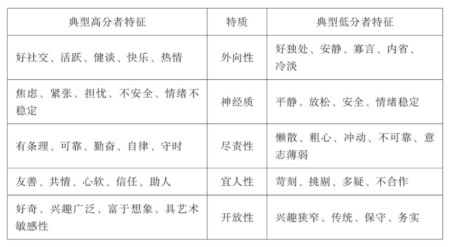

# 本人的大五人格测试结果和分析

## 一 大五人格简介及测试结果

大五人格模型（Big Five）被心理学界公认为目前对于个体基本特质最全面、最可靠、最有效的描述，在大量实证研究中脱颖而出，并得到广泛应用。它将人格特质分为五个方面：外向性、神经质、宜人性、尽责性和开放性。其中，神经质性的反面是情绪稳定性，很多测试偏好以此为正极。

和MBTI、星座、塔罗等测试相比，大五人格测试缺乏社交属性，但可靠性更强，大家可以根据测试结果更好地认识自己，并且扬长避短，为未来的学业、事业、感情提供指导。

本人的测试结果如下：

外向性：92分

稳定性：99分

宜人性：89分

尽责性：41分

开放性：91分

可见我的尽责性低于平均水平，其他指标则分数较高。以下是分析，写给自己，也供大家参考。

## 二 外向性：92分

尽管在外向性上得了高分，但我并不认为自己沉溺于社交、聚会，我更喜欢一个人思考一些问题，并且享受阅读和写作，喜欢打单机游戏而不是网络游戏。但是我不排斥社交，喜欢凑热闹。和人相处，我以倾听为主，熟悉以后，才会健谈起来，喜欢聊一些天马行空的事，比如科学问题、历史故事、新奇理论，但是很少聊当下具体的事。由于能力出众，饱读诗书，我在大多数时候都自信开朗。唯独遇到好看的女生，产生邪念，就会影响会发挥，变得拘谨内向起来。

由于有过主持演讲，以及校园、公司的组织管理经历，我从来不怯场，哪怕再陌生的环境，也能迅速镇静下来，融入其中。当有人把我推到舞台中心时，我也绝不会让大家扫兴。这些也都是高外向性的表现。

来马来西亚后我的外向性应该也进一步增加了，一方面是国外的社会氛围没有国内那样压抑，也能接触很多乐观开朗的陌生人；另一方面是少了很多社会压力，在这没人认识我，哪怕出丑也不影响我在国内的形象。

## 三 稳定性：99分

我的神经系统确实对外界的负面刺激敏感度极低，遇到危机时，我会迅速跳过情绪宣泄，进入理性分析模式。不用测也知道，我的血清素基线较高，压力应激下皮质醇分泌偏低，因此不内耗，不抑郁，遇到打击不会沮丧。

在人际交往中，我几乎不会被冒犯，更不会被激怒，所以很多情商低的人也愿意和我做朋友。我还有“闻过则喜”的优点，当别人批评我的时候，只要是有道理，我都会欣然接受；哪怕是求全之毁，我也会庆幸自己能听到真话。

缺点有两方面。一是对生活中的危机意识不够，容易在流程问题、文件问题上有所疏忽，对很多问题不够重视，影响事情进度。二是钝感太强，容易忽视别人的心理健康，比如同样的事情我可能觉得根本不算事，但其他人可能会介意，所以我也容易因为一些无心之言伤害别人的感情。

## 四 宜人性：89分

高宜人性意味着我待人体贴、周到、富有同情心，经常帮助别人并且乐在其中，愿意把人往好的方面想，人缘很好，积极情绪更多，生活满意度更高。

但是有研究指出，高宜人性不适合职场发展，一是价值观上对世俗的成功没有太多执念，二是经常被他人的事情耗尽心力，反而容易忽略自身的发展提高，所以平均工资往往低于低宜人性的人群。

## 五 尽责性：41分

我的尽责性处于中低水平，说明我总体上比较自由散漫，没有那么自律、恪尽职守（但也没有极端到无药可救的地步）。一个很重要的表现就是我很难严格执行自己的计划，也容易作息混乱，而且不以为耻。高尽责性是现代职业成功的最佳预测指标，很不幸我没有这个品质，这意味着我更难获得职场上的成功。

此外，根据研究，高尽责性和长寿具有显著的正相关，这意味着如果我能够提高尽责性，我的健康状况会更好一些，寿命也可能进一步延长。

中低尽责性也有一些好处，比如我随遇而安，能够拥抱生活的变化，也没有“完美主义”带来的心理包袱，也就不容易焦虑。

但是总体来说，我希望能够稍稍提高一些我的尽责性，大概提高到55%-60%，这样可以提升一些我的寿命，也有利于我在职场获得更大成绩。当然，性格是人类心理比较稳定的因素，改起来会比较缓慢。

## 六 开放性：91分

高开放性意味着我愿意尝试新事物，热衷于学习新知识，获得新体验。据研究，这样的特性有利于延缓老年期的智力衰退。

在政治和宗教观点上，我也非常宽容。我虽然自己不支持保守主义，但欣赏他们的热情；我不信仰宗教，但热衷于学习宗教知识。

（图源：王芳《我们何以不同：人格心理学40讲》）

## 七 我适合的工作

基于“高稳定性+高开放+高外向+高宜人+中低尽责”的离群组合，我更适合担任愿景引导者、战略制定者与资源连接者，而非微观守成者：

### 1 战略破局和宏观规划类

模式：需要从混沌或新事物中寻找规律、制定宏观战略、画路线图，但不负责日复一日的具体微观落地。

商业分析与战略发展

企业战略顾问

智库/政策研究员

创业公司CEO/联合创始人

### 2 资源整合和高阶撮合类

依赖极强的亲和力、同理心与沟通感染力去建立信任，拉动多方资源、达成共识或搞定复杂客户。

风险投资投资经理

跨国NGO/国际组织项目发起人

高端谈判代表

公关与媒介传播总监

### 3 思想传播与启发带头类

将复杂的概念/理论转化为有吸引力的语言，去教育、启发、带头或影响他人。

大学讲师/高校学者

纪录片导演/智库播客主

高管教练/组织心理顾问

教育创新项目负责人

## 八 我适合的伴侣

必须要求：高尽责，这样有人监督提醒，才能形成互补。如果找低尽责，两个人都很散漫，就容易一起摆烂，日子会过得一塌糊涂。

可选要求：高开放，高宜人，这样更投缘，更聊得来，日子也不会太枯燥。但是低一点也没事，因为我的容忍度比较高。

情绪稳定性中高水平即可，但尽量避开情绪太敏感的，因为如果两人对事情的敏感程度不一样，容易造成对方内耗。

内向外向则各有千秋。不做期望。

## 九 需要注意的健康问题

1. 中低尽责性让我作息和饮食随机，给肝脏和肠道菌群带来额外负担。依从性差容易导致我缺乏定期体检，不严格遵循医嘱，容易漏服药，疗程未满而擅自停药。

2. 高情绪稳定性导致我对身体的小毛病缺乏重视，可能将小问题拖成大病。

3. 高开放高外向意味着我的社会活动更多，虽然我不抽烟，极少喝酒，但高兴的时候，氛围一到，一年也难免会有几次大醉而归，这就非常损害健康了。

## 十 参考资料

Goldberg, L. R. (1992). The development of markers for the Big Five factor structure. Psychological Assessment, 4(1), 26–42.（International Personality Item Pool, IPIP-BFFM 量表测算依据）

王芳. (2023). 《我们何以不同：人格心理学40讲》. 北京：北京日报出版社. ISBN: 9787547746219.

维基百科条目. 《五大性格特质（Big Five personality traits）》. 检索自：https://zh.wikipedia.org/wiki/五大性格特质

Gemini (Google AI). 大五人格百分位数据解读与神经心理学交叉分析. (2026).

测试链接：https://openpsychometrics.org/
