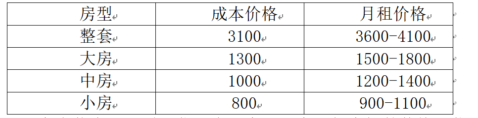
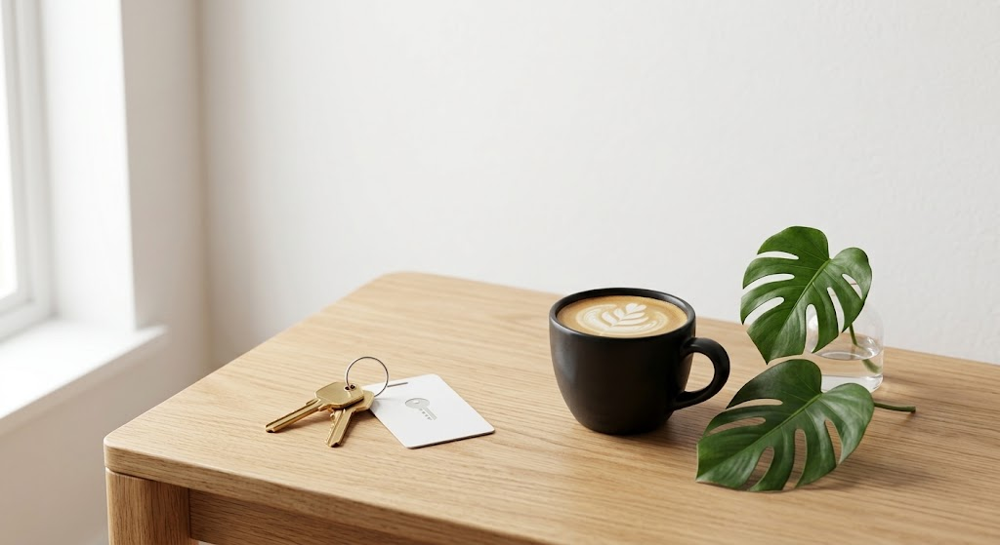

# 把房出租的经验

我和朋友在马来西亚整租了一套三房两卫一厅的房子，跟房东直租，租期一年，一个月3100马币。他有时不在马来西亚，所以经常有空置的房间，我负责空置房间的出租事宜，慢慢摸索出一些经验。经验如下，供大家参考批判：

1 首先是**设置目标**，目标不一样，采用的策略也不一样。比如我的目标一是减轻房租压力，二是交朋友，所以我会对室友的背景调查更重视，价钱倒是可以商量。对我来说，把大房和中房租出去，我每个月只需要花300-800马币的租房成本，这个经济目标对我来说已经很满意了。对二房东和中介来说，他们的目标则是赚取差价，所以更看重营销学和心理学，尽量向房东压价，向租客要价。对一手房东来说，他们则更看重稳定，价格不用太高，但是要尽量保证租客有持续交租的能力，而且要尽量防止租客对房屋破坏。

2 其次要**调查小区房子的市场价**。比如在我们小区，短租整租市场价在3600-4100马币之间，大房市场价是1500-1800马币之间，中房是1200-1400马币之间，小房是900-1100马币之间。暑假稍贵，平时稍便宜。了解市场行情后，自己根据行情和自己房子的状况做一个评估，之后既不要收费太高，也不要收费太低，公道合理的价格对双方都有好处。以我为例，我在调查市场情况后做了一个初步的心理定价表：

3 然后是**发布信息**。这需要你写个文案，文案里把房间的价格、位置、家具、周围设施、优势、对租客的要求写出来。发布到本地微信群和小红书上，附带上房间的照片和视频，文案最好让AI润色，毕竟小红书的文风非常肉麻、情绪化。发布后也不要守株待兔，要关注平台上的求租信息，主动私聊他们，请他们看看你的房源。

4 中介的居间费一般收租金的10%左右，越信息不透明的地方，居间费越高，我第一次出租大房时，房租1800，给了中介300，这个比例其实就高于市场价了。如果我们没有中介，那么我们的价格一定是有优势的，所以要敢于报价。比如大房我想1500租出去，就报价1600，中房想1300租出去，就报价1400，这样可以给对方一点砍价的空间。

5 除了房租本身以外，还有押金、付款方式、水电费、网费等因素，都可以谈，这些也要提前想好策略。比如我们每个月有150的网费，平均到一个房间就是50。有时候房租谈低了，就收网费，房租谈高了，就不收网费，其实这是一个用来调整的变量。再比如水电费，有人觉得麻烦，就可以加50-100块钱全包。

6 一定要**调查租客的背景**，在国外要看对方的护照照片，要了解对方的职业或学校，还要观察对方的性格，有些明显不好相处的，就可以找借口拒绝，以免未来出现更大的麻烦。有条件写一个书面协议，把注意事项写上。

