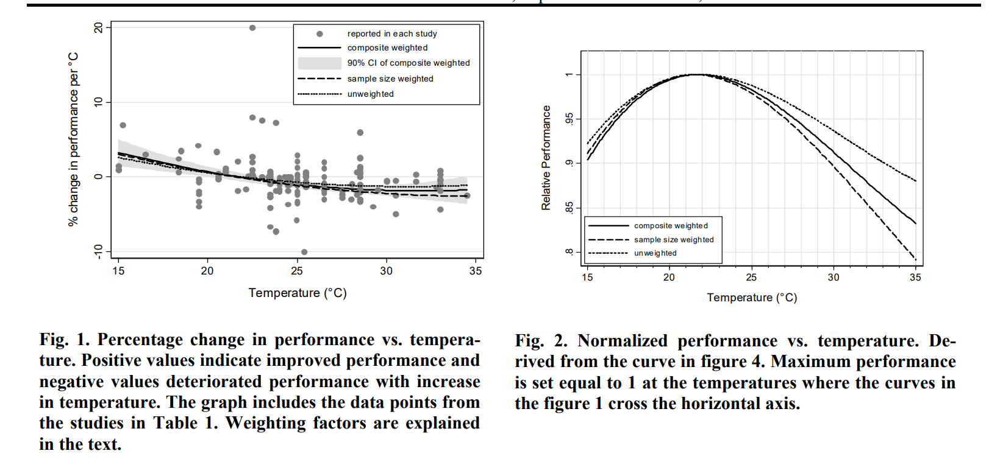

# 工作效率最高的温度区间：21-24度

刚刚看到一篇论文，题目是《Room Temperature and Productivity in Office Work》，研究室内温度和办公室工作效率之间的关系，最终得出结论：人在室内的工作效率最高的温度区间在21-24度之间。

以下是论文摘要：

> 室内温度是室内环境的核心特征之一。根据建筑及其暖通空调（HVAC）系统的不同，室内温度可以实现不同精度的控制。室内温度会影响人类的多项生理与心理反应，包括热舒适度、感知空气质量、病态建筑综合征（SBS）症状以及工作表现。

> 在本研究中，我们重点关注温度对办公室工作表现的影响。我们纳入了那些采用客观性能指标且与办公室类型工作相关的研究，例如文本处理、简单计算（加法、乘法）、电话客服接听时长以及呼叫中心员工处理每个客户的总时长。我们排除了工业生产绩效的研究数据。我们计算了所有研究中温度每升高1°C所对应的绩效变化百分比，并对测得的工作绩效与温度进行了统计分析。

> 结果表明，工作绩效随温度上升而增加，最高可达21-22°C；当温度超过23-24°C时，绩效随温度上升而下降。最高生产力出现在大约22°C左右。例如，在30°C时，工作绩效仅为最大值的91.1%，即绩效下降了8.9%。

此外，作者指出，温度与生产力之间的定量关系可能会因建筑的其他特征、建筑占用者的特征以及工作类型而异。比如，电话客服工作受到的影响比实验室受试者受到的影响更大。比如，实验中通风量保持恒定，但实际生活中低通风量往往与高温同时出现，这容易导致病态建筑综合征以及其他负面影响。

这让我想到我们初中的时候，县城中学条件不是很好，很多教室没有空调，但是夏天气温又高，有时直逼40度。高三基本没有暑假，很多高三的班级会用班费安装空调。现在看来这真是一个明智的决定，因为根据这篇论文的研究结果，室内温度在35的时候，人的工作效率就已经下降到最大值的80%以下了。装空调的性价比是很高的。

国际建筑环境标准（ISO7730）一般建议夏季办公区保持在23-26，冬季建议在20-24。我们日常生活中，室内温度在20-26之间都不用太担心，事实上大部分单位办公室、联合办公区、咖啡厅的室内温度都在这个舒适区范围间。如果在家工作学习，过冷过热则需要考虑开空调，或者改变出门另寻工作地点。为了工作效率，这些成本是值得付出的。

## 参考文献：

Seppänen, O., Fisk, W. J., & Lei, Q. H. (2006). Room Temperature and Productivity in Office Work. Lawrence Berkeley National Laboratory. LBNL-60952.
