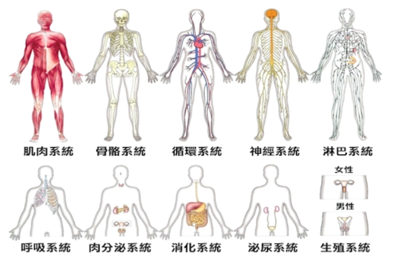
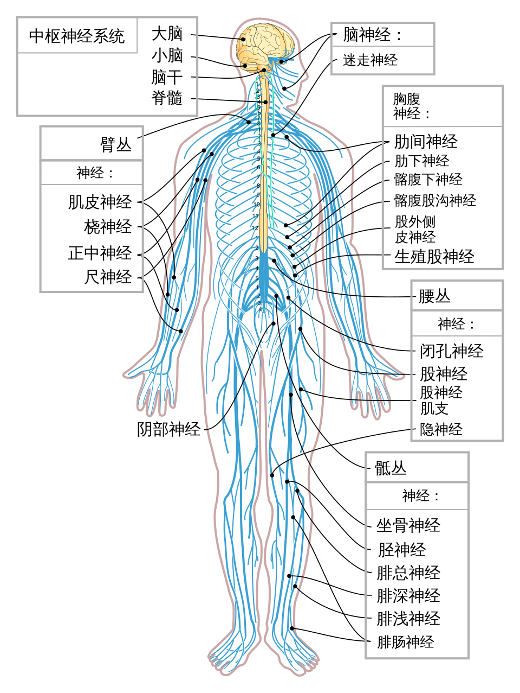
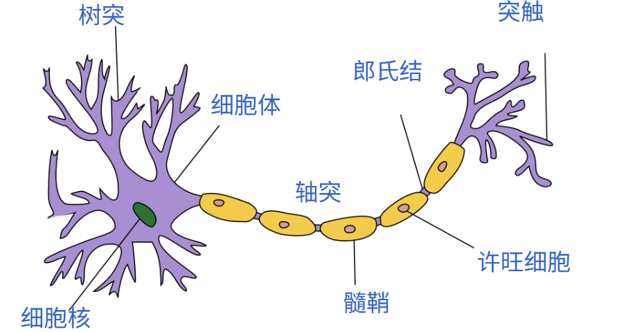
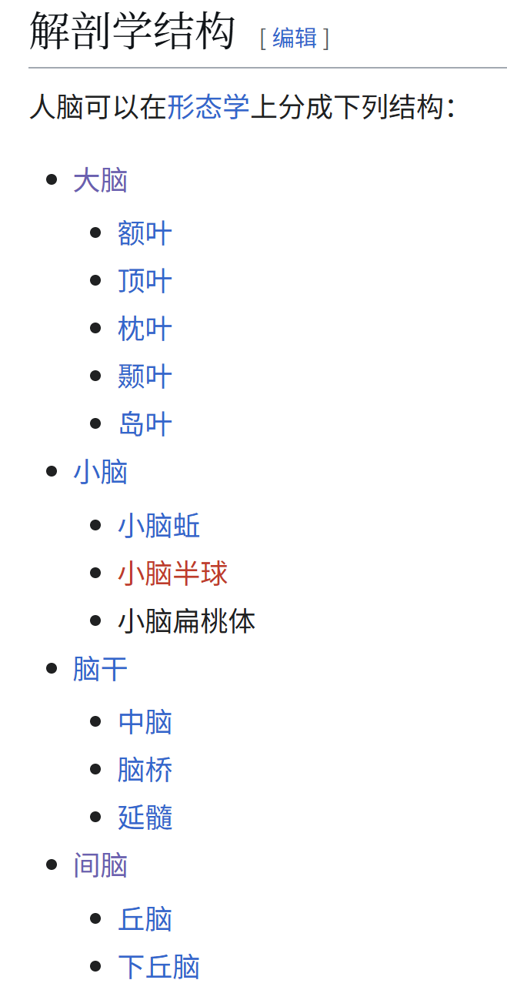
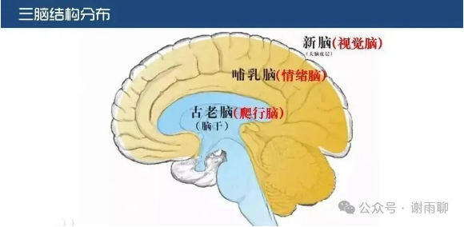
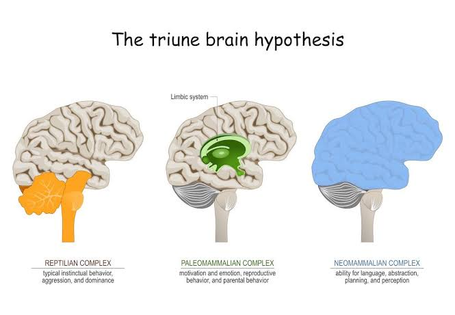
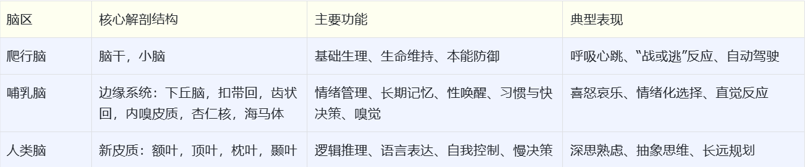

# 脑科学的重要知识点汇总

人的意识、心理，究其本质就是人脑的功能。当我们研究问题的时候，总会涉及脑科学的领域，因此了解一些脑科学的基本知识是很重要的。以下是脑科学的重要知识点汇总，通读一遍并时常翻阅，对我们的学习会有很大的启发。

## 一 什么是脑科学

脑科学其实就是神经科学（Neuroscience），研究对象就是人的神经系统。神经系统是人体系统之一，它控制着肌肉的活动，协调各个组织和器官，建立和接受外来信息，并进行协调。我们感受到外部信息，处理这些信息，控制身体对这些信息做出反应，都靠神经系统。

整体来看，神经系统分为中枢神经系统和周围神经系统，前者包括脑和脊髓，后者包括各种连接中枢神经系统和身体各部位的神经（脑神经、脊神经等）。

从细胞层面看，神经系统由神经元（神经细胞）和神经胶质细胞组成，前者负责传递信号，完成神经系统的功能，后者种类繁多，主要是为神经元提供支持、营养和保护作用。据估计，人脑中约有850-1200亿个神经元，神经胶质细胞的数目与神经元相当或略多。

部分神经出现问题，就会表现为腿麻脚麻；脊髓中间出了问题，就会出现半身不遂；脑子出现问题，可能会导致老年痴呆等症状。当脑子彻底失能，人的意识就没了，在医学上就是脑死亡，基本可以说这个人也死了。

正向来说，当我们说一个人智商高、情商高、博闻强识、见多识广，其实就是说他的某种脑功能比较强。如果我们能有意识地呵护、锻炼自己的大脑，也能让自己更聪明，精神更丰富，人生更幸福。

## 二 脑的结构

脑的结构很复杂，研究也不够全面。下面是从解剖学结构角度对脑的分区：

此外，三元脑是一个重要的脑结构理论模型，并不准确，但却非常实用，它把人脑分为爬行动物脑、哺乳脑（边缘系统）和人类脑（新皮质），越往外层越高级，越往内层越基本，也可以分别理解为本能脑、情绪脑和理智脑。具体分区和功能如下：

## 三 重要的脑分区功能

以下是重要脑分区的功能，并不全面，可用于大家快速检索。

### 1.脑干（Brainstem）

- **所处位置：**位于大脑底部，连接大脑与脊髓，是整个神经系统的“生命中枢”。

- **主要功能：**控制心率、呼吸、血压、体温、消化等生命维持功能，以及调节睡意与警报系统。

- **启发：**脑干的功能绝大多数由“自动驾驶”掌控，无法直接通过意志改变，唯独呼吸是唯一的“控制开关”。额叶运动区与下丘脑共同参与呼吸调节，通过腹式呼吸可以刺激内啡肽与血清素的分泌，是快速平复身体应激反应最直接的物理方法。

### 2.小脑（Cerebellum）

- **所处位置：**位于脑干后方、大脑半球下方。

- **主要功能：**负责保持身体平衡、肌肉协调、运动精准度以及条件反射的形成。

- **启发：**肌肉记忆和熟练的技能操作离不开小脑。当你通过反复练习将一项技能（如打球、骑车）练到“不假思索”时，就是小脑与基底神经节接管了这项任务，释放了前额叶的计算资源。

### 3.杏仁核（Amygdala）

- **所处位置：**位于边缘系统内部，与下丘脑紧密相邻。

- **主要功能：**负责处理恐惧、愤怒、兴奋等强烈情绪，触发“战或逃”（fight or flight）反应；是人类脑、哺乳脑、爬行脑三大区域的交会点与理性感性的“中转站”。

- **启发：**当遇到强烈的恐惧或威胁时，杏仁核会瞬间“劫持”大脑，让整个额叶失去思考能力（即“恐惧让聪明人变白痴”）。杏仁核无法通过纯粹的看书读书来训练，只能通过身临其境的体验与实战。经历过困境并成功应对的经验，是重塑杏仁核反应模式的终身财富。

### 4.下丘脑（Hypothalamus）

- **所处位置：**位于丘脑下方，与杏仁核紧密相邻。

- **主要功能：**调节体温、口渴、饥饿、血压、心率、睡眠生物钟、养育本能及性唤醒；同时参与脑部的奖赏系统。

- **启发：**下丘脑掌控着人体的基本欲望与内环境稳态。通过刻意练习良好的作息与生活习惯，可以有效“训练”下丘脑的反应，让身体的生理节律更加稳定。

### 5.海马体（Hippocampus）

- **所处位置：**位于大脑颞叶内侧，边缘系统的核心区域。

- **主要功能：**负责将工作记忆转化为长期记忆（尤其是情景记忆），并参与空间导航。

- **启发：**海马体是记忆的“转换站”而非“存储库”。情绪波动和深度睡眠对海马体巩固记忆至关重要；充满新鲜感的环境与积极的情绪能显著促进海马体的神经塑性。

### 6.扣带回（Cingulate Gyrus）

- **所处位置：**位于大脑半球内侧面，包裹着胼胝体，属于边缘系统的重要组成部分。

- **主要功能：**参与情感加工、焦虑表达、痛苦感知、自我调节以及负面想象。

- **启发：**女性的扣带回通常比男性更为活跃，这使得她们对情绪和潜在风险更敏感，容易产生焦虑，但同时也具备更强的情绪调节潜在能力。意识到“负面想象”只是扣带回的生理反应，能帮助我们更好地进行正念与自控。

### 7.额叶（Frontal Lobe）

- **所处位置：**位于大脑前半部分，是占比最大的大脑叶区。

- **主要功能：**

前额叶皮质区：计划、分析、判断、专注、自控、社交与抽象思维（人类最晚发育成熟的区域，通常25岁左右才完全成熟）。

布洛卡区（Broca's Area）：负责语言表达，并含有镜像神经元。

前运动区与初级运动皮层：控制躯体运动，连接脑干。

- **启发：**刻意练习的本质，就是用人类脑（前额叶）去训练哺乳脑与爬行脑。由于现代人每天处理海量信息，前额叶极易疲劳，导致自控能力下降。对年轻人多一些包容，因为他们的前额叶尚未发育完全；同时，善用镜像神经元（模仿与身教）来学习，比单纯的理论说教要高效得多。

### 8.顶叶（Parietal Lobe）

- **所处位置：**位于大脑顶部、额叶后方。

- **主要功能：**负责触觉等体感信息整合、空间想象力、抽象能力、数学计算以及动作协调；具有宏观调控和突然顿悟的特点。

- **启发：**顶叶赋予了人类强烈的空间感知与抽象思维能力。当我们在脑海中构思复杂模型或产生“灵光一闪”的顿悟时，往往都有顶叶在背后进行多模态信息的宏观整合。

### 9.颞叶（Temporal Lobe）

- **所处位置：**位于大脑两侧、耳朵上方。

- **主要功能：**

威尔尼克区（Wernicke's Area）：位于颞上回，负责语言理解。

颞中回与颞下回：负责听觉处理、语义捕捉、面部识别（人脸记忆）及长期记忆形成。

- **启发：**人脑对视觉信息的处理能力远大于听觉。单纯“听讲”效率有限，“边说边画”（如费曼学习法）将听觉信息转化为视觉画面，能更高效地激活颞叶与全脑记忆。

### 10.枕叶（Occipital Lobe）

- **所处位置：**位于大脑后下部（后脑勺位置）。

- **主要功能：**专职视觉信息的高级处理与分析，包含初级视觉皮层。

- **启发：**“一图胜千言”有着坚实的神经科学基础。人脑对视觉信息的处理能力极为强大，在学习、沟通或输出知识时，多用图表、思维导图和具象化的画面，能大幅降低大脑的理解门槛并增强记忆。

## 四 大脑的发育

大脑并非在成年后就停止变化，它的发育具有阶段性。

人脑的不同能力在不同年龄“登顶”，麻省理工学院（MIT）和哈佛大学的相关研究显示，大脑的功能并不是在20岁后全面走下坡路，而是在人生的不同阶段各自达到巅峰：

18~19岁：信息处理速度和反应能力达到巅峰。

25岁左右：短时记忆力（工作记忆）达到巅峰。

30岁左右：对陌生面孔的辨识与记忆能力达到巅峰。

40~50岁：理解他人情绪（共情能力）和社会洞察力达到巅峰。

50~60岁：词汇量、综合知识运用及解决复杂现实问题的能力达到巅峰。

尤其需要说明的是，大脑的发育顺序是从后往前推进的，负责情绪控制、长远规划和风险评估的前额叶皮质是最后发育成熟的区域，通常要到25岁左右才能发育成熟。所以有人说：“年轻人容易冲动”，“年轻人脑子没发育成熟”，这些说法都有科学依据。

另外，大脑具有终身具备的神经可塑性（Neuroplasticity），即便成年以后，我们仍然可以让大脑向好的方面发展。每当我们学习新技能、改变思考习惯时，神经元之间就会建立新的连接（突触）。经常使用的神经通路会被“髓鞘化”（就像把乡村小路修成高速公路），反应越来越快；长期不用的连接则会被大脑“剪枝”清除。所以年龄从来不是停止学习的借口，只要给予持续的微刺激与跨界学习，即使到了中老年，大脑依然能够重构网络、保持敏锐。

## 五 提高大脑功能的小方法

正如前文所说，大脑具有终身的神经可塑性。从坏的方面讲，喝酒会永久改变大脑，吸毒会永久改变大脑，抑郁会永久改变大脑，这些都对。但反过来用，我们也可以施加措施，让大脑朝着好的方面改变。以下是一些小方法：

### 1.每周150分钟中等有氧运动

促进脑源性神经营养因子（BDNF）分泌，直接刺激海马体产生新的神经元。

### 2.充足的深度睡眠

激活大脑的“淋巴清除系统”，清理白天代谢产生的废弃蛋白，巩固海马体的长期记忆。

### 3.抗炎饮食（omega3，抗氧化剂，少高糖和加工食品）

减少大脑慢性炎症，保护神经元细胞膜的流动性。

### 4.跨界学习新技能

打破既有思维定式，建立全新的神经元突触连接。

### 5.主动思考与输出（如费曼学习法）

强迫前额叶皮质进行深度信息整合，将信息转化为坚固的长期神经回路。

### 6.训练正念与专注

增加前额叶皮质厚度，降低杏仁核的过度活跃，增强情绪自控力。

### 7.改变日常习惯，进行微刺激

用非惯用手刷牙、走不一样的路线回家，强迫大脑从“自动驾驶模式”切换到“主动感知模式”。

> 转换说明：配图：第5幅暂沿用现图（指定资料目录未找到可靠且质量更好的无水印原件）。
