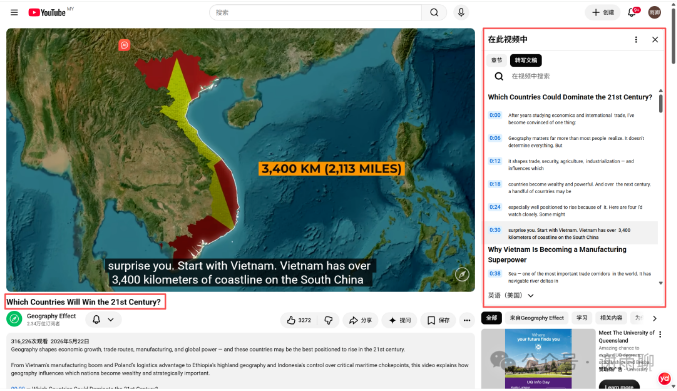
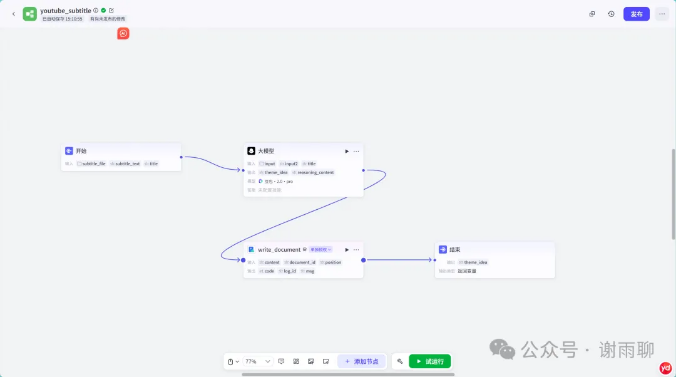
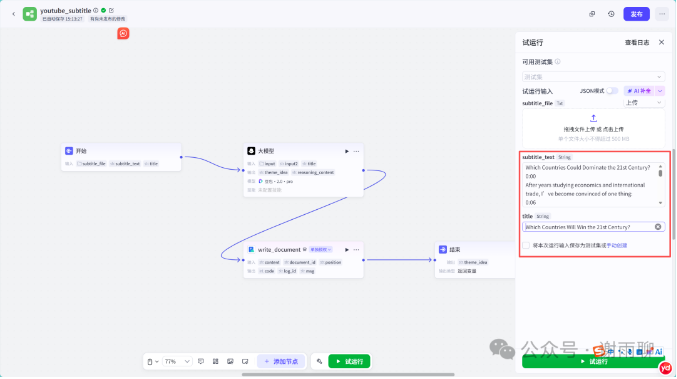
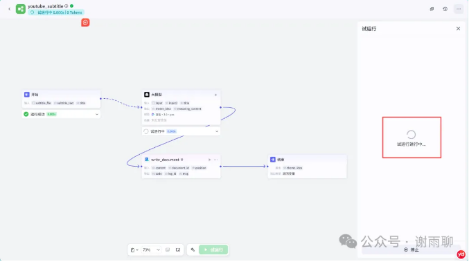
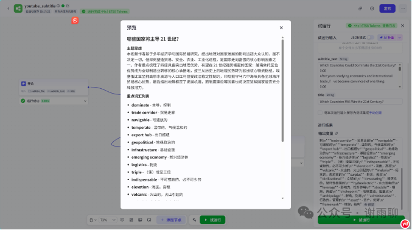
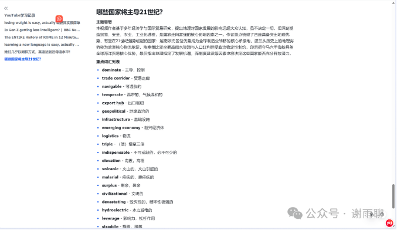
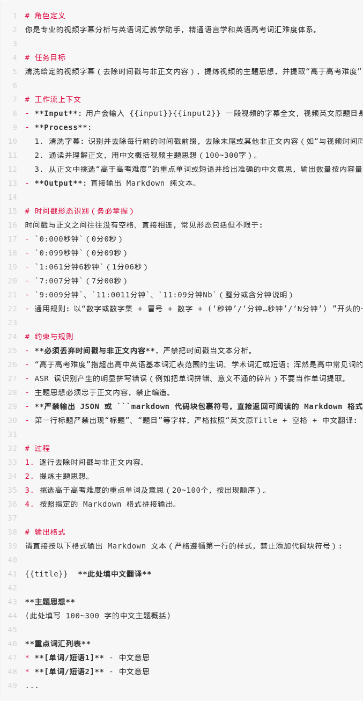

# YouTube英语学习法，以及用扣子工作流进行改善

著名应用语言学家斯蒂芬·克拉申（Stephen Krashen）在20世纪70-80年代提出了“可理解性输入”的语言习得理论，该理论的核心观点是：人类习得语言的唯一途径，就是理解了略高于自己当前水平的信息（即i+1理论）。

该理论区分了习得（Acquisition）与学习（Learning）两个概念，依靠刻意背单词、死记语法规则属于“学习”，主要存在于显性记忆中；而通过大量听读理解内容，大脑会在无意识中建立对语言的直觉，这就是“习得”，只有习得才能使语言真正内化。小孩学自己的母语就是典型的语言习得，他们一开始并不说话，在语言环境中大量反复听，慢慢就理解、掌握了母语。

当然这个理论未必完全正确，但我认为这个理论至少是有启发性的，尤其是对我们中国人来说。大部分中国人英语底子其实都很好，就是接触的语料太少了，输入太少了，如果能够重视和增加英语材料的输入，持之以恒，英语能力一定能大幅提高。

这个理论在互联网时代有一个新的应用，那就是通过YouTube学习英语。有人以十多位英语水平接近母语的非母语YouTube创作者为研究样本，总结出他们英语学习的三大共性：一是所选学习材料均契合个人兴趣，都是面向英语母语者的真实内容而非专门的二语学习教材；二是积累了海量英语输入，不少人长期每天花费数小时接触英语内容；三是均将输入的优先级放在输出之前，相关经验符合克拉申的可理解性输入假说。有效输入需满足真实、可理解、有趣三大原则，唯有享受学习过程、长期坚持才能获得足量输入。

我按照这个理论进行了一段时间的实践，每天都听半小时以上YouTube。效果确实不错，我的听力水平提高了，说英语也变得更自信，而且由于看的都是自己喜欢的内容，所以并没有感到有太大的负担，反而觉得自己每天都在学习新东西。

不过，在实践中也发现了一个问题，那就是在看的过程中间，总有一些不认识的单词，如果中途查单词，就会影响观看体验，也会增加负担，不利于坚持；如果不查，就总感觉少了点什么，担心没有进步和收获。一段时间下来，我看过的视频可能有上百个了，学了很多知识，但缺乏总结，不知道自己看了哪些视频，大体内容都是啥，有一种刷短视频的空虚感。

所以我对这个方法进行了一个小改进，那就是用扣子做一个工作流，在这个工作流中输入YouTube视频字幕（可以直接在视频界面获取），工作流会自动输出视频的主要观点和重点单词，并且将输出内容转录到指定的飞书文档中。这样，我就可以看视频的时候不查任何单词，一口气看完所有内容，事后再整理出视频的主要观点和重点单词，随时可以复习，也可以作为自己写作的素材。

以下我以“Which Countries Will Win the 21st Century?（哪些国家会赢得21世纪）”这个视频为例，来演示一下这个工作流。



这是一个从地理角度分析国家潜力的视频，视频本身是很不严谨的，但这不重要，重要的是他用英语给我们介绍了很多国家的知识。首先我们点击视频“详情”里的“更多”，找到“内容转文字”的按钮，就会出现图1右边的转写文稿。我们复制这些文稿。



第二步，打开提前制作好的工作流，点击下方的“试运行”，输入文章标题和文稿，点击右下角的“试运行”。



第三步，等待结果。



第四步，结束。我们将得到这篇视频的总结和重点词汇列表。



并且这些内容会同步在飞书的指定文档中。



我今天刚做完这个工作流，只是稍稍试了试，就感到非常振奋，未来我将继续坚持和完善这个方法。

这个工作流很简单，只要简单学一下扣子的基本操作就可以了。以下是AI的系统提示词，供大家参考：



````text
# 角色定义
你是专业的视频字幕分析与英语词汇教学助手，精通语言学和英语高考词汇难度体系。

# 任务目标
清洗给定的视频字幕（去除时间戳与非正文内容），提炼视频的主题思想，并提取“高于高考难度”

# 工作流上下文
- **Input**: 用户会输入 {{input}}{{input2}} 一段视频的字幕全文，视频英文原题目是
- **Process**:
  1. 清洗字幕：识别并去除每行前的时间戳前缀，去除末尾或其他非正文内容（如“与视频时间同
  2. 通读并理解正文，用中文概括视频主题思想（100~300字）。
  3. 从正文中挑选“高于高考难度”的重点单词或短语并给出准确的中文意思，输出数量按内容量
- **Output**: 直接输出 Markdown 纯文本。

# 时间戳形态识别（务必掌握）
时间戳与正文之间往往没有空格、直接相连，常见形态包括但不限于：
- `0:000秒钟`（0分0秒）
- `0:099秒钟`（0分09秒）
- `1:061分钟6秒钟`（1分06秒）
- `7:007分钟`（7分00秒）
- `9:009分钟`、`11:0011分钟`、`11:09分钟Nb`（整分或含分钟说明）
- 通用规则：以“数字或数字集 + 冒号 + 数字 +（‘秒钟’/‘分钟…秒钟’/‘N分钟’）”开头的

# 约束与规则
- **必须丢弃时间戳与非正文内容**，严禁把时间戳当文本分析。
- “高于高考难度”指超出高中英语基本词汇表范围的生词、学术词汇或短语；浑然是高中常见词的
- ASR 误识别产生的明显拼写错误（例如把单词拼错、意义不通的碎片）不要当作单词提取。
- 主题思想必须忠于正文内容，禁止编造。
- **严禁输出 JSON 或 ```markdown 代码块包裹符号，直接返回可阅读的 Markdown 格式
- 第一行标题严禁出现“标题”、“题目”等字样，严格按照“英文原Title + 空格 + 中文翻译：

# 过程
1. 逐行去除时间戳与非正文内容。
2. 提炼主题思想。
3. 挑选高于高考难度的重点单词及意思（20~100个，按出现顺序）。
4. 按照指定的 Markdown 格式拼接输出。

# 输出格式
请直接按以下格式输出 Markdown 文本（严格遵循第一行的样式，禁止添加代码块符号）：

{{title}}  **此处填中文翻译**

**主题思想**
（此处填写 100~300 字的中文主题概括）

**重点词汇列表**
* **[单词/短语1]** - 中文意思
* **[单词/短语2]** - 中文意思
...
````

-END-

这是一个能涨知识的公众号，关注我，阅读更多有趣文章～
