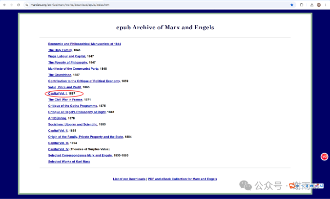
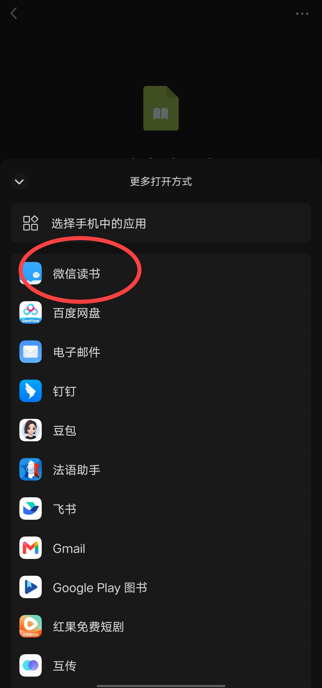
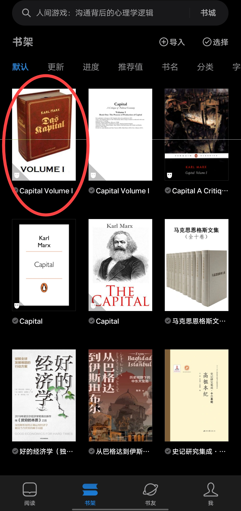
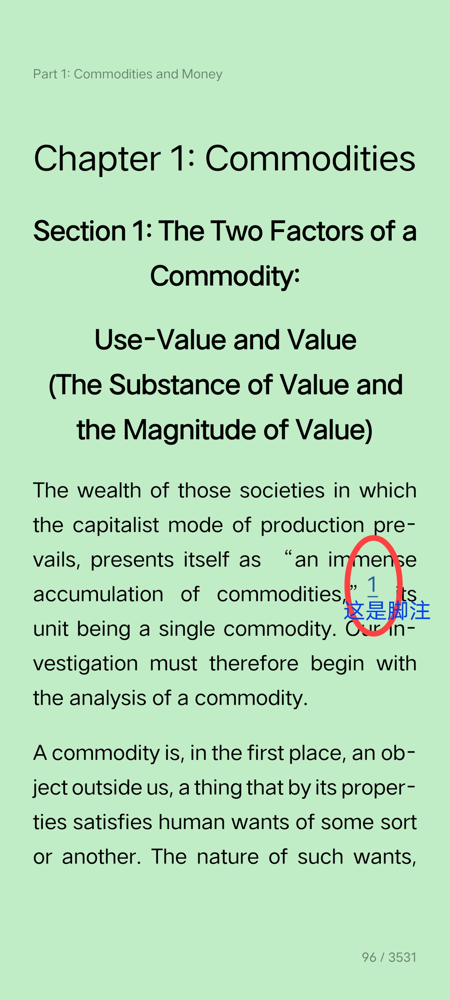
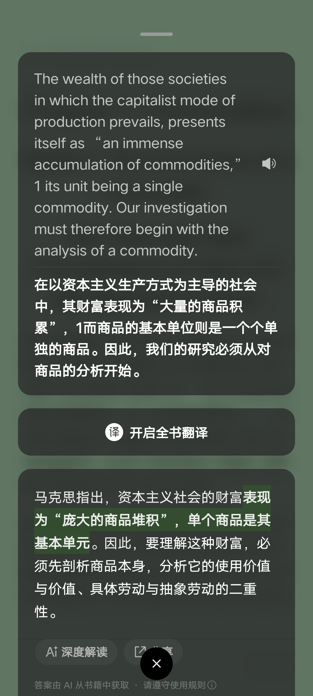
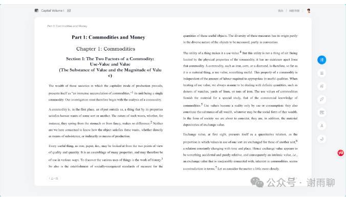
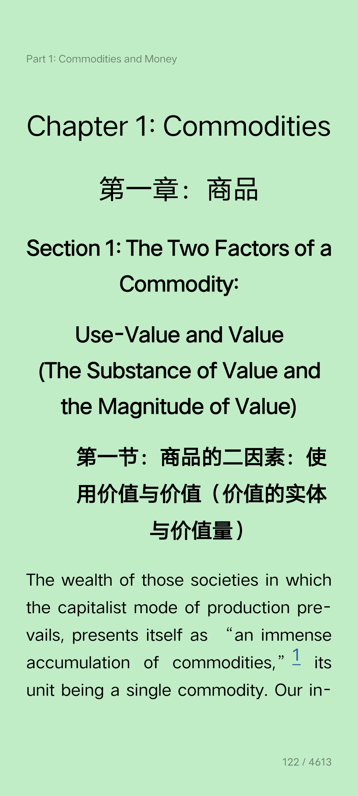
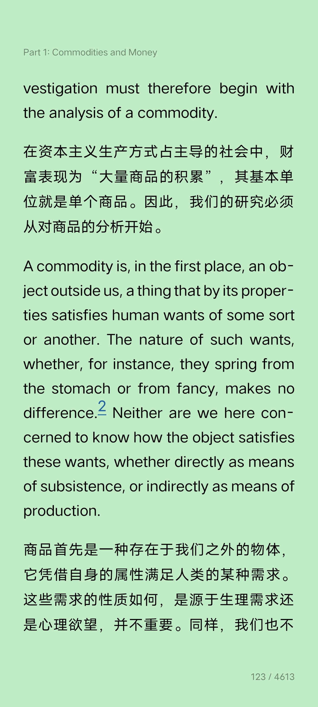

# 用微信读书看英文原著

我以前没有阅读英文书的习惯，总结起来有三个原因：一是纸质版英文书太贵，二是国内没有合适的英文电子书阅读平台，三是我自己词汇量有限，阅读时遇到困难容易放弃。

出国后，我本以为在国外能够使用对标微信读书的电子阅读平台，我下载了很多阅读软件和APP，但没有一个令人满意——书价一点不比实体书便宜，阅读体验欠佳，连基本的划线翻译功能都非常难用。

因此，我仍然很少读英文书，只是在必要的时候下载PDF的电子资料，在电脑用WPS或别的工具看。

直到最近我才发现：**其实直接用微信读书，就完全能满足看英文原著的所有需求。**不仅翻译和AI解读功能强大，而且阅读还能顺便积累微信读书的时长（有面子）。具体操作流程很简单，只有三步：

1. 在网络公开资源库或你常用的电子书网站下载书籍的EPUB格式；
2. 发送到微信的任意一个聊天框；
3. 用手机打开文件，选择打开方式，点击微信读书。

导入后就可以直接阅读了。

我以英文版《资本论》（*capital*）为例。

首先在marxists.org下载《资本论》的epub版本，也就是马克思主义互联网文库（MIA，中马库的主站，收录了最完整、最权威的马克思主义作品）：

然后发送到微信里，手机端打开，选择微信读书：

导入后，我们就能在书架看到并阅读了：

现在我们看排版效果，以第一章第一节为例，讲商品的价值和使用价值，可以看到，排版非常清晰，标题加粗加大，作者自己的脚注也有超链接可以直接跳转，和中文版没有任何区别。

翻译功能也非常好，既有直译，又有AI解读。以第一段为例，英文原文：

> The wealth of those societies in which the capitalist mode of production prevails, presents itself as “an immense accumulation of commodities,”1 its unit being a single commodity. Our investigation must therefore begin with the analysis of a commodity.

直接翻译：

> 在以资本主义生产方式为主导的社会中，其财富表现为“大量的商品积累”，1而商品的基本单位则是一个个单独的商品。因此，我们的研究必须从对商品的分析开始。

AI解读：

> 马克思指出，资本主义社会的财富表现为“庞大的商品堆积”，单个商品是其基本单元。因此，要理解这种财富，必须先剖析商品本身，分析它的使用价值与价值、具体劳动与抽象劳动的二重性。

作为对比，最权威的中文版（中央编译局译本）是这样写的：

> 资本主义生产方式占统治地位的社会的财富，表现为“庞大的商品堆积”，单个的商品表现为这种财富的元素形式。因此，我们的研究就从分析商品开始

可见，中央编译局的翻译兼顾信达雅，堪称典范，但是微信读书内置的翻译和AI解读也并没有偏离原文的意思。更何况在微信读书，我们随时可以切出去看中文版，进行对照研究。

除了手机端，我们也可以在微信读书的**电脑端**看，电脑端屏幕大、沉浸感强，支持划线选词翻译，阅读体验同样很好，缺点是脚注的超链接没了，无法直接跳转。

手机版甚至可以打开全文对照翻译，在不改变原文排版的情况下呈现译文，效果如下：

总之，用微信读书看英文电子书，是我目前找到的综合体验最好、门槛最低的方法，强烈建议有英文阅读需求的朋友实践一下。

当然，微信读书作为一个阅读平台是很理想的，但是它本身不能决定书籍的版本和质量，所以**找到一个优秀的epub版本至关重要。**

我一开始尝试过很多版本，排版多多少少都有瑕疵，有些甚至存在OCR自动识别导致的单词拼写错误（比如把in part from误识别成in the from）。这是因为很多网上的EPUB直接由纸质书扫描转写，缺乏仔细的人工校对。至于如何找到优秀的版本，就需要反复尝试总结，有些还要在阅读的过程中才能发现。当然，这就是另一个议题了。

> 转换说明：配图：第1、6幅暂沿用现图（指定资料目录未找到可靠且质量更好的无水印原件）。
