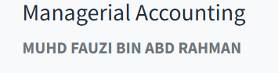
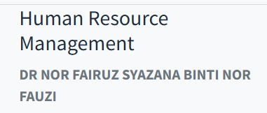

# 马来人的名字研究

第一次在课表看到马来老师名字的时候，我第一反应就是跳过。因为这一长串字符对我来说实在是太复杂了：有四五个单词，有的甚至七个单词，而且都是大写。所以很长时间我都不记马来人的名字，也没有研究过，总感觉麻烦，也不算非常重要。

新的学期开始，同学和新老师互相介绍名字，老师说我们中国人的名字可难记了，甚至连读都不知道怎么读。比如有姓徐的，老师看着Xu陷入了沉默，因为在马来语的拼写体系里，没有X这个单词，就算遇到，他们第一反应也是参考英语里的发音，读“Z”的音，他们想破脑袋也想不明白为什么中国拼音的X要发英语里的“s（sh）”音。

然后有孟加拉国同学介绍自己的名字，老师问他哪个是他父亲的名字，同学回答没有父亲的名字，只有“family name”。当时我意识到，其实马来人的名字也没有那么复杂。回去我研究了一下，原来他们习惯把自己父亲的名字放在自己的名字后面，又习惯在名字前面放上称号，所以才显得很长，其实他们自己的名字也就是一两个单词，很好记。

以我们某个老师的名字为例：**MUHD FAUZI BIN ABD RAHMAN**，转成小写就是**Muhd Fauzi Bin Abd Rahman**。在这个名字中：

**Muhd**是Muhammad的缩写，即默罕默德，放在前面是为了表达对先知穆罕默德的尊敬。

**Fauzi**是他自己的名字，源自阿拉伯语，意思是“成功、胜利”。

**Bin**是阿拉伯语“儿子”的意思。

**Abd**是Abdul的缩写，意思是仆人。

**Rahman**是真主安拉的99个尊名之一，意思是至慈的真主。

在这个名字中，一共有5个单词，只有第二个**Fauzi**是他真正的名字，第一个单词**Muhd**是前缀，第三个单词**Bin**纯粹是连接词，第四个和第五个单词**Abd Rahman**（仁慈真主的仆人）则是他父亲的名字。因此，我们真正要称呼他只需要记住Fauzi一个单词就够了。

我们再来分析这个名字：**DR NOR FAIRUZ SYAZANA BINTI NOR FAUZI**，小写为**Dr Nor Fairuz Syazana Binti Nor Fauzi**。其中：

**Dr**是博士的意思，是个头衔；

**Nor**是光辉、光明的意思，属于前缀；

**Fairuz**是绿松石、高雅的意思；

**Syazana**是聪慧的意思；

**Binti**是女儿的意思；

**Nor**和前文一样；

**Fauzi**是胜利、成功的意思。

从名字可以知道，这位女士是博士，父亲叫**Nor Fauzi**，本名是**Nor Fairuz Syazana**，但一般只称**Fairuz**或**Syazana**即可。所以尽管她的名字有七个单词，我们仍然只需要记1-2个单词。

了解了这些，我们可以很快分析出一个马来人的名字，比如现任马来西亚首相安华的法定全名为**Dato’Seri Anwar Bin Ibrahim**。其中：

**Dato’Seri**是“拿督斯里”的意思，这是政府给他发的勋衔；

**Anwar**是他自己的名字；

**Ibrahim**是他父亲的名字。

他这个名字就很简单。安华女儿的名字则叫**Nurul Izzah binti Anwar**，一看就知道是安华的女儿。类比一下，**王思聪**一家如果是马来人，他都不用说“我爸是**王健林**！”因为按照马来人的传统，他的全名就叫“**健林之子思聪**”。

总之，马来人的名字一点也不难，看着长是因为包含了头衔、宗教前缀、本名和父名。当然，他们的前缀、称号也各种各样，名字也总有很多伊斯兰和阿拉伯的文化印记，不过这些都不重要，遇到一个新的，自己搜一下什么意思就行了，真正需要记得就是他们那1-2个单词的本名。
