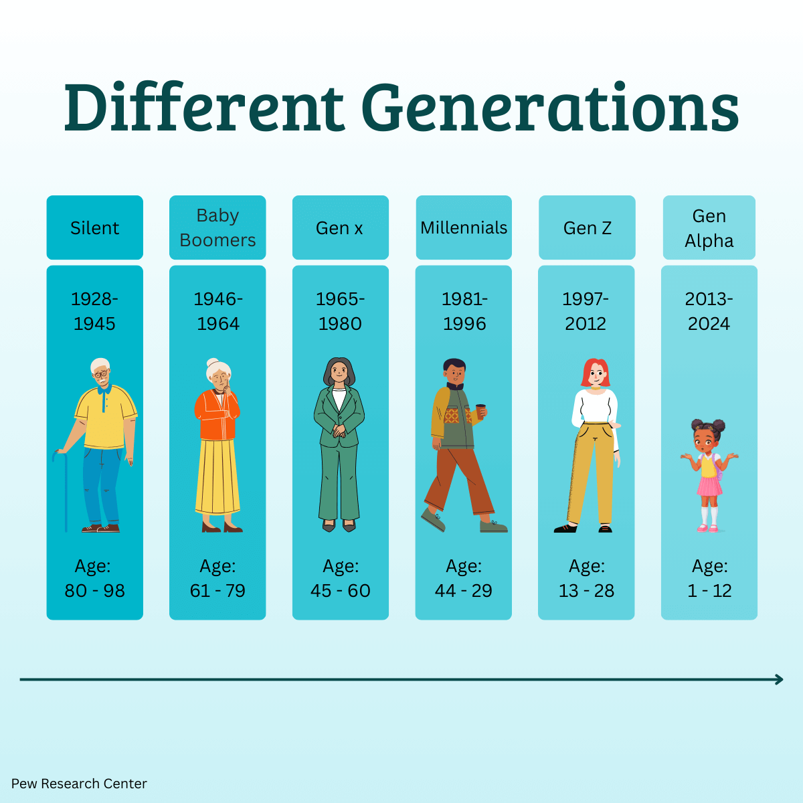
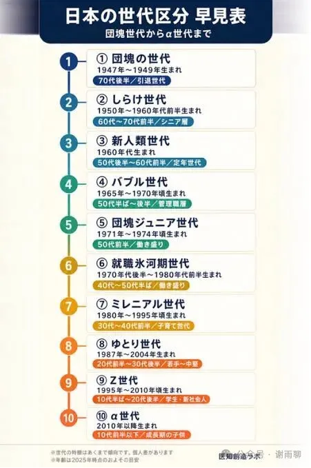
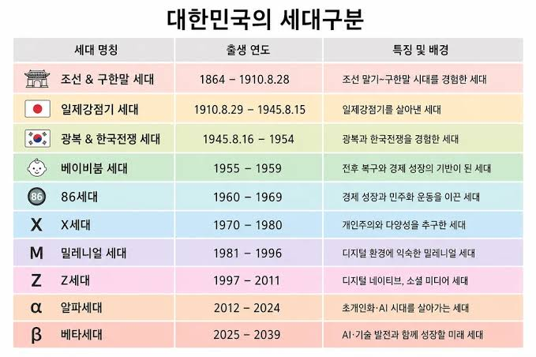

# 中国的年代和外国的世代

在中国，我们习惯用“70后”、“80后”“90后”、“00后”这样的说法来区分不同年龄阶段的人，我们很容易认为这是一种自然的说法，毕竟“xx后”是一种客观描述，但实际上国外并不这样说。在英语国家，几乎没有人会说“post-00s”，你在谷歌搜索“post-00s”，显示的搜索结果几乎都是关于中国的信息。我们的“00后”一般对应他们所说的“Gen Z”，即“z世代”。

如果我们去翻看欧美主流的世代划分，会发现一套非常严密的命名规则：

迷惘的一代（Lost Generation）：1883-1900，亲历一战与战后创伤。

最伟大的一代（Greatest Generation）：1901-1927，度过大萧条并在二战中主力出征。

婴儿潮一代（Baby Boomers）：1946-1964，二战后人口爆发与经济黄金期的受益者。

X世代（Generation X）：1965-1980，冷战尾声成长，被称为“抱钥匙儿童”。

千禧一代（Millennials）：1981-1996，拥抱早期互联网与次贷危机。

Z世代（Gen Z）：1997-2012，真正的数字原住民与短视频一代。

我们可以观察到，这种世代划分法其实是为美国社会量身打造的，是美国社会变化和重要事件的反映，比如二战、二战后婴儿潮、冷战、美式互联网。而英法德等欧洲国家，由于20世纪后的历史相似，所以也基本采用这种说法，大同小异。

由于美国和英语在战后长期居于主导地位，这种世代划分法和其他文化一起，被顺理成章地输出到全世界。从印度、拉美到中东、东南亚，许多国家虽然有着截然不同的本土历史，却直接将Gen X、Gen Y、Gen Z的框架套在自己国民身上。

所以我的标题是“中国的年代和外国的世代”，而不是“中国的年代和美国的世代”，因为美国文化渗透到了世界的各个角落，不只是年代的划分，其他很多意识形态都是这样，包括各种理论、文学、体育、音乐……美国总结，其他国家邯郸学步，亦步亦趋。在这样的文化冲击之下，很少有国家能保持自己相对的独立性。

全球只有极少数国家，能够在西方文化狂潮中，保留一套具有强本土特色的代际叙事，比如日本、韩国、前苏联、伊朗、越南，这些国家无一例外，都有自己强大的语言载体和文化主体性，能够抵抗所谓“文明世界”的同化。

日本：有着“团块世代”、“泡沫世代”、“就职冰河期世代”、“宽松世代”等反映自身经济周期的独特称呼；

韩国：有着“386世代”、“IMF世代”、“N抛世代”等记录本土社会变迁的词汇；

伊朗：有着“Dehe-80s（伊朗历80年代人）”这样带有强烈本土历史痕迹的标签。

而且即使是像日本、韩国这样拥有强本土文化底蕴的国家，在近年来也展现出了越来越被美式‘MZ世代’、‘Z世代’同化的趋势，传统的‘宽松世代’、‘386世代’正在被西方统一的字母代号所稀释。现在，除了中国有“00后”的说法，其他国家基本都叫“Z世代”，这种独有的自我定义体系其实是难能可贵的。

回头看中国自己的这套“xx后”划分法，看似只是客观描述，其实也反映了中国的国情。从时间上看，中国近现代的历史太复杂太曲折，几乎每个十年都有几个重大事件，所以像外国的那种“xx世代”的划分法就并不能满足我们分类的需求。从地域上看，中国太大，发展不均衡，比如同样是80后，上海城里的80后可能童年接触了大量西方文化，还经常出国，思想也比较前卫；四川乡下的80后可能除了课本，村里没有别的课外书，大学毕业才第一次出省。在这种情况下，80后的身份只能说明他们在相似的年龄段经历了相似的社会事件，其他结论则需要结合其他信息才能做出判断。

所以，在中国，我们只需要知道他是几几后，以及他的籍贯，结合中国的历史和地理，一般就足够推断出他的大体经历。

在历史课本上，我们会引用乾隆的一句话：“天朝上国，物产丰盈，无所不有，原不籍外夷货物以通有无。”这句话常常被用来讽刺封建社会晚期统治者的骄傲自大、固步自封。但换个角度看，这句话也确实说出了中国地大物博的优势：人民需要的物质资料，本国都能够生产，这难道不是一种强大吗？要知道，即使是晚清最腐败最堕落、沦为半殖民地的时候，清朝的国力仍然仅次于西方各列强。甚至对很多小国来说，大清自己就是列强，很多人不知道，晚清GDP仍然是全世界前三，综合国力保守估计也是世界前十五，晚清长期驻军朝鲜，快灭亡的时候都有能力出兵海参崴和墨西哥以保护华侨。这种大体量至少为中国未来的崛起提供了回旋的余地。

同理，在文化上，如果我们自己使用和消费的流行符号、社科模型、文艺作品、流行语、音乐作品、体育活动，都能用中文生产，都有中国特色，都在中国这片土地上孕育发展而来，这难道不也是一种强大吗？事实上，我们已经是文化强国了，我们一直都是文化强国，只是需要精益求精，需要增强影响力，需要百尺竿头，更进一步，更好地建设我们中国特色社会主义的理论体系、政治经济制度和文化。

当然，这和学习外国（所谓“师夷长技以制夷”）并不冲突，只是在学习他国科技文化的同时，时刻坚持以我为主，为我所用的原则即可。而且也不能只学习欧美这些所谓的主流国家，还要向其他非主流国家学习。

> 转换说明：配图：第2幅暂沿用现图（指定资料目录未找到可靠且质量更好的无水印原件）。
