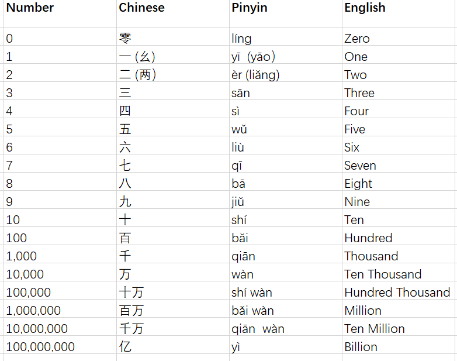
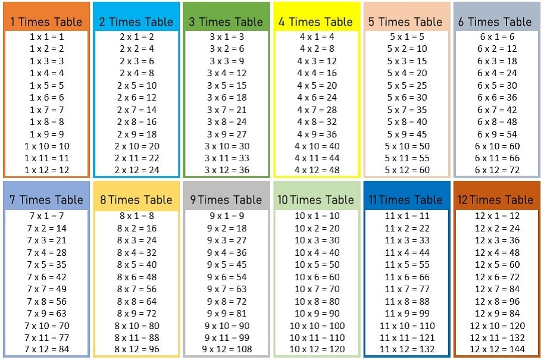
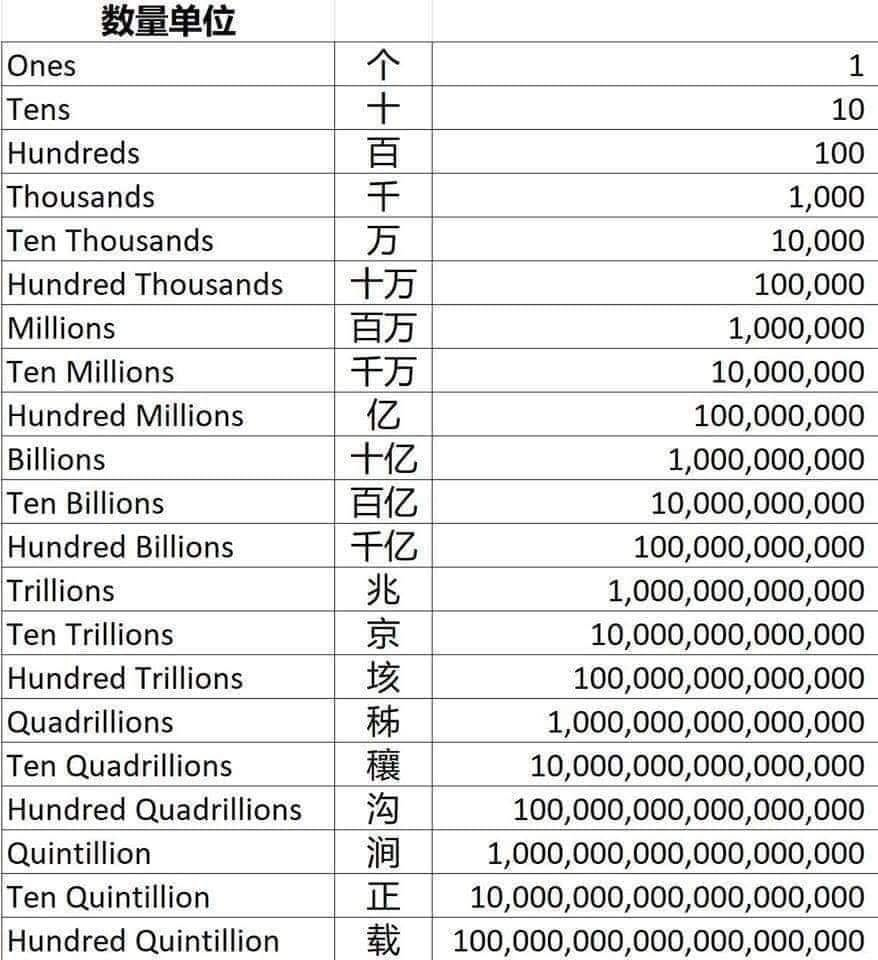
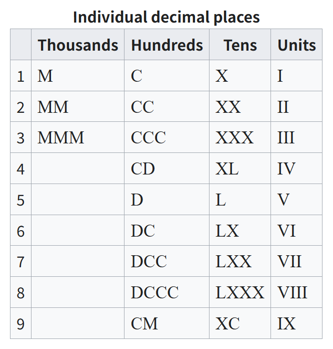
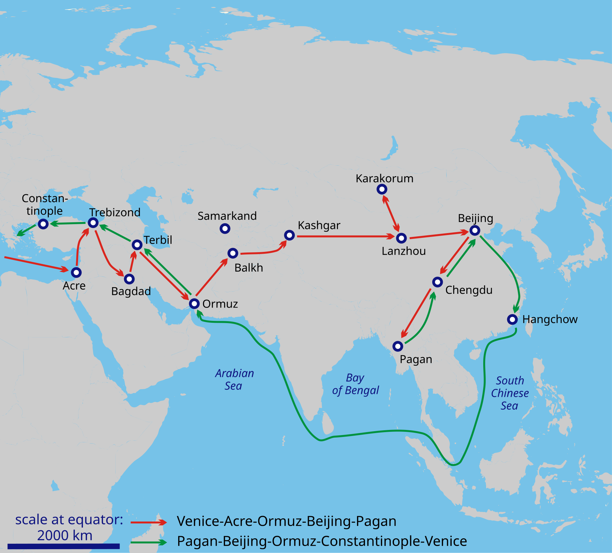

# 英语的千和汉语的万

双语数字转换有时也挺麻烦，比如突然被外国人问到某国某省人口面积的时候，我们往往会措手不及。我们脑子里首先想到的是中文数字，比如13亿、960万、3000万，但是要转化成英语，就突然慌张了，要思考半天，有时甚至卡壳，急忙打开手机搜。

不过这也不是很大的问题，熟能生巧，只要熟悉万（ten thousand）、十万（hundred thousand）、百万（million）、千万（ten million）、亿（hundred million）、十亿（billion）这几组转换，就能从容应对生活中绝大多数的问题。而这在大学英语的听力口语课程中，也不过就是一节课的专项练习罢了。

从感觉上来说，我们发现用英语表达数字会更麻烦一点，理性分析以后，我们会发现事实确实如此。这主要有两个原因，一是汉语有单音节优势，二是汉语是四位一进（万，亿，兆）而英语是三位一进（thousand, million, billion）。单音节是主要优势，四位一进是次要优势。

**先说单音节优势。**汉语0-9每个数字都是单音节，常用的计数单位十百千万也是单音节，研究表明，由于中文数字发音速度更快，中文使用者的数字记忆广度高于英文使用者（Hoosain & Salili，1987），所以中国人的数数能力和计算能力都强于英美人。

有一本法国人写的科普书，叫《脑与数学》。他在引言部分这样写道：

> 在我第一次坐下来写这本书时，我遇到了一个有些荒唐的算术问题：如果这本书预计有250页，一共9个章节，那么每章有几页？认真思考以后，我得出了结论：每章略少于30页。我花了大约5秒的时间，对于人类来说，这样的计算速度并不算慢，然而这却远远比不上任何一台电子计算器的速度。计算器不仅反应迅速，而且它得出的结果精确到了小数点后10位：27.7777777778！

作者迪昂是巴黎高师数学专业毕业生，是数学认知领域公认的专家，他思考250÷9这个算式，用了5秒时间，竟然只算出了一个概数。而我，一个普通的中国人，最多5秒就能算出精确的结果，还能精确到小数点后一亿位：27.77...............778！这显然不是因为我比他更聪明，仅仅只是因为我用汉语心算，他用法语或英语心算罢了。

作者在后面紧接着问道：

> 为什么经过了多年训练后，仍然有不少人不能确定7乘以8的结果是54还是64，或者是56？

我相信中国的小朋友经过一天的培训就能够准确地回答7×8到底等于多少，无非就是背一遍乘法口诀表的问题。而乘法口诀表恰恰就是利用了汉语单音节的优势。

**再说四位一进的优势。**我认为这种进位的差别源自于社会对计数需求的差别。人类所有的语言，一开始都只有“一”“二”“三”“多”，后来随着计数需求的增加，语言中的数词才随之增加。直到现在，澳大利亚的原住民部落瓦尔皮里斯（Warlpiris）的语言里，也就只有1、2、一些和很多这几个表示数量的概念。原始的采集渔猎社会人们没有多少剩余产品，也不需要那么多剩余产品，所以也就没有那么多计数的需求；农业社会以后，剩余产品增加，精确的计数才成为必要。

同样，在古代中国，统一王朝和大市场具有更多的计数需求，而在古代欧洲，政权多是小国家，交易多是小贸易，太大的数字用处不大。

在商朝甲骨文中，最大的数字是三万，比如出兵三万，俘敌三万，抓鱼三万，这大概就是当时古人认知中最大的数了。但是“三”和“万”可能都不是实指，这两个都可以表示很多，多到数不清。但是这种记载也说明当时的中国在实践中频繁地接触到万这个数量级的事物。

到了周朝，就有了亿、兆、京、垓等单位。春秋战国时期，商品经济发展，国家兼并，计数的需求变得更大更频繁了。到了战国时期，列国出兵都是以几十万计数，金钱的计量以百万计，其他事物也可以想象，成千上万都是常态。

亿在西周更多指的是十万（10⁵），少数时候指万万（10⁸），大概正是因为万这个数量级的使用太频繁，所以四位一进成为主流，在战国时期形成了万万为亿（10⁸），万亿为兆（10¹²）的四位一进的计数体系。由于需求有限，基本千万级以上就不常用了。这种需求规模决定了中国人的计数习惯。

“十千”“百千”的用法也不是没有，但似乎都集中在文学领域，而且多是虚指，比如“金樽清酒斗十千，玉盘珍羞值万钱”“策勋十二转，赏赐百千强”……看来大数量的计数，千确实不如万好用。

（这图是网上找的，不知道是否正确，不过也不重要了）

但是欧洲人却习惯用千表示大数。尽管古希腊数学家阿基米德在《数沙者》中，已经提到很大的数了，但这没有现实意义，古欧洲人现实中不需要太大的数。即使是罗马帝国，他们的计数符号也不过就是：I（1）、V（5）、X（10）、L（50）、C（100）、D（500）、M（1000）。千就已经是最大了，三千就是MMM，九千就是写九个M，或者其他复杂的变形。复杂也没有关系，大部分时候够用。于是欧洲人在思维方式上，遇到大数就习惯以千为单位来计量。

13世纪的意大利商业兴盛，千作为单位实在不够用了，百万（或者说千千）量级的计数越来越频繁，于是他们发明了大千这个词，意大利语千是“mille”，后面加个表示大的后缀-one，也就成了“milione”，即现在英语的“million”，表示千个千。

《马可波罗游记》的意大利名就叫Il Milione（The Million），这本来是意大利人给马可波罗的外号“百万先生”。为什么取这个外号呢？因为马可波罗从中国回来，描述中国的财富、人口和土地，动不动就好几个million，大家觉得他在吹牛，所以取这个外号进行讽刺。

总而言之，英语用千，汉语用万，差异在于**其文化兴盛时期的文明规模**，而文明规模决定了计数需求。古中国频繁使用万计数，所以习惯大数用万万；古欧洲频繁使用千计数，所以习惯大数用千千（million）。

这种差异也使中国人在面对大数的时候更具优势。比如常用的几个大数：中国人口约14亿，面积约960万平方公里，四川省常住人口约8300万，面积48.6万平方公里。换成英语，这四个数字分别为：1.4 billion，9.6 million，83 million，486 thousand。显然汉语的表达更高效更简洁，因为汉语只用到了万和亿，而英语却用到了thousand, million和billion三个计数单位，浪费大脑资源更多，反应自然更慢。

欧美国家有历史包袱，非常在意政治正确，很少说某种东西优于某种东西。但在数学学习方面，他们也不得不承认，汉语母语者对英语母语者确实具有优势。而且我认为这种优势可能还被低估了。

Hoosain, R., & Salili, F. (1987). Language differences in pronunciation speed for numbers, digit span, and mathematical ability. Psychologia, 30(1), 34–38.

[法] 斯坦尼斯拉斯·迪昂. 脑与数学[M]. 周加仙, 等, 译. 杭州: 浙江教育出版社, 2022.

Miura, I. T., Kim, C. C., Chang, C. M., & Okamoto, Y. (1988). First graders' cognitive representation of number and understanding of place value: Cross-national comparisons. Journal of Educational Psychology, 80(3), 325–330.

[英] 李约瑟. 中国科学技术史: 第三卷 数学[M]. 《中国科学技术史》翻译小组, 译. 北京: 科学出版社, 1978.

维基百科. 汉语数字[EB/OL]. [2026年9月24日]. https://zh.wikipedia.org/wiki/汉语数字.
