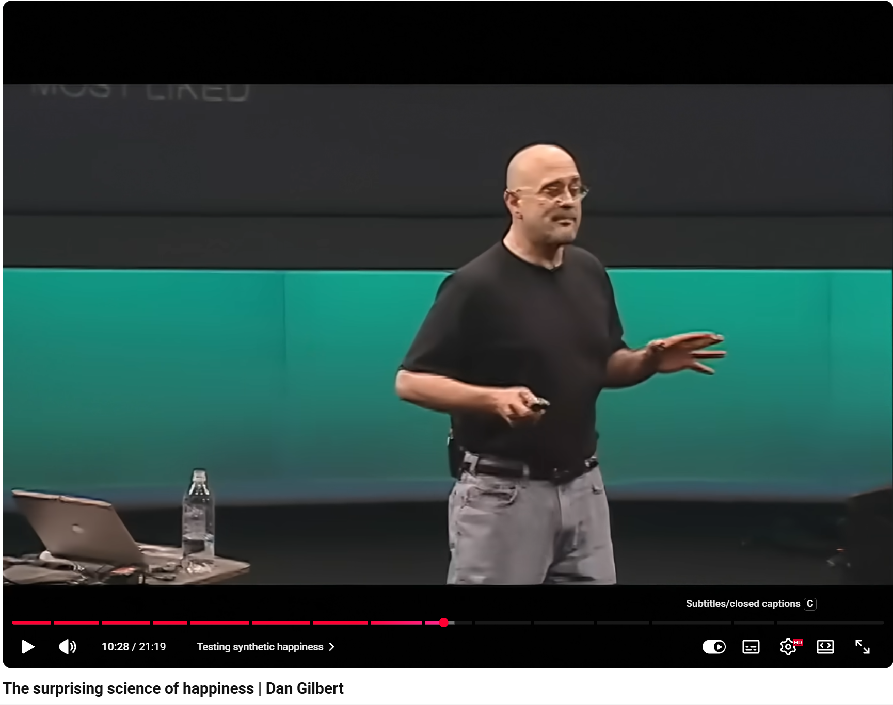

# 合成幸福理论及其启示

哈佛大学心理学家**丹尼尔·吉尔伯特**（Daniel Gilbert）在TED有一个经典的演讲**《令人惊讶的幸福科学》**（The surprising science of happiness），核心就是介绍**合成幸福理论**。总结起来内容如下：

1 人类大脑在200万年进化出了新的结构：前额叶皮层。前额叶皮层赋予了人类**“体验模拟器”**（experience simulator）的功能，让我们能够在脑海中预演未来。但是这种功能会让我们形成误判，我们会高估重大事件对我们长期幸福感的影响。例如，研究表明，一个人中奖3.14亿美元彩票，另一个人下半身瘫痪，一年后，他们的幸福感是一样的。但我们主观上仍然会认为中彩票的人会更幸福，这就是所谓的**“影响偏差”**（impact bias）。

2 事实上，即使是重大的人生创伤，三个月后对我们的幸福感都没有任何影响（只有极少数例外）。这是因为人类拥有**“心理免疫系统”**（psychological immune system），这个系统帮助人们改变自己对世界的看法，从而让他们对自己所处的世界感觉更好。也就是说，大脑拥有**“合成幸福”**的能力。

丹尼尔举了很多“合成幸福”的例子：

比如贵为美国众议院议长的**Jim Wright**，被政敌发现有一笔见不得光的交易，不得不黯然辞职，一夜之间失去了所有的金钱和权力，但是他后来却说：**“我在身体上、财务上、情感上以及几乎所有其他方面都好多了。”**

比如一个叫**Moreese Bickham**的人，此人被冤枉入狱，在路易斯安那州立监狱关了37年，直到78岁，才因为DNA证据被无罪释放，被释放的时候他说**“我连一分钟的后悔都没有。那是一段光荣的经历。”**

诸如此类。

3 人们往往会对这样的“自我安慰”不屑一顾。因为我们会认为“合成幸福”的质量比不上“天然幸福”。（天然幸福是指我们得到了我们想要的东西时所获得的感受；而合成幸福是指我们在得不到想要的东西时，自己制造出来的感受。）但实验数据证明：**合成幸福和天然幸福一样，都是真实而持久的。**

丹尼尔提到一个实验：准备6张莫奈画作的印刷品，让人们从最喜欢到最不喜欢的顺序排序，然后声称会送给他们自己排名的第三或者第四的其中一个画作印刷品，人们往往会选择排名第三的画作。一段时间过后，可能是15分钟，也可能是15天，幸福感出现了：让大家重新排序，结果排名第三的画作评价变高，而排名第四的画作则被降低了排名。

这样的实验在顺行性遗忘症患者（无法形成新的记忆）中间结果依然一致。这说明人们合成幸福时，他们真实、确切地改变了他们对那张海报的情感。他们并不是因为“我拥有它，所以我才说它好”，因为遗忘症患者根本不知道自己拥有这个画作。

4 但是，**选择、改变和做决定的自由，却是合成幸福的死敌。**当你有选择权的时候，你往往会对自己现在的结果不满意，反而是没有选择权的时候，你会合成幸福。比如你和一个男人约会，他抠鼻子，你就不会再和他约会了。如果你和一个男人结婚了，他抠鼻子，你会说：“他有一颗金子般的心，别碰那块水果蛋糕就行了。”

丹尼尔又提到一个摄影课实验：让参加课程的哈佛学生拍12张照片，选出最好的两张，然后说这两张只有一张能够带走，另一个则要上交存档，让他们做选择。这时分成两组，一组学生被告知有4天时间可以更换选择，另一组学生则被告知选不了了。最终结果显示：那些“被迫接受”那张照片、别无选择、永远不能改变主意的人，非常喜欢他们的照片。而那些正在犹豫不决的人，非常纠结，他们不喜欢自己的照片，而且即使在交换期失效之后，他们仍然不喜欢自己的照片。

最后，他们找来了一批对此不知情的哈佛学生，说他们正在开设两门摄影课，采取两种方式，一种是拍下两张照片后，有四天时间可以改变主意选择哪一张；第二种是拍下照片后必须立刻做决定，而且不能改变。

结果66%的学生选择了有机会改变主意的课，也就是选择了让他们对自己的照片深感不满的课。

5 作者最终的结论是：**我们的渴望和我们的担忧，在某种程度上都被过度夸大了。**因为我们体内拥有这样一种能力，能够去制造我们一直在苦苦追寻的那个名为幸福的东西。过度的渴望和过度的担忧都是有害的。

以下是我的看法：

1 演讲中丹尼尔并没有讲“合成幸福”理论或“心理免疫系统”的具体生理机制，只是说这是一种人脑的普遍现象，大概是因为作用机制太复杂了，20分钟讲不完。从生理层面讲，幸福无非就是多巴胺、内啡肽、血清素、催产素等神经递质激活了人脑特定区域而形成的一种感觉。

2 所以人脑的生理机制决定了人不能持续性地无限悲伤或者极致狂喜，否则就会出现神经问题。**“合成幸福”**作为人脑的一种调节机制，让我们的幸福感保持在一个**基线**上下，以此保证我们的心理健康。所以极乐不能也不应该是一种追求，追求极乐的后果就是吸毒、酗酒以及大脑的永久性损伤。

3 因此，我认为最好的状态或许就是长期维持着淡淡的幸福，偶尔掺杂着淡淡的悲伤，不以物喜，不以己悲，按照自己的原则行事。这样稳定的情绪从总体来看是最幸福的。

4 但是我们常常会嘲笑人们的这种“合成幸福”。比如鲁迅笔下的“阿Q精神”，以及所谓“网络基本盘”的“赢学”。可是，阿Q被打了以后如果不说一句“我总算被儿子打了，现在的世界真不像样”来安慰自己，他还能做什么呢？“赢学”也一样，很多人嘲讽我们骂美国没有意义，其实并非如此，骂美国对于自己生活满意度的提高，绝对是实打实的。事实上，那些嘲讽“赢学”的人，又何尝不是另一种“赢学”？只不过我们的“赢学”是在心里战胜了美国人，而他们则是战胜了搞“赢学”的人——其实大家都是阿Q。阿Q也没什么不好，阿Q总比抑郁强。

5 这个理论还告诉我们，一个总是抱怨的人，一个对什么都不满意的人，要是不改变自己的心态，哪怕给他无数金钱和权力，他也一样不会满意。他的幸福感会短暂升高，但最终会慢慢跌回到原来的水平。李商隐说“如何四纪为天子，不及卢家有莫愁”，唐玄宗做了四十四年皇帝，还是比不上普通人家的老婆孩子热炕头，更何况现在人们再怎么奋斗也做不了皇帝了。所以我们在满足基本的温饱后，不应该再过度追求金钱、权力和美色，这些都不会让你进一步得到满足，相反，我们应该做一些有意义的事情。

6 宗教迅速传播并为人所接受，一个很重要的原因，就是它放大了人脑“合成幸福”的机制。宗教赋予苦难意义，许诺死亡是一个新的开始，并且让人们珍惜现在拥有的东西，再通过集体仪式强化这一切……在阶级社会，大部分人注定无法得到太多自己想要的东西，获得“天然幸福”，但是宗教给了一个低成本、高效率的方式，让他们得到“合成幸福”。

7 这样看，文化娱乐产业的未来也非常明朗，尤其是游戏产业和元宇宙概念。因为人的物质需求可以随着社会的发展，不断得到满足，但是人的心理需求却不会。而虚拟世界可以满足人们的心理需求：只要虚拟游戏够逼真，人们在游戏上获得的幸福，不会比在现实世界中获得的幸福更少更虚假。
