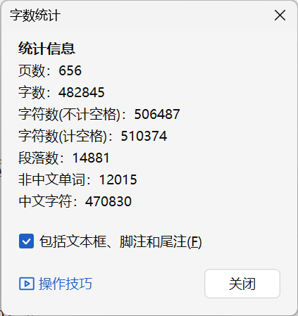
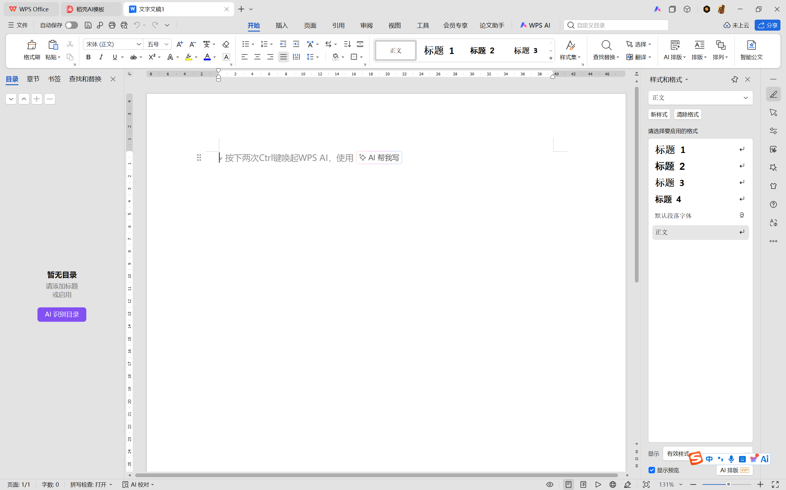
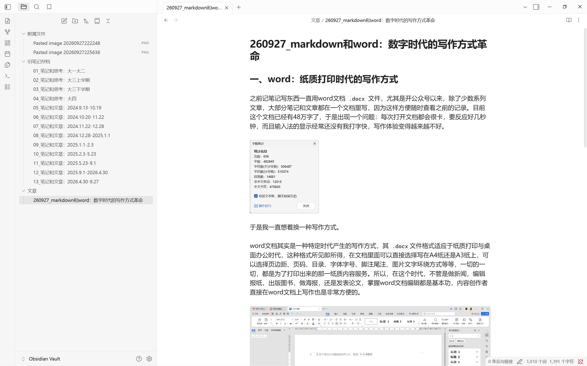
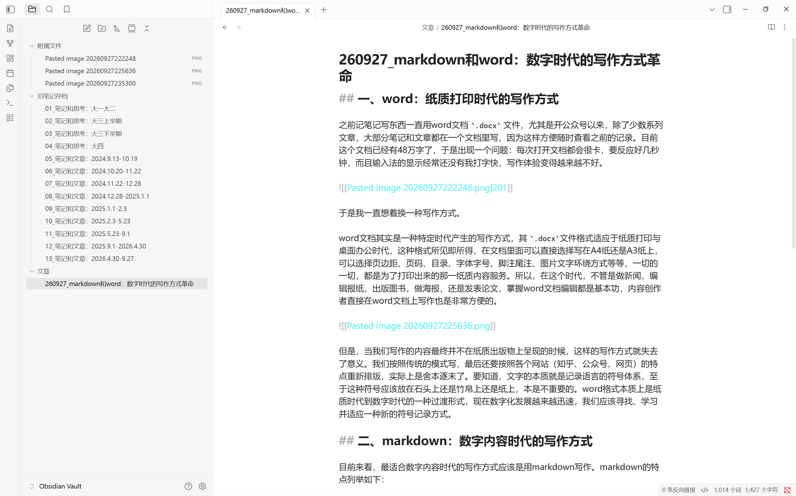

# markdown和word：数字时代的写作方式革命

## 一、word：纸质打印时代的写作方式

之前记笔记写东西一直用word文档 `.docx` 文件，尤其是开公众号以来，除了少数系列文章，大部分笔记和文章都在一个文档里写，因为这样方便随时查看之前的记录。目前这个文档已经有48万字了，于是出现一个问题：每次打开文档都会很卡，要反应好几秒钟，而且输入法的显示经常还没有我打字快，写作体验变得越来越不好。

于是我一直想着换一种写作方式。

word文档其实是一种特定时代产生的写作方式，其 `.docx`文件格式适应于纸质打印与桌面办公时代，这种格式所见即所得，在文档里面可以直接选择写在A4纸还是A3纸上，可以选择页边距、页码、目录、字体字号、脚注尾注、图片文字环绕方式等等，一切的一切，都是为了打印出来的那一纸质内容服务。所以，在这个时代，不管是做新闻，编辑报纸，出版图书，做海报，还是发表论文，掌握word文档编辑都是基本功，内容创作者直接在word文档上写作也是非常方便的。

但是，当我们写作的内容最终并不在纸质出版物上呈现的时候，这样的写作方式就失去了意义。我们按照传统的模式写，最后还要按照各个网站（知乎、公众号、网页）的特点重新排版，实际上是舍本逐末了。要知道，文字的本质就是记录语言的符号体系，至于这种符号应该放在石头上还是竹帛上还是纸上，本是不重要的。word格式本质上是纸质时代到数字时代的一种过渡形式，现在数字化发展越来越迅速，我们应该寻找、学习并适应一种新的符号记录方式。

## 二、markdown：数字内容时代的写作方式

目前来看，最适合数字内容时代的写作方式应该是用markdown写作。markdown的特点列举如下：

1. 易于撰写，没有那么多复杂的字体字号，界面简洁，让人专注于写作。
2. 易于阅读，只需要掌握几个简单的符号，就能设置标题、表格、列表、引用链接、图片等，而且在视觉上就已经非常舒适了，读起来很舒服。
3. 可以自动编译为XHTML/HTML格式，这是互联网各种网站使用最广泛的语言。编译成XHTML/HTML格式后，markdown的内容可以直接发布到公众号、知乎、个人博客等网页上，非常方便。而且比直接写XHTML代码更简单。
4. 和大部分主流网站兼容，比如各种AI软件（deepseek、ChatGPT、豆包、gemini等）、GitHub、飞书等，复制这些网站的内容，粘贴出来已经就是markdown格式了。
5. 和代码语言兼容。只要加入三个反引号，写上代码语言，就能插入代码，直接以代码框的形式呈现出来。事实上，Markdown 的创始人就是程序员，绝大多数程序员也都在用 Markdown 来编写代码的说明文档与技术笔记。

之前我曾经用飞书和notion来写文章，但是效果都不太好，主要原因是他随时要同步，所以打开有延迟，各种文档之间的关系也很难整理到本地。现在我尝试使用Obsidian，这实际上就是一个markdown的`.md`格式的阅读和写作软件，可以直接呈现出当前文档以及所在的文件夹，目前来看非常方便。之后会继续尝试，并且探索将内容同步到GitHub和博客上。

以下是效果：

