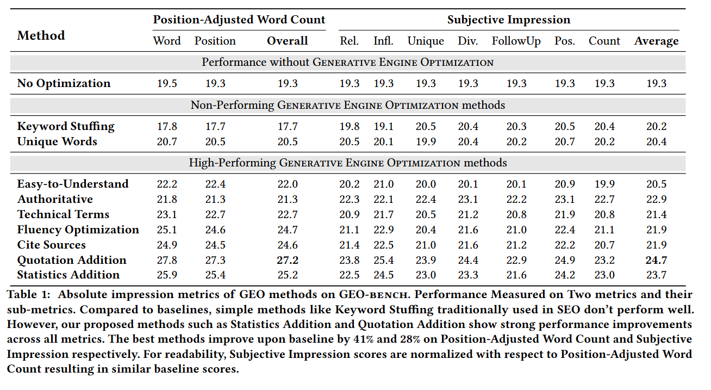
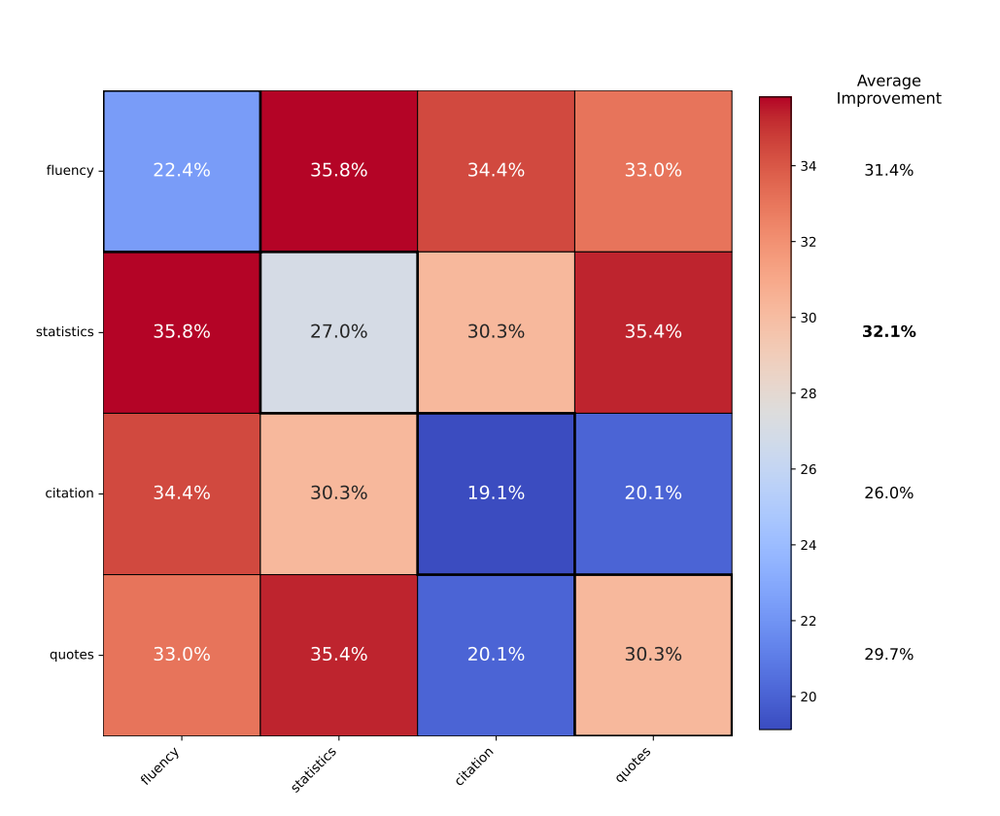
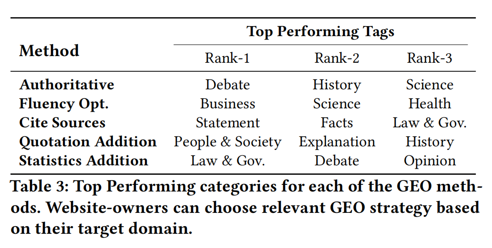
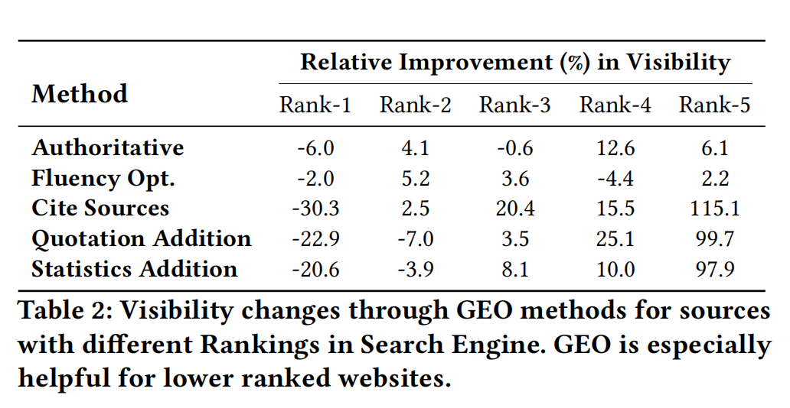

# GEO：生成式引擎优化介绍及启示

## 一、互联网时代，如何让信息被别人知道：SEO和GEO

互联网时代，很多信息都在网上，我们也习惯了通过网络获取信息。而AI又是一个分水岭：在AI兴起之前，我们用搜索引擎获取信息；而在AI兴起之后，我们越来越习惯直接问AI来获取信息。前者的模式，我们更容易获取到那些**搜索排名靠前**的内容；后者的模式，我们更容易获取到那些**容易被AI引用**的内容。

以上是从信息消费端来说，那么从信息生产端来说呢？有些人希望某些信息能够被其他人知道，这时他就要研究信息传输的机制。在前AI时代，他就要研究怎么让搜索排名上升，这就是**SEO**，全称Search Engine Optimization，即搜索引擎优化；在AI时代，他就要研究怎么让AI引用，这就是**GEO**，全称Generative Engine Optimization，即生成式引擎优化。

SEO和GEO的本质就是**在互联网时代使某种信息更容易被其他人知道**的学问，他们的主要工作就是研究**搜索引擎排名或AI引用的工作原理**，并按照这个原理，来优化自己在网上发布的内容，从而让更多人获得这些内容。如果有组织或个人希望**销售某种产品、提高知名度、声誉或影响力**，那他们多多少少都会接触到SEO和GEO。

我们个人可以学习一些SEO和GEO知识，正向使用，或许我们未来可以借以打造自己的个人品牌；反向使用，也可以提高警惕，避免被AI生成的营销内容迷惑。

## 二、GEO的主要方法

2024年8月，来自印度理工学院、普林斯顿大学的多位作者联合正式发表了一篇名叫*GEO: Generative Engine Optimization* 的论文，首次提出了GEO这个概念，至今不过一两年时间。以下是对论文主要结论的介绍：

### 1. 各种策略

在这篇论文中，作者们尝试了多种方法来优化文章，测试AI对其的偏好。

结果发现，**堆砌关键词和独特词汇**的传统方法表现不佳，而**添加引言、添加统计数据、引用来源**这三种方法表现最好，**权威语气**表现也不错，此外，**提高流畅度和易读性**也有利于提高AI的引用偏好。

### 2. 组合策略

这些策略组合起来提升的效果会更好，最好的组合有：提高流畅度+提供数据（35.8%），添加引言+提供数据（35.4%）。

### 3. 不同领域的差异

此外，不同领域对于优化策略的敏感度也不同，以下是各方法最有效的几个领域：
1. 权威语气：辩论、历史、科学。
2. 流畅度优化：商业、科学、健康。
3. 引用来源：陈述、事实、法律及政府。
4. 添加引言：人与社会、解释、历史。
5. 添加统计数据：法律及政府、辩论、观点。

### 4. 对不同排名网站的影响

论文指出，GEO优化对排名4-5名的网站优化效果最大，而如果大家都用了GEO优化策略，排名第一的网站优势会减弱。因此，GEO打破了传统搜索引擎对高权重网站的垄断，有利于小型创作者。

## 三、GEO的局限性

在生产过剩的时代，销售变得非常重要；在生产过剩的AI互联网时代，生成式引擎优化（GEO）就异常重要——但什么都不如**产品**本身重要。

GEO可以让你的文案更容易被AI引用，但它**本身不会优化你的产品**，而且也**不会优化别人对你产品的评价**。所以，哪怕你把**GEO**做到极致，产品不好，那就是言过其实，用户会用钱包和评价投票，最终产品口碑变坏，任何营销都无济于事。相反，如果你的**产品**非常优秀，哪怕你不做任何GEO，酒香不怕巷子深，自然也会有网友帮你把产品口碑做上去，第三方的评价文章照样让你的产品被AI推荐。

因此，做公司，最重要的就是打磨自己的产品和服务，更好地满足用户的需求；做人，最重要的就是提高自己的品德和能力，更好地为别人服务。GEO则是AI时代的一种营销工具，可做锦上添花之用。

## 四、参考资料

Aggarwal, P., Murahari, V., Rajpurohit, T., Kalyan, A., Narasimhan, K., & Deshpande, A. (2024). GEO: Generative Engine Optimization. In _KDD 2024 - Proceedings of the 30th ACM SIGKDD Conference on Knowledge Discovery and Data Mining_ (pp. 5-16). (Proceedings of the ACM SIGKDD International Conference on Knowledge Discovery and Data Mining). Association for Computing Machinery. https://doi.org/10.1145/3637528.3671900
Wikipedia: Generative Engine Optimization. https://en.wikipedia.org/wiki/Generative_engine_optimization