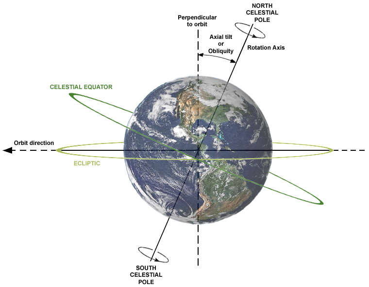
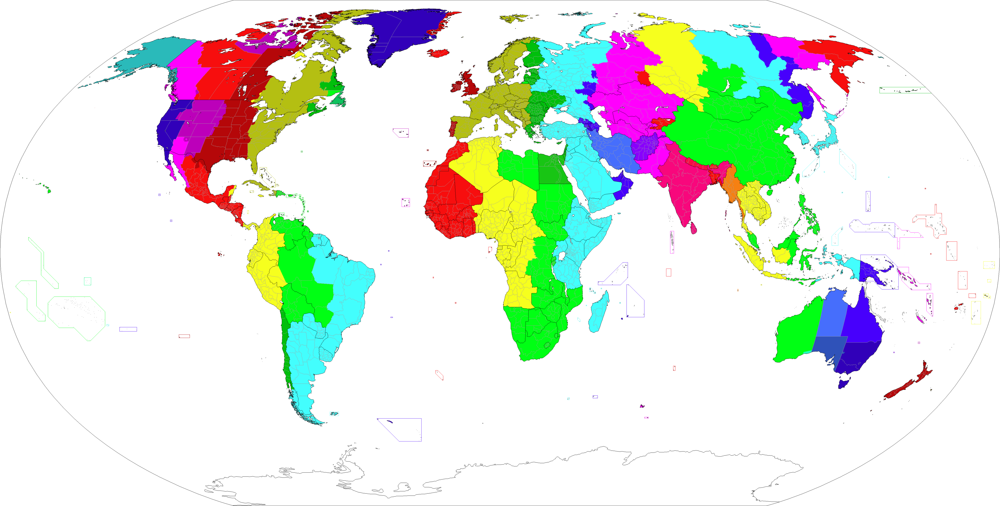
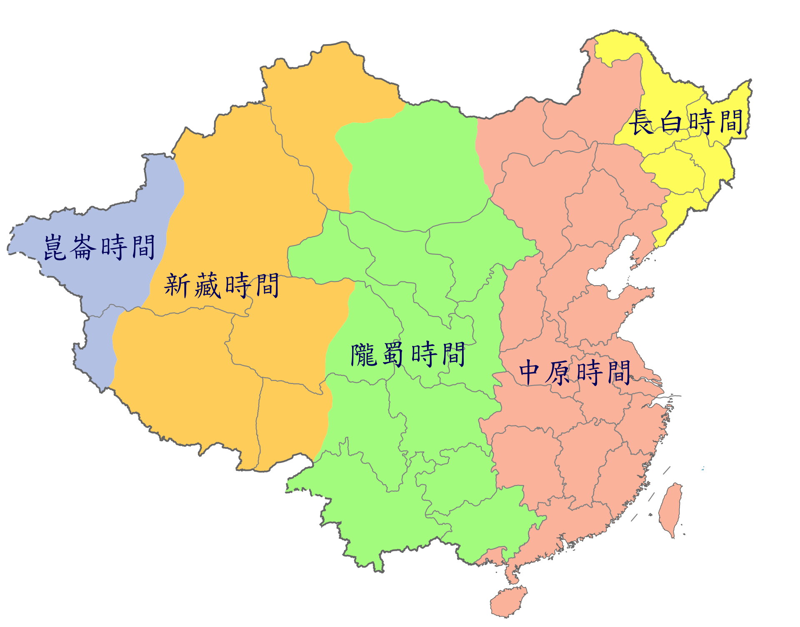
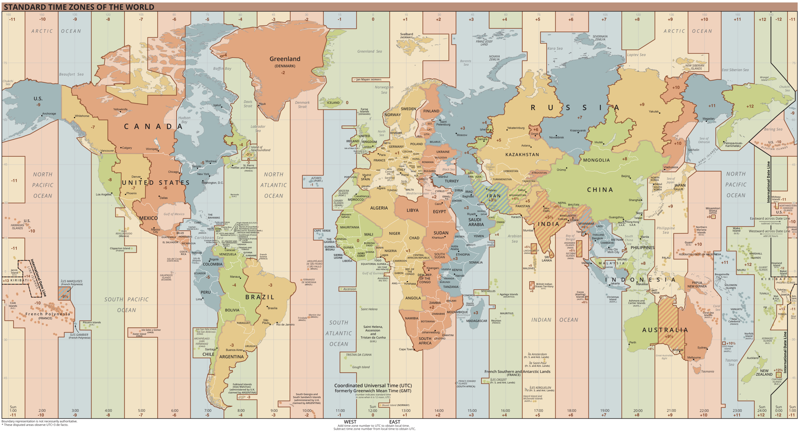

# 时区问题研究

在高考地理中，有人认为最难的题就是地球运动题，因为这是文科中少有的需要计算的题目；但也有人（比如我）认为地球运动题是整个文综最简单的题目，因为这是我们唯一有把握快速100%做对的题。在地球运动题中，可能考地方时与时区计算、正午太阳高度角和日影变化、昼夜长短变化与日出日落方位等知识点。

今天我们来研究时区问题。

## 地球运动和社会发展：时区划分的必要性

地球总有一个半球面对太阳，理论上总是一半是白天，一半是黑夜；它又自西向东自转，因此地球各地会先后进行昼夜交替。在即时通讯非常普遍的今天，我们很容易就能知道，浙江天亮的时候，四川还没天亮；而浙江天黑的时候，四川却还是白天。

但是，这个问题在古代并没有被重视，主要原因是没有需求。比如四川到浙江有2000公里左右，在古代再怎么快马加鞭，也得走好几天，但两地的地方时却只相差一小时，这就显得不重要了，简直可以忽略不计。各地按照自己的日晷计时，或者直接看看天，了解个大概时间就够了。

古代中国用时辰计时，正午影子最短的时候就是午时，其实就是我们现在的地方时的正午12点。其他时间用各种方法（比如日晷、水钟）推演，估计也没有非常精确。但这在农业社会已经非常先进了。古希腊古罗马的学者对这个问题思考得更深刻，他们已经意识到地球是圆的了，也意识到了时差，但也没啥应用，因为不管是当时的农业生产还是商业贸易、管理统治，都不需要那么精细的时间，更不需要计较千里之外的时差。

一直到19世纪，铁路运输尤其是长途铁路发展，人们才遇到这个问题：铁路车次的时间表需要统一，但是各站点的地方时间却不统一。这时，解决各地的时差问题，制定时间标准，才第一次成为人类的当务之急。

1884年，在美国华盛顿召开的国际子午线会议，将英国格林尼治天文台所在的经线定义为0°经线，其地方时被设定为标准时间（格林尼治时间，GMT），此经线向东西延伸7.5°属于一个时区。于是，每个时区占有15°的经度范围，以其中心经线的地方时为本时区的时间；每隔一个时区，地方时相差1小时。当然，这是理论上的划分，由于各国具体情况不同，所以也采取了不同的时区制度。

以前的格林尼治时间（GMT）都是天文观测得出的，1972年以后，国际上采用了更科学的 UTC （协调世界时，Coordinated Universal Time） 系统，用原子钟计时，有闰秒机制，这样就更精确了。现在互联网上所用的时间来自于NTP（网络时间协议，Network Time Protocol），也和UTC相关联。所以，只要你的设备能联网，再根据你所在的时区，你的时间总是标准的。

## 各国各地时区划分情况
时区的计算很简单，明确两地时区，东加西减即可。例如中国是东八区，伦敦是零时区，差8个时区，所以中国的时间减8就是伦敦的时间。如果现在中国是16:12，那么伦敦的时间就应该是8:12。但是伦敦夏天用夏令时，时间拨快1小时，相当于东一区的时间，所以现在中国和英国差7小时，刚才那个例子中，伦敦时间就是9:12。

所以难的并非是时区计算，而是不同国家的不同时间规定。有些国家一个国家有好几个时间，有些国家实行冬令时和夏令时，每年还要调2次闹钟。

中国幅员辽阔，横跨东五区到东九区5个时区，民国时期，中国曾经采用过多个时区的制度，将全国划分为五个时区，分别是：昆仑时区（+5:30）、新藏时区（+6）、陇蜀时区（+7）、中原时区（+8）和长白时区（+8:30），这种划分显示出我们地盘很大，也方便各地人民按照传统时间生活，但不利于各地区交流。如果仍然采用这种方式，我们现在四川的8点和浙江的8点就不是一个时刻，交流起来就会很麻烦。

现在我们统一用东八区的北京时间，极大降低了跨省协同和全国交通通信的成本。我们西部的人要迁就一下，但也可以根据地理知识调整生活作息。比如我们四川13点左右是正午，春秋分的时候早上7点左右太阳升起，晚上19点左右太阳下山，所以可以早上晚起一点，晚上晚睡一点，但总体其实影响不大。按照北京时间的节奏，反而有利于早睡早起。不过新疆那边就迁就多一点了，他们跟北京时间差2个小时左右，夏天一些纬度较高的地区，晚上22点可能还是亮的，所以他们的时间安排就很不一样，很多地方10点钟上班，下午14点吃午饭，晚上20点甚至更晚吃晚饭。

马来西亚也很明智，他们国家分为东马和西马，东马是东八区，西马在地理上是东七区，国家的首都在西马。但他们却全国用东马的东八区时间，这样一方面团结了东马，另一方面也方便了和中国做贸易，一举两得。所以吉隆坡和成都在这方面处境差不多，经度相近，都处于东七区，但时间都用的东八区时间。

东亚东南亚其他各国，日本韩国用东九区，菲律宾用东八区，泰国、越南、柬埔寨、老挝、印度尼西亚主体都用东七区，孟加拉国、不丹用东六区，这些跟中国相差都不大，很好记。

西欧大部分国家是东一区，夏天的夏令时则和东二区的时间一致。这些国家包括法国、德国、西班牙、意大利、波兰等大部分国家，还是比较统一的。这里面西班牙迁就最多，他们冬天9点多才天亮，夏天22点多才天黑，所以他们经常14点多吃午饭，21点多才吃晚饭。

美东时间也很重要，因为这是华盛顿、纽约的时间。冬天美东时间是西五区的时间，北京时间减13即是；夏天美东时间就是西四区的时间，正好和中国相反，所以也不难记。比如美股核心交易时间是9:30-16:00。对中国来说，夏天就是晚上21:30美股开盘，冬天22:30美股开盘。

印度采用东五区半（+5:30）的时间，没有夏令时，这种划分对他们来说是全国都能接受的折中方案，但是不利于跟国际接轨。比如中国8点16分的时候，印度慢2小时半，也就是5点46分。这种复杂的计算，对大多数外国人来说是必须使用计算器的。

**参考资料 / References：**

1. Wikipedia. Time zone [EB/OL]. Wikipedia, The Free Encyclopedia.
    
2. Wikipedia. Standard time [EB/OL]. Wikipedia, The Free Encyclopedia.
    
3. Wikipedia. Time in China [EB/OL]. Wikipedia, The Free Encyclopedia.
    
4. 维基百科编者. 时区[G/OL]. 维基百科, 自由的百科全书.
    
5. 维基百科编者. 中国时区[G/OL]. 维基百科, 自由的百科全书.