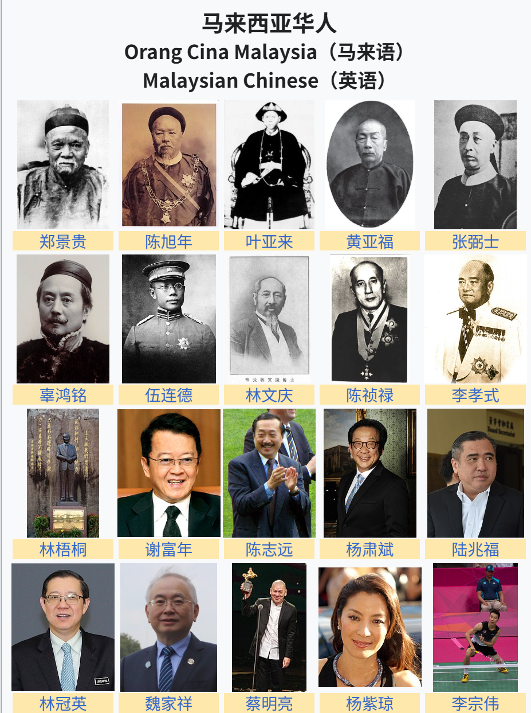

# 新马华人的姓名拼写规律及人物名单

表音文字的一个局限性在于，同样一个字，只要分开短短几十上百年，就会出现不同的读音，再结合不同的拼写规则，最后写法也不一样了。

这一点从海外华人的姓氏拼写上可见一斑。以本人的姓氏“谢”为例，汉语拼音为“Xie”，台湾（威妥玛拼音）为“Hsieh”，香港（按粤语发音，英语拼写习惯）是“Tse”，澳门（粤语发音，葡萄牙拼写习惯）是“Che”，越南的拼法（汉越音）是“Tạ”，韩国的拼法（汉韩音）是"Sa"，新加坡和马来西亚更复杂，分别可能是“Cheah/Tay/Chia”和“Cheah/Chiah/Chia/Seah/Sia/See/Tia”。

新加坡和马来西亚的拼写如此多样，是因为这里方言多，有粤语、客家话、潮州话/闽南话，再加上文白异读，所以一个字可能是不同的拼法，一个拼法也不一定指一个姓，比如Tan可能指“谭”，但更可能指“陈”（按潮州话/闽南话拼）。

所以，新马华人姓名的基本规律就是，用英语来拼写自己方言的音。现在有些新生华人用汉语拼音来拼写自己的名字，不过姓氏仍然遵从父辈的，否则一个家庭里有不同的姓氏，登记姓名的马来办事员会很奇怪。好在新加坡和马来西亚华人的传统都保存很好，他们有自己的汉语名字，拼音只是一个辅助，方便外族人称呼而已。

非常可惜我不会这些方言，所以很难分析这些拼写的发音。不过我也有方法，那就是列举大法：只要我们看过足够多的人名，自然会摸清楚一些规律。

为了研究，我整理了以下两份参考数据：表一是结合公开史料整理的新马代表性华人名录，由AI辅助生成；表二则是基于“新加坡人物传记数据库（SBDB）”进行清洗和筛选后（去除了没有独特英语名的华人）得到的 206 位华人先贤的姓氏拼写样本（这个表里面并非所有都是新加坡人，很多只是跟新加坡相关）。

看完以后，我的感受如下：①找不到规律；②还是普通话和汉语拼音好懂；③也许精通粤语、闽南语、客家话和英语的人可以看出些什么。

附录：

表一：新马代表性华人名录

| 中文名          | 英文名                             | 籍贯 / 方言族群       | 简短介绍                                                             |
| ------------ | ------------------------------- | --------------- | ---------------------------------------------------------------- |
| **郑景贵**      | Chung Keng Quee                 | 广东增城（客家）        | 霹雳州甲必丹，吉利资（Pee) 锡矿巨擘，开辟太平市，英殖民时期最具影响力的华人领袖之一。                    |
| **陈旭年**      | Tan Yeok Nee                    | 潮州              | 柔佛华人侨长（甲必丹），新山开埠先贤，曾受柔佛苏丹重用，新山陈旭年街即以其命名。                         |
| **叶亚来**      | Yap Ah Loy                      | 广东惠州（客家）        | 吉隆坡第三任华人甲必丹，吉隆坡开埠重建的核心功臣，带领吉隆坡从战火中复苏。                            |
| **黄亚福**      | Wong Ah Fook                    | 广东台山（粤语）        | 柔佛州著名建筑承包商、企业家与慈善家，主持修建了新山大皇宫，新山黄亚福街即以其命名。                       |
| **张弼士**      | Chang Bishi (Tjang Tjhoek Njin) | 广东大埔（客家）        | 著名清末爱国华侨实业家、张裕葡萄酒创办人，曾任清政府驻槟城总领事，槟城蓝屋（张弼士故居）为其遗存。                |
| **辜鸿铭**      | Koh Hong Beng (Ku Hung-ming)    | 福建厦门同安（闽南）      | 出生于槟城的中西文化巨擘，精通多国语言，清末著名学者，曾向西方系统翻译和传播中国儒家经典。                    |
| **伍连德**      | Wu Lien-Teh                     | 广东台山（粤语）        | 出生于槟城的医学家，哈佛大学医学博士，成功控制1910年东北大鼠疫，被誉为“中国现代医学先驱”。                 |
| **林文庆**      | Lim Boon Keng                   | 福建漳州海澄（闽南）      | 著名学者、医生与社会改革家，曾任厦门大学校长，新加坡华族社会与教育改革的关键推动者。                       |
| **陈祯禄**      | Tan Cheng Lock                  | 福建漳州龙溪（闽南/峇峇娘惹） | 马来西亚华裔政治先贤，马华公会（MCA）创办人兼首任总会长，在马来亚独立谈判及争取华人公民权中功不可没。             |
| **李孝式**      | Henry Lee Hau Shik              | 广东信宜（粤语）        | 马来亚联合邦首任财政部长，马华公会创办人之一，在推动马来亚独立及金融体系建立中发挥了极其关键的作用。               |
| **李光耀**      | Lee Kuan Yew                    | 广东梅州大埔（客家）      | 新加坡建国总理，被誉为“新加坡建国之父”，带领新加坡从贫困小岛发展为国际金融中心。                        |
| **陈嘉庚**      | Tan Kah Kee                     | 福建厦门同安（闽南）      | 著名爱国华侨领袖、企业家与教育家，创办了厦门大学及新加坡南洋华侨中学，深受新马华社爱戴。                     |
| **吴庆瑞**      | Goh Keng Swee                   | 福建泉州永春（客家/闽南）   | 新加坡前副总理，新加坡经济建设的核心总设计师，奠定了新加坡工业化、金融体系与国防基础。                      |
| **李显龙**      | Lee Hsien Loong                 | 广东梅州大埔（客家）      | 李光耀长子，新加坡第三任总理（现任国务资政），掌舵新加坡二十年，延续了新加坡的经济繁荣与政局稳定。                |
| **黄循财**      | Lawrence Wong Shyun Tsai        | 福建泉州南安（闽南）      | 新加坡第四任总理兼财政部长，新一代领导团队（4G）领军人物，带领新加坡应对后疫情时代的转型。                   |
| **谢富年**      | Jeffrey Cheah Fook Ling         | 广东客家            | 马来西亚商业巨头，双威集团（Sunway Group）创办人，创办双威大学并大力投身公益教育慈善事业。              |
| **陈志远**      | Vincent Tan Chee Yioun          | 福建泉州永春（闽南）      | 马来西亚成功集团（Berjaya Corporation）创办人，业务涵盖地产、博彩、零售及体育产业（卡迪夫城足球俱乐部老板）。 |
| **杨肃斌**      | Francis Yeoh Sock Ping          | 福建金门（闽南）        | 杨忠礼（Yeoh Tiong Lay）长子，杨忠礼集团（YTL Group）掌门人，将其扩展为跨国基础设施与电力巨头。      |
| **陆兆福**      | Anthony Loke Siew Fook          | 广东客家 / 粤语       | 马来西亚资深政治家，民主行动党（DAP）秘书长，多次出任马来西亚交通部长，推动多项公共交通重大改革。               |
| **林冠英**      | Lim Guan Eng                    | 福建漳州平和（闽南）      | 林吉祥之子，曾任马来西亚财政部长及槟城州首席部长，对槟城经济与工业转型起到了关键推动作用。                    |
| **魏家祥**      | Wee Ka Siong                    | 客家              | 马来西亚资深政治家，马华公会（MCA）总会长，曾任马来西亚交通部长及首相署部长。                         |
| **蔡明亮**      | Tsai Ming-liang                 | 广东梅州（客家/闽南）     | 出生于马来西亚砂拉越古晋的享誉国际影坛的导演，台湾电影“新浪潮”代表人物，曾斩获威尼斯影展金狮奖。                |
| **杨紫琼**      | Michelle Yeoh Choo Kheng        | 福建漳州（闽南/粤语）     | 出生于马来西亚怡保的国际影星，凭借电影《瞬息全宇宙》成为奥斯卡金像奖历史首位华人最佳女主角。                   |
| **李宗伟**      | Lee Chong Wei                   | 福建泉州南安（闽南）      | 马来西亚羽毛球传奇巨星，曾连续349周排名男单世界第一，获三届奥运会银牌，被誉为大马国家体育英雄。                |
| **王鼎昌**      | Ong Teng Cheong                 | 福建厦门同安（闽南）      | 新加坡首任民选总统，资深建筑师与政治家，极力推动了新加坡第一条地铁（MRT）系统的建设计划。                   |
| **陈庆炎**      | Tony Tan Keng Yam               | 福建厦门同安（闽南）      | 新加坡第七任总统，曾任副总理及新加坡政府投资公司（GIC）副主席，在科技、教育与金融领域贡献卓著。                |
| **陈修信**      | Tan Siew Sin                    | 福建漳州龙溪（闽南/峇峇娘惹） | 陈祯禄之子，马来西亚任期最长的财政部长（任职15年），奠定了马来亚独立初期健全的财政与税收体系。                 |
| **林吉祥**      | Lim Kit Siang                   | 福建漳州平和（闽南）      | 马来西亚资深政治家，民主行动党（DAP）元老，大马国会任期最长的反对党领袖之一，被封为“丹斯里”。                |
| **廖中莱**      | Liow Tiong Lai                  | 广东梅州（客家）        | 马来西亚著名华人政治家，曾任马来西亚卫生部长、交通部长及马华公会（MCA）总会长。                        |
| **李显扬**      | Lee Hsien Yang                  | 广东梅州大埔（客家）      | 李光耀次子，曾任新加坡电信（Singtel）首席执行官及民航局主席，后跨足政坛并加入反对党。                   |
| **陈秀连**      | Chan Sow Lin                    | 广东广州番禺（粤语）      | 吉隆坡开埠先贤、著名锡矿家与华人领袖，创办大马首家华人铁厂，被称为“大马华人机械工程之父”（吉隆坡陈秀连路即以其命名）。     |
| **郭鹤年**      | Robert Kuok Hock Nien           | 福建福州            | 马来西亚首富，跨国企业嘉里集团与香格里拉酒店集团创办人，享誉国际的“亚洲糖王”。                         |
| **李光前**      | Lee Kong Chian                  | 福建泉州南安（闽南）      | 新加坡著名实业家与慈善家，南益橡胶集团创办人，华侨银行（OCBC）主理人，创立了知名的“李氏基金”。               |
| **林梧桐**      | Lim Goh Tong                    | 福建泉州安溪（闽南）      | 马来西亚传奇企业家，云顶集团创办人，凭一己之力将荒山野岭开辟为享誉全球的云顶高原综合度假胜地。                  |
| **杨忠礼**      | Yeoh Tiong Lay                  | 福建金门（闽南）        | 马来西亚杨忠礼集团（YTL Group）创办人，将家族企业打造成涵盖电力、水泥、房地产和建筑的跨国商业帝国。           |
| **李深静**      | Lee Shin Cheng                  | 福建泉州安溪（闽南）      | 马来西亚IOI集团创办人，被誉为“棕榈油之王”，在大马房地产及农业领域举足轻重。                         |
| **陈六使**      | Tan Lark Sye                    | 福建厦门同安（闽南）      | 新加坡中华总商会前会长、著名橡胶大王，东南亚第一所华文大学“南洋大学（Nanyang University）”的核心创办人。   |
| **胡文虎**      | Aw Boon Haw                     | 福建永定（客家）        | 著名客家籍企业家，“虎标万金油”创办人，曾创办《星洲日报》《星岛日报》等多个新闻报业集团。                    |
| **章芳琳（章芳艳）** | Cheang Hong Lim                 | 福建厦门同安（闽南）      | 19世纪新加坡富商与慈善家，慷慨捐赠公共绿地，新加坡著名的演说者角“芳林公园（Hong Lim Park）”即以其命名。     |
| **林连玉**      | Lim Lian Geok                   | 福建泉州永春（闽南）      | 马来西亚华文教育领袖，教总前主席，被尊称为大马“族魂”，为争取华文教育及华人公民权奋斗终生。                   |
| **林晃升**      | Lim Fong Seng                   | 广东梅州（客家）        | 马来西亚华文教育领袖，董总前主席，积极推动“华文独中复兴运动”及申办独立大学，是大马华教的核心斗士。               |
| **沈慕羽**      | Sim Mow Yu                      | 福建泉州晋江（闽南）      | 马来西亚华教先贤、教总前主席，一生致力于推广中文教育及书法艺术，被大马华社尊称为“沈老”。                    |
| **郑格如**      | Tang Kak Choo                   | 福建福州            | 郭鹤年（亚洲糖王）的母亲，深受福州文化熏陶，对郭氏家族的家风教诲及商业道德形成了深远的影响。                   |
| **潘斯里·陈开蓉**  | Chen Kai Jung                   | 福建              | 马来西亚杨忠礼集团（YTL）创办人杨忠礼的遗孀，知名教育与慈善赞助人。                              |
| **梁静茹**      | Fish Leong Chui Peng            | 广东佛山顺德（粤语）      | 马来西亚知名华语流行女歌手，享誉华语乐坛的“情歌天后”，代表作《勇气》《宁夏》《情歌》风靡华人世界。               |
| **林俊杰**      | Wayne Lim Jun Jie               | 福建金门（闽南）        | 新加坡国宝级华语流行乐男歌手、音乐制作人，金曲奖双料歌王，享誉华语乐坛的“行走的CD”。                     |
| **光良**       | Michael Wong Kong Leong         | 广东梅州（客家）        | 马来西亚著名创作歌手，“无印良品”组合成员，以一首唱响华人世界的《童话》创下华语乐坛纪录。                    |
| **戴佩妮**      | Penny Tai Pei Nee               | 广东海丰（客家）        | 马来西亚创作女歌手、音乐制作人，多次斩获台湾金曲奖最佳国语女歌手及最佳作曲人奖。                         |
| **巫启贤**      | Eric Moo Chii Sien              | 广东梅州（客家）        | 出生于马来西亚霹雳州的著名歌手、音乐制作人，华语乐坛“校园民谣/红观音”时代代表人物。                      |
| **李心洁**      | Angelica Lee Sinje              | 福建（闽南）          | 出生于马来西亚吉打州的知名女演员、歌手，凭惊悚片《见鬼》斩获金马奖、金像奖双料影后。                       |
| **王雪晶**      | Crystal Ong Shir Ching          | 广东客家 / 福建       | 马来西亚著名女歌手、童星鼻祖，8岁出道发行多张个人童星专辑，后加入“M-Girls四个女生”组合，被誉为大马“贺岁天后”。    |
| **莊群施**      | Queenzy Cheng Kuan Si           | 广东潮州 / 客家       | 马来西亚著名女歌手、演员，“M-Girls四个女生”核心成员，与王雪晶同为大马跨世代的童星记忆与贺岁歌后。            |
| **阿杜**       | A-Do (A-Toon)                   | 福建（闽南）          | 出生于新加坡的流行男歌手，凭借沙哑极具辨识度的嗓音以《他一定很爱你》《坚持到底》红遍亚洲。                    |
| **曹格**       | Gary Chaw Ge                    | 广东台山（客家）        | 马来西亚创作型歌手，凭借高亢别致的爵士与R&B唱腔获得金曲奖最佳国语男歌手。                           |
| **黄明志**      | Namewee (Goh Ming Wei)          | 广东海南            | 马来西亚鬼才创作歌手、导演，以极具个人风格的多语言音乐与社会讽刺作品在网络上获得超高关注度。                   |
| **杨雁雁**      | Yeo Yann Yann                   | 福建（闽南）          | 马来西亚著名女演员，凭借电影《爸妈不在家》与《热带雨》两次荣获金马奖（最佳女配角与最佳女主角）。                 |
| **林宇中**      | Rynn Lim Yee Chung              | 福建（闽南）          | 马来西亚创作型男歌手与演员，曾获台湾金曲奖最佳新人奖，代表作《靠岸》《干物女》。                         |
| **温绍平**      | Jordan Voon Siow Ping           | 广东客家            | 马来西亚资深华语影视演员，参演过多部新马经典剧集，曾斩获金视奖最佳男主角。                            |

表二：206 位华人先贤的姓氏拼写样本

| **Chinese_Name 汉字人物姓名** | **English_Name 英语人物姓名**   | **Dialect_Group 方言群** |
| ----------------------- | ------------------------- | --------------------- |
| 李大傻                     | Lee Dai Soh               | 粤/Canton              |
| 孙中山                     | Sun Yat-sen               | 粤/Canton              |
| 伍连德                     | Wu Lien-Teh               | 粤/Canton              |
| 杨缵文                     | Yeo Chan Boon             | 潮/Teochew             |
| 林义顺                     | Lim Nee Soon              | 潮/Teochew             |
| 张永福                     | Teo Eng Hock              | 潮/Teochew             |
| 李光前                     | Lee Kong Chian            | 闽/Hokkien             |
| 周献瑞                     | Chew Hian Swee            | 闽/Hokkien             |
| 黄奕欢                     | Ng Aik Huan               | 闽/Hokkien             |
| 何葆仁                     | Ho Pao Jin                | 闽/Hokkien             |
| 陈嘉庚                     | Tan Kah Kee               | 闽/Hokkien             |
| 陈六使                     | Tan Lark Sye              | 闽/Hokkien             |
| 陈延谦                     | Tan Ean Kiam              | 闽/Hokkien             |
| 胡少炎                     | Oh Siow Yam               | 闽/Hokkien             |
| 林惠祥                     | Lin Huixiang              | 闽/Hokkien             |
| 陈维龙                     | Tan Ee Leong              | 闽/Hokkien             |
| 林邦彦                     | Lim Pang Gan              | 闽/Hokkien             |
| 陈育崧                     | Tan Yeok Seong            | 闽/Hokkien             |
| 林文庆                     | Lim Boon Keng             | 闽/Hokkien             |
| 陈武烈                     | Tan Boo Liat              | 闽/Hokkien             |
| 吴寿珍                     | Goh Siew Tin              | 闽/Hokkien             |
| 侯西反                     | Hau Say-huan              | 闽/Hokkien             |
| 白清泉                     | Pek Cheng Chuan           | 闽/Hokkien             |
| 蔡金吉                     | Choa Kim Keat             | 闽/Hokkien             |
| 蔡金钟                     | Chua Kim Cheng            | 暂无/Nil                |
| 曹亚志                     | Chow Ah Chey              | 粤/Canton              |
| 陈成宝                     | Tan Seng Poh              | 潮/Teochew             |
| 陈楚楠                     | Tan Chor Lam              | 闽/Hokkien             |
| 陈笃生                     | Tan Tock Seng             | 闽/Hokkien             |
| 陈恭锡                     | Tan Keong Saik            | 闽/Hokkien             |
| 陈金声                     | Tan Kim Seng              | 闽/Hokkien             |
| 陈金钟                     | Tan Kim Ching (Cheng)     | 闽/Hokkien             |
| 陈明水                     | Tan Beng Swee             | 闽/Hokkien             |
| 陈齐贤                     | Tan Chay Yan              | 闽/Hokkien             |
| 陈人浩                     | Chen Jen Hao              | 闽/Hokkien             |
| 陈若锦                     | Tan Jiak Kim              | 闽/Hokkien             |
| 陈诗武                     | Tan See Boo               | 闽/Hokkien             |
| 陈思敏                     | Tan Soo Bin               | 闽/Hokkien             |
| 陈送                      | Tan Che Sang (Inhek Sang) | 闽/Hokkien             |
| 陈泰                      | Tan Tye                   | 闽/Hokkien             |
| 陈旭年                     | Tan Yeok Nee              | 潮/Teochew             |
| 陈延反                     | Tan Yan Huan              | 暂无/Nil                |
| 陈仰安                     | Tan Ngiang Ann            | 潮/Teochew             |
| 陈永锡                     | Tan Yong Siak             | 潮/Teochew             |
| 陈永裕                     | Tan Eng Joo               | 暂无/Nil                |
| 陈振传                     | Tan Chin Tuan             | 闽/Hokkien             |
| 陈之初                     | Tan Tsze Chor             | 潮/Teochew             |
| 陈宗瑞                     | Chen Chong Swee           | 潮/Teochew             |
| 戴河水                     | Tay Ho Swee               | 闽/Hokkien             |
| 丁马成                     | Teng Mah Seng             | 闽/Hokkien             |
| 杜进才                     | Toh Chin Chye             | 闽/Hokkien             |
| 傅无闷                     | Fu Wumen                  | 闽/Hokkien             |
| 符致逢                     | Foo Chee Fong             | 琼/Hainan              |
| 高德根                     | Ko Teck Kin               | 闽/Hokkien             |
| 郭芳枫                     | Kwek Hong Png             | 闽/Hokkien             |
| 郭可模                     | Guok Koh Muo              | 闽/Hokkien             |
| 郭珊瑚                     | Guo Shanhu                | 闽/Hokkien             |
| 郭新                      | Quek Shin                 | 琼/Hainan              |
| 韩槐准                     | Han Wai Toon              | 琼/Hainan              |
| 韩瑞生                     | Hon Sui Sen               | 潮/Teochew             |
| 何思明                     | Ho See Beng               | 暂无/Nil                |
| 洪恭兰                     | Ang Keong Lan             | 暂无/Nil                |
| 洪锦池                     | Ang Kim Tee               | 闽/Hokkien             |
| 洪锦棠                     | Hong Jintang              | 闽/Hokkien             |
| 胡金钟                     | Aw Kim Chen               | 暂无/Nil                |
| 胡文豹                     | Aw Boon Par               | 客/Hakka               |
| 胡文虎                     | Aw Boon Haw               | 客/Hakka               |
| 胡亚基                     | Hoo Ah Kay                | 粤/Canton              |
| 黄葆芳                     | Huang Pao Fang            | 闽/Hokkien             |
| 黄笃修                     | Wong Tok Sau              | 闽/Hokkien             |
| 黄桂楠                     | Ng Quee Lam Dato          | 暂无/Nil                |
| 黄金辉                     | Wee Kim Wee               | 暂无/Nil                |
| 黄麟根                     | Wong Lin Ken              | 粤/Canton              |
| 黄曼士                     | Huang Mun Se              | 闽/Hokkien             |
| 黄乃裳                     | Wong Nai Siong            | 闽/Hokkien             |
| 黄瑞朝                     | Wee Swee Teow             | 暂无/Nil                |
| 黄树芬                     | Wong Shee Fun             | 粤/Canton              |
| 黄亚福                     | Wong Ah Fook              | 粤/Canton              |
| 黄仲涵                     | Oei Tiong Ham             | 闽/Hokkien             |
| 黄宗仁                     | Wee Chong Jin             | 闽/Hokkien             |
| 柯进来                     | Kuah Chin Lai             | 闽/Hokkien             |
| 柯隆美                     | Kuah Leong Bee            | 暂无/Nil                |
| 孔天增                     | Kung Tian Cheng           | 暂无/Nil                |
| 柯玉芝                     | Kwa Geok Choo             | 闽/Hokkien             |
| 李光耀                     | Lee Kuan Yew              | 客/Hakka               |
| 李金塔                     | Lee Kim Tah               | 闽/Hokkien             |
| 李俊承                     | Lee Choon Seng            | 闽/Hokkien             |
| 李浚源                     | Lee Choon Guan            | 闽/Hokkien             |
| 李庆杰                     | Lee Keng Kiat             | 暂无/Nil                |
| 李庆炎                     | Lee Keng Yam              | 暂无/Nil                |
| 李清渊                     | Lee Cheng Yan             | 闽/Hokkien             |
| 李绍茂                     | Lee Siow Mong             | 潮/Teochew             |
| 李伟南                     | Lee Wee Nam               | 潮/Teochew             |
| 李云龙                     | Lee Hoon Leong            | 客/Hakka               |
| 李振殿                     | Lee Chin Tian             | 闽/Hokkien             |
| 李钟珏                     | Li Zhongjue               | 三江/Sam Kiang          |
| 李珠娘                     | Lee Choo Neo              | 客/Hakka               |
| 连士升                     | Lian Shisheng             | 闽/Hokkien             |
| 连瀛洲                     | Lien Ying Chow‏           | 潮/Teochew             |
| 梁庆经                     | Leong Heng Keng           | 粤/Canton              |
| 梁润之                     | Leung Yun Chee            | 粤/Canton              |
| 梁宙                      | Neo Tiew                  | 闽/Hokkien             |
| 廖正兴                     | Liau Chia Heng            | 潮/Teochew             |
| 林秉懋                     | Lim Peng Mau              | 闽/Hokkien             |
| 林秉祥                     | Lim Peng Siang            | 闽/Hokkien             |
| 林晨                      | Lin Chen                  | 闽/Hokkien             |
| 林衡南                     | Lim Kong Chuan            | 闽/Hokkien             |
| 林继民                     | Lim Kee Ming              | 潮/Teochew             |
| 林金山                     | Lim Kim San               | 闽/Hokkien             |
| 林浪新                     | Lim Nang Seng             | 闽/Hokkien             |
| 林谋盛                     | Lim Bo Seng               | 闽/Hokkien             |
| 林师万                     | Lim Soo Ban               | 客/Hakka               |
| 林树彦                     | Lim Soo Gan               | 潮/Teochew             |
| 林推迁                     | Lim Chwee Chian           | 闽/Hokkien             |
| 林学大                     | Lim Hak Tai               | 闽/Hokkien             |
| 林有福                     | Lim Yew Hock              | 闽/Hokkien             |
| 林忠邦                     | Lim Chong Pang            | 潮/Teochew             |
| 刘金榜                     | Low Kim Pong              | 闽/Hokkien             |
| 刘抗                      | Liu Kang                  | 闽/Hokkien             |
| 刘仁心                     | Low Ing Sing              | 闽/Hokkien             |
| 陆寅杰                     | Look Yan Kit              | 粤/Canton              |
| 陆佑                      | Loke Yew                  | 粤/Canton              |
| 陆运涛                     | Loke Wan Tho              | 粤/Canton              |
| 欧阳奇                     | Owyang Chi (Au Yong Chi)  | 潮/Teochew             |
| 潘受                      | Pan Shou                  | 闽/Hokkien             |
| 潘醒农                     | Phua Chye Long            | 潮/Teochew             |
| 邱德拔                     | Khoo Teck Puat            | 闽/Hokkien             |
| 邱菽园                     | Khoo Seok Wan             | 闽/Hokkien             |
| 邱新民                     | Chiou Sin Min             | 闽/Hokkien             |
| 邱正忠                     | Khoo Cheng Tiong          | 闽/Hokkien             |
| 邱雁宾                     | Yow Ngan Pan              | 粤/Canton              |
| 邵仁枚                     | Shaw Runme                | 三江/Sam Kiang          |
| 佘连城                     | Seah Liang Seah           | 潮/Teochew             |
| 佘有进                     | Seah Eu Chin              | 潮/Teochew             |
| 施香沱                     | See Hiang To              | 闽/Hokkien             |
| 宋佛俭                     | Song Hoot Kiam            | 闽/Hokkien             |
| 宋旺相                     | Song Ong Siang            | 闽/Hokkien             |
| 宋旺裕                     | Song Ong Joo              | 闽/Hokkien             |
| 孙炳炎                     | Soon Peng Yam             | 闽/Hokkien             |
| 孙崇瑜                     | Sng Choon Yee             | 闽/Hokkien             |
| 王邦杰                     | Heng Pang Kiat            | 潮/Teochew             |
| 王德霖                     | Ong Teck Lim              | 闽/Hokkien             |
| 王鼎昌                     | Ong Teng Cheong           | 闽/Hokkien             |
| 王九河                     | Ong Kew Ho                | 闽/Hokkien             |
| 王平福                     | Ong Peng Hock             | 闽/Hokkien             |
| 王三龙                     | Ong Sam Leong             | 闽/Hokkien             |
| 王绍经                     | Wee Cheow Keng            | 琼/Hainan              |
| 王文达                     | Ong Boon Tat              | 闽/Hokkien             |
| 王有海                     | Ong Ewe Hai               | 闽/Hokkien             |
| 吴鸿业                     | Goh Hong Giap             | 暂无/Nil                |
| 吴来喜                     | Goh Lai Hee               | 暂无/Nil                |
| 吴庆瑞                     | Goh Keng Swee             | 闽/Hokkien             |
| 吴胜鹏                     | Ng Sing Phang             | 粤/Canton              |
| 吴水阁                     | Goh Tjoei Kok             | 闽/Hokkien             |
| 吴秀水                     | Goh Siew Swee             | 闽/Hokkien             |
| 吴在炎                     | Wu Tsai Yen               | 闽/Hokkien             |
| 萧保龄                     | Seow Poh Leng             | 闽/Hokkien             |
| 谢安祥                     | Chia Ann Siang            | 闽/Hokkien             |
| 谢荣西                     | Chia Eng Say              | 闽/Hokkien             |
| 徐长怀                     | Chee Teang Why            | 闽/Hokkien             |
| 许宏博                     | Koh Heng Pok              | 暂无/Nil                |
| 许甦吾                     | Koh Soh Goh               | 闽/Hokkien             |
| 许云樵                     | Hsu Yun Tsiao             | 三江/Sam Kiang          |
| 薛佛记                     | See Hoot Kee              | 闽/Hokkien             |
| 薛茂元                     | See Moh Guan              | 闽/Hokkien             |
| 薛荣樾                     | See Eng Wat               | 闽/Hokkien             |
| 薛文仲                     | See Boon Tiong            | 闽/Hokkien             |
| 薛有礼                     | See You Lay               | 闽/Hokkien             |
| 颜永成                     | Gan Eng Seng              | 闽/Hokkien             |
| 杨瑞初                     | Yang Shui Chor            | 粤/Canton              |
| 杨天恩                     | Yeo Thian In              | 暂无/Nil                |
| 姚紫                      | Yao Zi                    | 闽/Hokkien             |
| 叶畅芬                     | Yip Cheong Fun            | 粤/Canton              |
| 叶季允                     | Yeh Chi-Yun               | 三江/Sam Kiang          |
| 叶平玉                     | Yap Pheng Geck            | 潮/Teochew             |
| 叶之威                     | Yeh Chi Wei               | 闽/Hokkien             |
| 殷碧霞                     | Yin Grace Peck Ha         | 三江/Sam Kiang          |
| 殷雪村                     | Yin Suat Chuan            | 三江/Sam Kiang          |
| 余东璇                     | Eu Tong Sen               | 粤/Canton              |
| 云英杰                     | Wan Eng Kiat              | 暂无/Nil                |
| 曾锦文                     | Chan Kim Boon             | 闽/Hokkien             |
| 章芳琳                     | Cheang Hong Lim           | 闽/Hokkien             |
| 张汉三                     | Teo Han Sam               | 潮/Teochew             |
| 张礼千                     | Chang Lee Chien           | 三江/Sam Kiang          |
| 张梦生                     | Chong Moong Seng          | 客/Hakka               |
| 张汝器                     | Tchang Ju Chi             | 潮/Teochew             |
| 赵玉山                     | Chao Yoke San             | 琼/Hainan              |
| 郑古悦                     | Tay Koh Yat               | 闽/Hokkien             |
| 郑章远                     | Teh Cheang Wan            | 闽/Hokkien             |
| 周如切                     | Chew Joo Chiat            | 闽/Hokkien             |
| 周润亨                     | Chew Joon Hiang           | 暂无/Nil                |
| 周文礼                     | Chew Boon Lay             | 闽/Hokkien             |
| 周星衢                     | Chou Sing Chu             | 三江/Sam Kiang          |
| 周镇豪                     | Chew Teng How             | 潮/Teochew             |
| 周子敬                     | Chew Choo Keng            | 闽/Hokkien             |
| 庄庆利                     | Ching Keng Lee            | 闽/Hokkien             |
| 庄竹林                     | Chuang Chu Lin            | 闽/Hokkien             |
| 左秉隆                     | Tso Ping Lung             | 三江/Sam Kiang          |
| 佘松城                     | Seah Song Seah            | 潮/Teochew             |
| 陈谦福                     | Tan Kheam Hock            | 闽/Hokkien             |
| 陈锡九                     | Tan Siak Kew              | 潮/Teochew             |
| 黄敏                      | Wee Bin                   | 闽/Hokkien             |
| 林路                      | Lim Loh                   | 闽/Hokkien             |
| 陈国朝                     | Tan Koh Teou              | 闽/Hokkien             |
| 王水斗                     | Ong Chwee Tow             | 闽/Hokkien             |
| 陈芳岁                     | Tan Hong Suay             | 闽/Hokkien             |
参考资料：
Kow, K. Y. C. (2008). Names in multilingual-multicultural Malaysia. _Names_, _56_(1), 47–53. [https://doi.org/10.1179/175655008X287311](https://www.google.com/search?q=https://doi.org/10.1179/175655008X287311)
National University of Singapore, & Singapore Federation of Chinese Clan Associations. (n.d.). _Singapore Biographical Database_. Retrieved October 2, 2026, from [https://sbdb.nus.edu.sg/](https://sbdb.nus.edu.sg/)
Google. (2026). _Gemini_ (Oct 2 version) [Large language model]. [https://gemini.google.com](https://gemini.google.com)
