# AI时代的论文整理方案

## 一、不同时代的文献整理

——我做了一个扣子工作流，把论文自动整理成“电子知识卡片”。

每个研究生都要写论文，论文的关键点有三个，一是要用科学的方法，二是要有材料和数据，三是要有创新性。如何体现创新性？首先就得证明你已穷尽这个研究领域内所有前人的研究成果。而前人的研究成果又大多以论文形式存在，所以，写论文首先就是看论文。

可是，人的记忆是有限的，所以要记笔记。马克思作为一个伟大的科学家，他研读前人的著作，摘录了很多内容，笔记和手稿加起来超过50本。中国有个历史学家叫傅筑夫，为了研究经济史，他和他的团队用厚纸做卡片，分门别类整理，抄写的资料多达数箱，最终积累了220万字的学术资料。我本科的时候，老师教我们写论文，也让我们用卡片整理文献，每张卡片写好摘录内容、来源等，并分好类，这样方便以后查找。

所以说，做学术是个苦差事。马克思晚年饱受病痛折磨，死后恩格斯还用马留下的手稿，继续整理了十几年，才出版了《资本论》的第三卷及其他著作。傅筑夫前半生都在整理文献，几乎没有作品，文革结束垂垂老矣，才开始密集发表文章，到1985年去世，他留下的书稿让出版社又忙乎了好多年。可谓是板凳坐得十年冷，文章不写半句空。

如今，传播媒介发生了变革，数字化让我们习惯用键盘打字，互联网让我们习惯用电子屏幕阅读，人工智能让我们习惯把琐碎的事情让机器代劳。现在，不管是看论文还是写论文，我们基本上不再用纸笔了，而是用电脑；而且也无需讳言，我们的写作，从收集资料到最终润色，都需要仰仗AI的辅助。在这样的局势下，纸质卡片摘录的传统文献整理方法，可能确实已经过时了。

大多数研究者都在探索AI时代的文献整理方法，我最近也有论文写作的需求，因此也在思考这个问题。我认为我们首先要明确自己的需求，迅速拿出第一版方案，之后不断迭代，最终实现文献整理的自动化。

## 二、明确需求，形成方案

论文最终还是要自己读的，我们现在要做的，其实就是一个电子化的知识卡片，把我们看过的或者要看的论文交给AI，让它生成总结，方便我们日后回顾和引用。

那么总结什么呢？我目前认为以下几个部分是必要的：
1. 论文基本信息：包括标题、作者、年份、发表期刊/会议等。
2. 引用信息：中国的GB/T 7714格式，国际通用的APA格式，以及文中引用格式。
3. 论文摘要。
4. 核心问题、核心方法、假设思路。
5. 主要观点和结论、建议/展望、局限性/担忧。
6. 重要术语的对照表。

当然，这个设计当然不是完美的，但可以之后再完善。于是我根据这个思路，让AI做了提示词，并在扣子上做了工作流，经过多次测试，基本能够完成我的需求。效果如下：

### 1、打开工作流，将论文文本上传。

这里也可以上传pdf版本，但是docx的效果应该会更好。

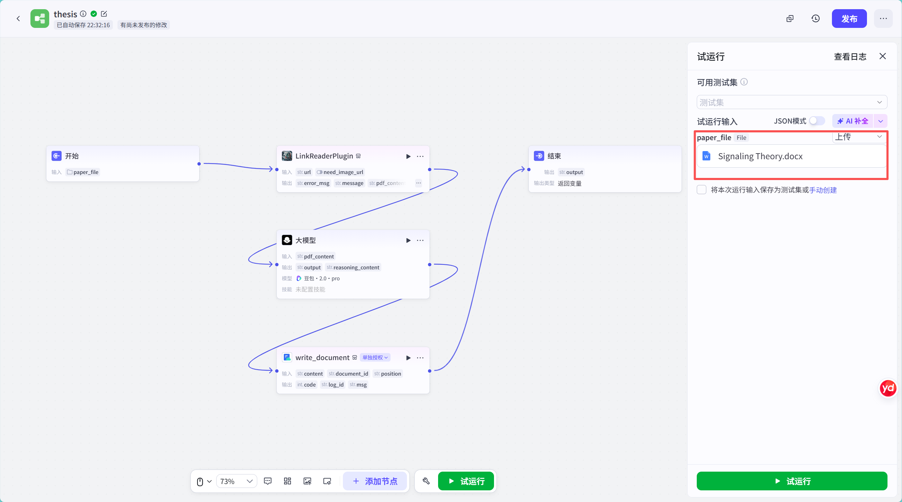

### 2、点击试运行，等待，直至成功

这个过程大概1-2分钟，期间不要操作。

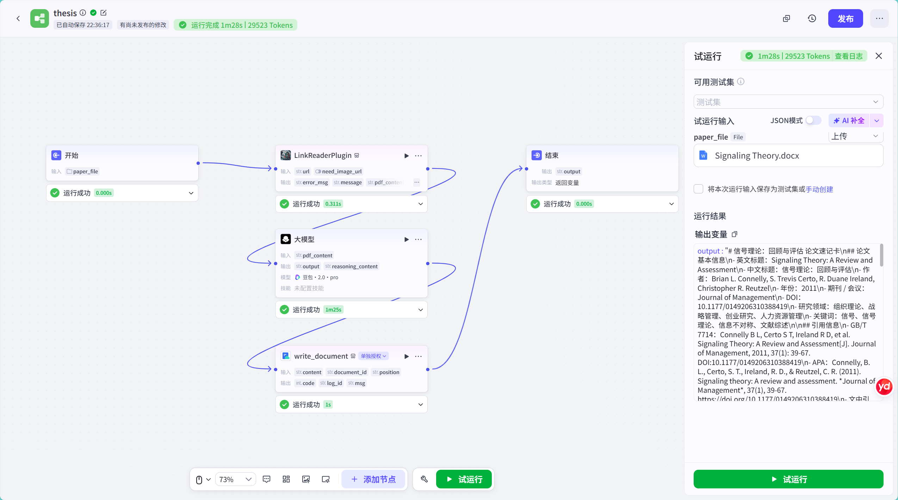

### 3、检查飞书文档

此时，结果已经写入到指定的飞书文档，可以检查。

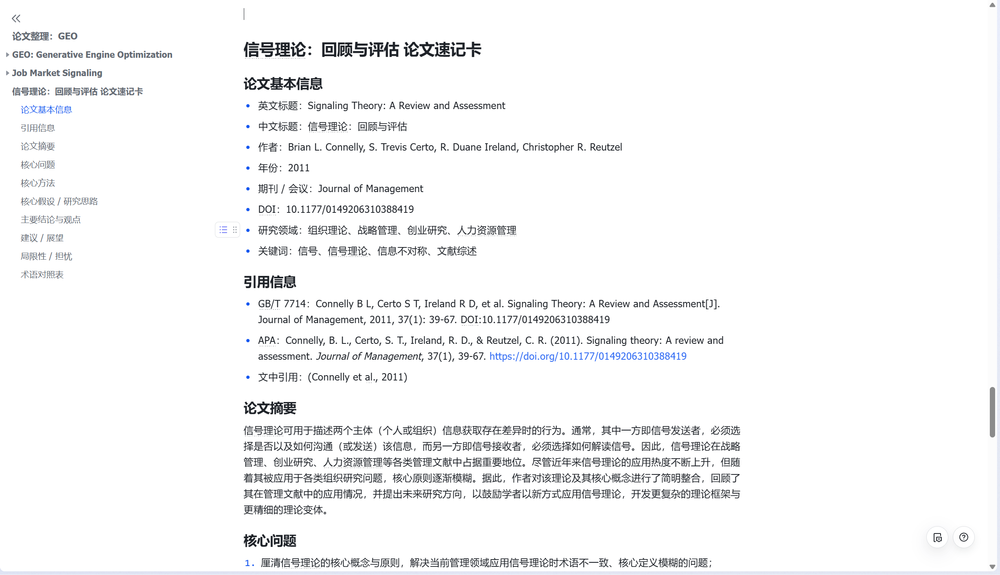
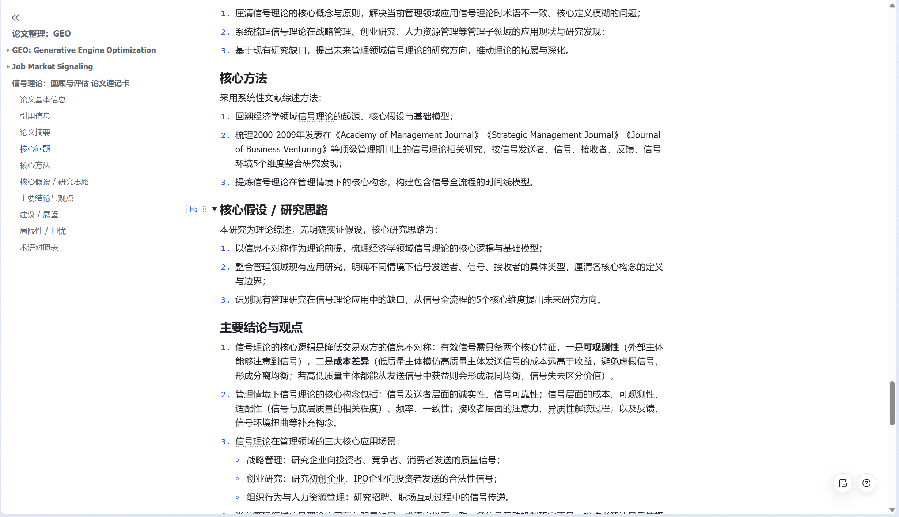
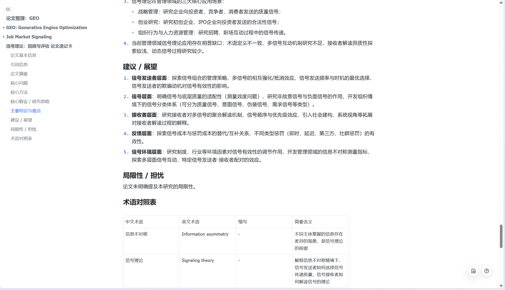
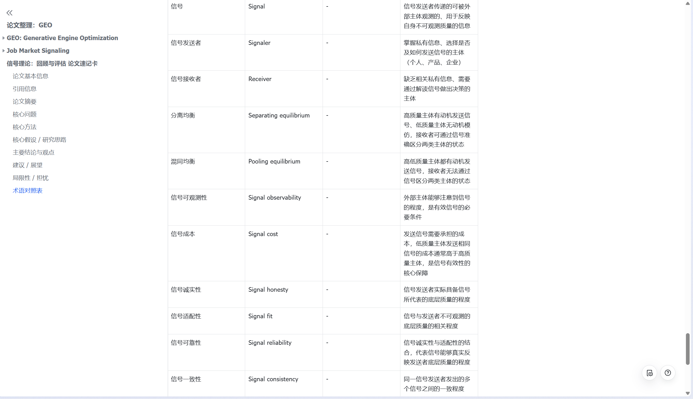

可见，最终效果还是可以的。如果读完这篇论文，有这个记录，哪怕几个月后再看一遍，也能迅速想起来这篇论文的主要观点。读完后，也可以将认为有价值的段落复制到这些记录后面。需要引用的时候也很方便。

如果长期积累下去，即使以后读了100篇甚至更多论文，我们仍然可以通过目录快速浏览所有文献，并随时跳转到指定文献去查看这篇论文的详情，再有不懂再打开论文原文。后续还可以进一步让 AI 比较不同论文的研究问题、方法和结论，寻找不同研究之间的联系。

当然，提示词可以不断优化，比如我这次这个标题如果直接换成英文标题，会更容易检索。比如像这样：

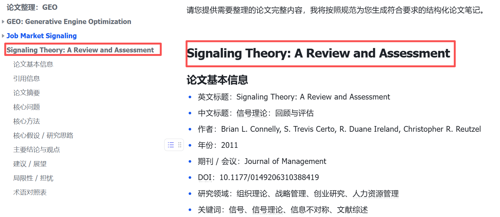

不过这些都不重要，之后可以慢慢改。重点是找到论文梳理的自动化方法，形成体系，解放更多的时间去做更有价值的事情。

## 三、如何使用这个工作流

之前我写了一个YouTube学习工作流，很多人不清楚如何部署。我在这里做个简要的教程，并附上我的下载链接。

### 1、下载zip，不需要解压
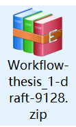
### 2、登录扣子个人空间，点击资源库，点击导入

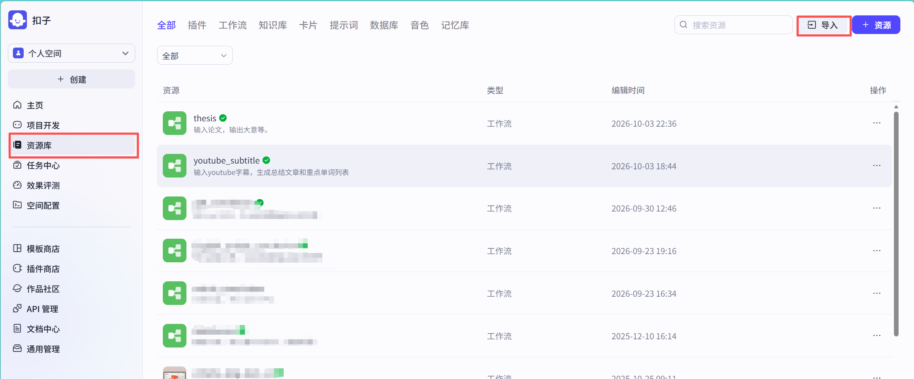

### 3、选择之前的文件，点击导入即可

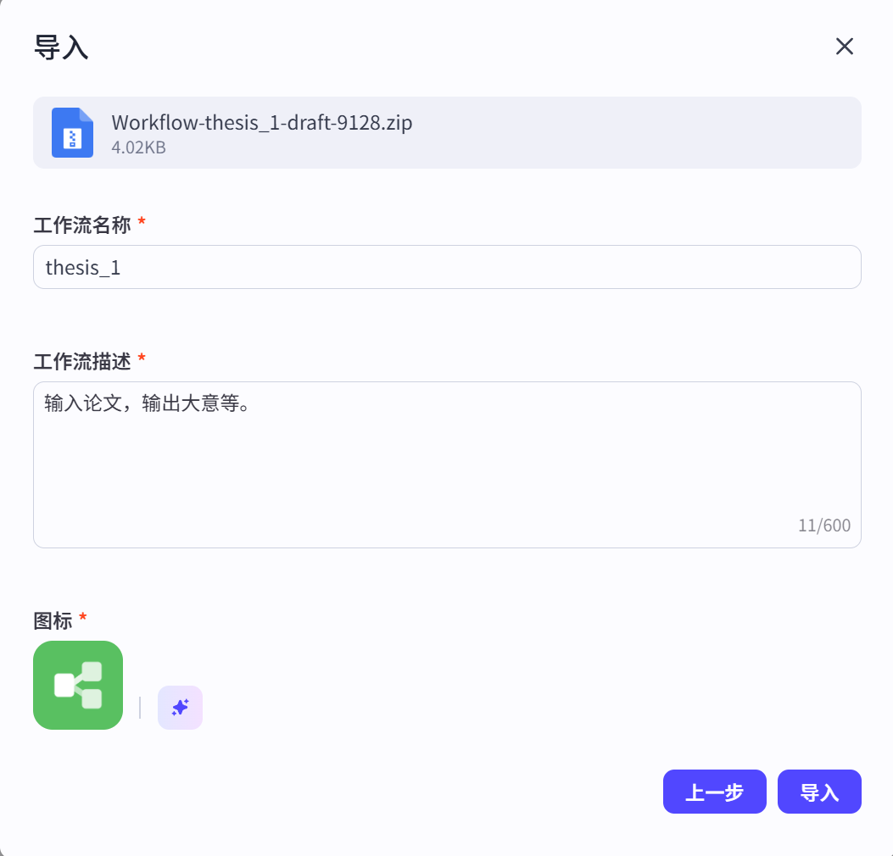

### 4、点击这个工作流，点击飞书写入那个模块，将自己的飞书文档id填写进去

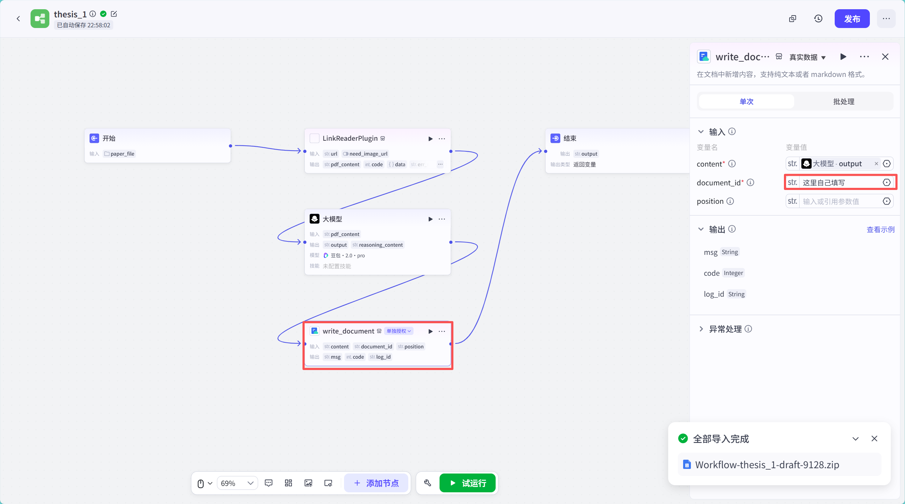

这就是部署的完整教程。

下载地址如下：

**项目地址：**

[GitHub 项目主页](https://github.com/xieyuqingme-source/coze-paper-quick-reference?utm_source=chatgpt.com)

**直接下载最新版本：**

[下载 Coze 论文速记工作流](https://github.com/xieyuqingme-source/coze-paper-quick-reference/releases/latest/download/Workflow-thesis_1-draft-9128.zip?utm_source=chatgpt.com)

扣子空间网址如下：https://www.coze.cn/space
## 参考文献

梁捷. (2007年7月2日). 傅筑夫最后十年惊人冲刺. 上海证券报, 014.

潘飞.  研究中国经济史的力作——评傅筑夫《中国封建社会经济史》. 044–050.

