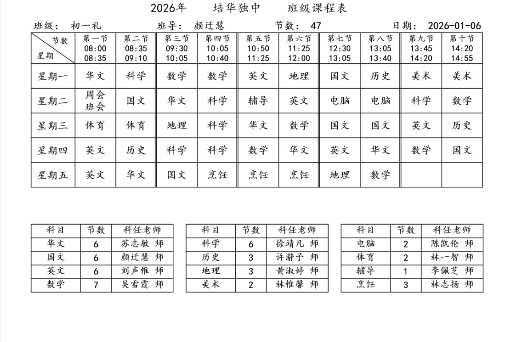
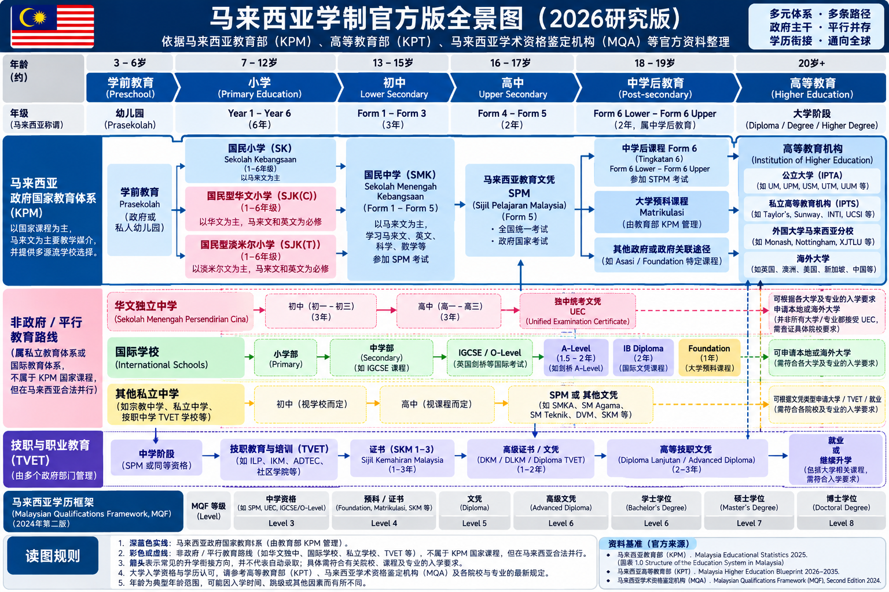
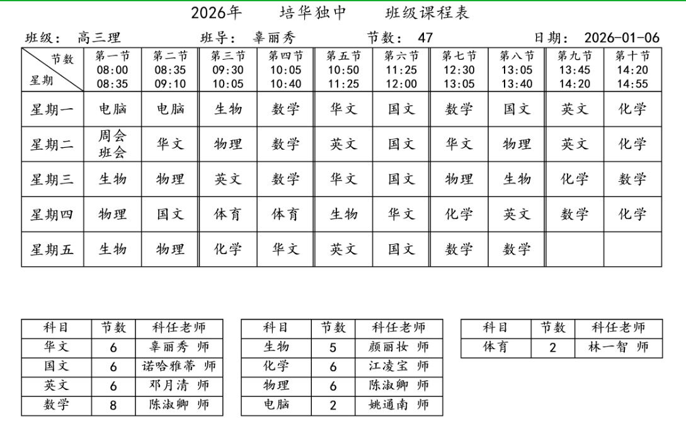

# 快乐的马来西亚中学生

之前早就听说马来西亚中小学生放学早，但是我一直没放在心上，因为我潜意识里认为放学再早也早不到哪里去。我小学在浙江一个城中村小学读书，平时五点放学，星期五下午3点半放学，我觉得已经很早了。初中在西充中学，初一初二大概六点放；初中后期有全班自愿参加的晚自习，晚自习要上到八点多或者九点多，周六也有补习。高中就更别说了，只有学习，没有个人生活。

前段时间有个大马华人小朋友加我微信，华文独中二年级，相当于中国的初二。我就经常跟她聊天，请教一下当地的情况。有一天，我突然发现一个问题：她几乎任何时候都能回我消息。一问才知道，他们早上7点上学，中午13点就放学了，课间还能玩手机。

对于这个事实，我是拒绝的，因为13点放学实在太夸张了。我们初中最早也是五六点下课，大多数时候还有晚自习，每天挑灯夜战，而他们中午就放学了，这算什么？更过分的是，我们当时学习英语非常痛苦，但收效甚微；他们学英语则毫无压力，还能同时学好马来语、闽南语和粤语。

后来听一个司机说，13点下课是确有其事，但绝大多数是下午两三点放学。即使补课，基本上也是遵循学生自己的意见，补习也就补一两个小时罢了。

我在网上找了一些独中的课表，基本上都是14:30到15:00放学。13点确实夸张，也许那个小姑娘是逗我。但即使是这样，3点下课也非常早了，何况上课还能带手机。

他们的升学率也比我们高。马来西亚的教育体制比较复杂，大体说来，高校升学有两条主流途径：预科班和STPM考试。马来西亚每年大概4万人去预科班，4万人考STPM考试，这个考试的结果可以用来申请海内外各种大学，大概80%的申请者都能上公立大学，只是名校和热门专业需要竞争一下。

尽管缺乏系统分析，但是感觉上我觉得在马来西亚读中学应该会比在国内读中学更快乐。我相信，要是让衡水中学的学生看到下面这张马来西亚华文独中的课程表，想象一下马来西亚中学生的快乐生活，大概会哭死在厕所吧。

